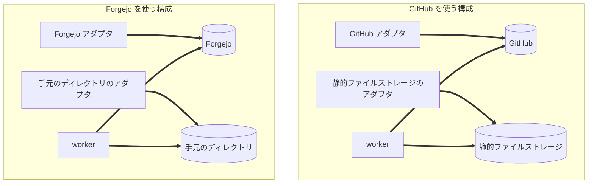

# アダプタ

バックエンドのポートを、何で実装するかを決めるときと、アダプタを作るときに読む。
ポートの定義は、[ポート](../backend/ports/README.md) が正本である。

## 一覧

| ポート | アダプタ | ページ |
|---|---|---|
| GitForge | GitHub アダプタ、Forgejo アダプタ | [GitHub アダプタ](github.md)、[Forgejo アダプタ](forgejo.md) |
| スナップショットの置き場 | 静的ファイルストレージ、手元のディレクトリ | [スナップショットの置き場のアダプタ](snapshot-store.md) |
| 認証 | GitHub アダプタ、Forgejo アダプタ | [GitHub アダプタ](github.md)、[Forgejo アダプタ](forgejo.md) |

- [worker](../backend/worker/README.md) が git を読むやり方は、[git アダプタ](git.md) に書く。
- GitHub アダプタと Forgejo アダプタに共通するところは、[GitForge アダプタの共通の書き方](pull-requests.md) と [記録のコメントとレビュー](records.md) に書く。
- 構成ごとの設定と秘密情報は、[設定と秘密情報](settings.md) に書く。

## GitForge アダプタに求めること

バックエンドとクライアントは、GitForge に次の性質を求める。どの GitForge でも、アダプタがこれを満たす。

- pull request を、head の SHA を指定して squash merge できる。
- merge したコミットから、その pull request を API で引ける（[反映かの判定](../backend/verify/README.md)）。
- 主体のトークンで、pull request、レビュー、コメント、issue を書ける。
- git の HTTP の Basic 認証のパスワードに、GitForge のトークンを入れて読み書きできる（[CLI](../cli/README.md)）。
- pull request の最後の先頭のコミットを、ref に残す。

GitForge ごとに違う性質は、次のとおりである。

| 性質 | GitHub | Forgejo |
|---|---|---|
| API でコメントにファイルを添付できるか（[人への依頼の回答](../files/artifacts.md)） | できない。添付はリンクだけ | できる |
| repository をバックエンドが作れるか（[repository の登録](#repository-の登録)） | 作らない。管理者が作り、登録する | 作る |
| pull request の最後の先頭のコミットの ref | `refs/pull/<number>/head` | `refs/pull/<index>/head` |

## 組み合わせ

- 太い矢印は、アダプタと worker が外のサービスを読み書きすることを表す。
- worker は、外のサービスではなく、バックエンドと並ぶ Logiforge のプロセスである（[レイヤー構成](../architecture.md)）。図では、外のサービスとのつながりを見せるために、アダプタと並べた。
- 構成は、サーバの設定で 1 つに決める。
  - なぜ：repository ごとに構成を選べると、組み合わせが増えて単純さを失うから。
- worker は、どちらの構成でも同じ実装である。リモートの URL と認証情報だけが違う。worker は git を読み、置き場に書く。
- 置き場を読むのは、スナップショットの置き場のアダプタ（バックエンド）である。
- git に書くのは、GitHub アダプタか Forgejo アダプタが、GitForge の API で行う repository の用意と pull request の merge だけである。
- GitForge と認証のポートは、同じアダプタが実装する。
  - なぜ：どちらの正本も、同じ GitForge にあるから。
- GitHub の PR（pull request）や issue として、apply request や人への依頼を見たいなら、GitHub を使う構成にする。
- GitHub を使わずに動かしたいなら、Forgejo を使う構成にする。Forgejo を使う理由は、[Forgejo アダプタ](forgejo.md#forgejo-を使う理由) に書く。
- GitHub を使う構成は、複数人で使い、バックエンドを何台か並べることを想定する。そのため、置き場を、どのプロセスからも読める静的ファイルストレージにする（[バックエンドだけを増やすとき](../deploy/README.md#バックエンドだけを増やすとき)）。
- Forgejo を使う構成は、1 台のマシンで使うことを想定する。Forgejo と、バックエンドと worker を並べた 1 つのタスクを動かし、置き場を、タスクの中で共有する手元のディレクトリにする（[動かし方](../deploy/README.md)）。
- どちらの構成でも、[worker](../backend/worker/README.md) が置き場に書き、バックエンドが読む。

構成ごとの正本とバックアップは、次のとおりである。

| 構成 | 正本の置き場所 | バックアップ |
|---|---|---|
| GitHub を使う構成 | GitHub と、置き場の `keep/` | GitHub は GitHub に任せる。置き場の `keep/` は、置き場の仕組みで取る |
| Forgejo を使う構成 | Forgejo と、置き場の `keep/` | Forgejo は、Forgejo のバックアップの仕組み（`forgejo dump` など）で取る。置き場の `keep/` は、手元のディレクトリを写して取る |

- どちらの構成でも、バックエンドはデータを保持しない（[状態を持たない](../backend/README.md)）。
- worker の clone と、置き場の多くは、正本ではない。失っても、worker が git から作り直す。そのため、バックアップは要らない。
- ただし、置き場の `keep/` には、git から作り直せないもの（ブランチの履歴、記録の控え、壊れていることの記録など）がある。そのため、`keep/` だけはバックアップを取る（[スナップショットの置き場](../backend/ports/snapshot-store.md)）。

## repository の登録

repository の名前の正本は、構成ごとに次のとおりである。

- GitHub を使う構成：サーバの設定（repository の名前と `owner/name` の組）
  - 管理者が GitHub リポジトリを作り、この組を登録する（[GitHub アダプタ](github.md)）。
  - gitforge_ref は `owner/name` である。
  - 設定に登録されていない名前では、repository を作れない（`repository_not_registered`）。
- Forgejo を使う構成：設定した organization の、Forgejo の repository の一覧
  - 利用者が作るときに、バックエンドが、利用者のトークンで Forgejo に repository を作る（[Forgejo アダプタ](forgejo.md)）。
  - gitforge_ref は、`<organization>/<名前>` である。
  - 管理者の登録は要らない。そのため、`repository_not_registered` は起きない。

- ディレクトリの repository は、どちらの構成でも、サーバの設定（repository の名前と、git リポジトリとディレクトリのパスの組）が正本である（[ディレクトリ方式](../directory/README.md)）。

- 利用者は、名前と根の主文だけで repository を作る。
