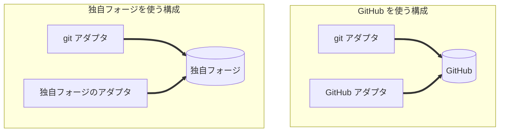

# アダプタ

バックエンドのポートを、何で実装するかを決めるときと、アダプタを作るときに読む。
ポートの定義は、[ポート](../backend/ports/README.md) が正本である。

## 一覧

| ポート | アダプタ | ページ |
|---|---|---|
| 木の読み書き | git アダプタ（リモートの git リポジトリを読み書きする） | [git アダプタ](git.md) |
| やりとり | GitHub アダプタ、独自フォージのアダプタ | [GitHub アダプタ](github.md)、[独自フォージのアダプタ](forge.md) |
| 認証 | GitHub アダプタ、独自フォージのアダプタ | [GitHub アダプタ](github.md)、[独自フォージのアダプタ](forge.md) |

## 組み合わせ

- 太い矢印は、アダプタが外のサービスを読み書きすることを表す。
- 構成は、サーバの設定で 1 つに決める。
  - なぜ：repository ごとに構成を選べると、組み合わせが増えて単純さを失うから。
- git アダプタは、どちらの構成でも同じ実装である。リモートの URL と認証情報だけが違う。
- やりとりと認証は、同じアダプタが実装する。
  - なぜ：どちらの正本も、同じ外のサービス（GitHub か独自フォージ）にあるから。
- GitHub で PR（pull request）や issue としてやりとりを見たいなら、GitHub を使う構成にする。
- GitHub を使わずに動かしたいなら、独自フォージを使う構成にする（[独自フォージ](../forge/README.md)）。

構成ごとの正本とバックアップは、次のとおりである。

| 構成 | 正本の置き場所 | バックアップ |
|---|---|---|
| GitHub を使う構成 | GitHub | GitHub に任せる |
| 独自フォージを使う構成 | 独自フォージ | 独自フォージのデータを取る（[独自フォージ](../forge/README.md)） |

- どちらの構成でも、バックエンドには正本がない。サーバの状態は、メモリだけに置く（[サーバの状態](../backend/server-state.md)）。

## repository の登録

repository の名前の正本は、構成ごとに次のとおりである。

- GitHub を使う構成：サーバの設定（repository の名前と `owner/name` の組）
  - 管理者が GitHub リポジトリを作り、書き込み主体を入れて、この組を登録する（[GitHub アダプタ](github.md)）。
  - provider_ref は `owner/name` である。
  - 設定に登録されていない名前では、repository を作れない（`repository_not_registered`）。
- 独自フォージを使う構成：独自フォージの repository の一覧
  - 利用者が作るときに、独自フォージに repository を作る（[独自フォージのアダプタ](forge.md)）。
  - provider_ref は、repository の名前そのものである。
  - 管理者の登録は要らない。そのため、`repository_not_registered` は起きない。

- 利用者は、名前と根の主文だけで repository を作る。

## 設定と秘密情報

次のものは、サーバの設定ファイルか環境変数に置く。git リポジトリには置かない。

- 構成（GitHub を使う / 独自フォージを使う）
- 版の署名の鍵（[記録の形式](../files/revisions.md)）
- git アダプタの手元の複製を置くディレクトリ（[git アダプタ](git.md)）
- GitHub を使う構成だけ
  - GitHub の書き込み主体の認証情報（GitHub App の秘密鍵など）
  - `user` とみなす GitHub のアカウント名か、organization の team（[GitHub アダプタ](github.md)）
  - repository の名前と `owner/name` の組
- 独自フォージを使う構成だけ
  - 独自フォージの URL
  - 独自フォージの書き込み主体のトークン（[独自フォージのアダプタ](forge.md)）

- なぜ：git リポジトリは、人やエージェントが読めるから。
- 署名の鍵と設定は、バックエンドが持つ唯一の正本である。署名の鍵を失うと、それまでの版と回答の署名を確かめられなくなるので、バックアップを取る。
