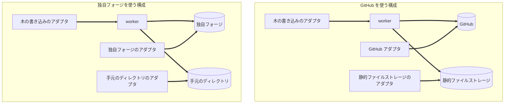

# アダプタ

バックエンドのポートを、何で実装するかを決めるときと、アダプタを作るときに読む。
ポートの定義は、[ポート](../backend/ports/README.md) が正本である。

## 一覧

| ポート | アダプタ | ページ |
|---|---|---|
| 木の書き込み | 木の書き込みのアダプタ（[worker](../backend/worker.md) の内部 API のクライアント。worker がリモートの git リポジトリに書く） | [git アダプタ](git.md) |
| やりとり | GitHub アダプタ、独自フォージのアダプタ | [GitHub アダプタ](github.md)、[独自フォージのアダプタ](forge.md) |
| スナップショットの置き場 | 静的ファイルストレージ、手元のディレクトリ | [スナップショットの置き場のアダプタ](snapshot-store.md) |
| 認証 | GitHub アダプタ、独自フォージのアダプタ | [GitHub アダプタ](github.md)、[独自フォージのアダプタ](forge.md) |

## 組み合わせ

- 太い矢印は、アダプタが外のサービスを読み書きすることを表す。
- 構成は、サーバの設定で 1 つに決める。
  - なぜ：repository ごとに構成を選べると、組み合わせが増えて単純さを失うから。
- 木の書き込みのアダプタと worker は、どちらの構成でも同じ実装である。リモートの URL と認証情報だけが違う。
- 置き場に書くのは worker、読むのはスナップショットの置き場のアダプタ（バックエンド）である。
- やりとりと認証は、同じアダプタが実装する。
  - なぜ：どちらの正本も、同じ外のサービス（GitHub か独自フォージ）にあるから。
- GitHub で PR（pull request）や issue としてやりとりを見たいなら、GitHub を使う構成にする。
- GitHub を使わずに動かしたいなら、独自フォージを使う構成にする（[独自フォージ](../forge/README.md)）。
- GitHub を使う構成は、複数人で使い、バックエンドを何台か並べることを想定する。そのため、置き場を、どのプロセスからも読める静的ファイルストレージにする。
- 独自フォージを使う構成は、1 台のマシンで使うことを想定する。そのため、置き場を、手元のディレクトリにする。
- どちらの構成でも、[worker](../backend/worker.md) が置き場に書き、バックエンドが読む。

構成ごとの正本とバックアップは、次のとおりである。

| 構成 | 正本の置き場所 | バックアップ |
|---|---|---|
| GitHub を使う構成 | GitHub | GitHub に任せる |
| 独自フォージを使う構成 | 独自フォージ | 独自フォージのデータを取る（[独自フォージ](../forge/README.md)） |

- どちらの構成でも、バックエンドはデータを保持しない（[状態を持たない](../backend/README.md)）。
- スナップショットの置き場と worker の clone も、正本ではない。失っても、worker が git とプロバイダから作り直す。そのため、バックアップは要らない。

## repository の登録

repository の名前の正本は、構成ごとに次のとおりである。

- GitHub を使う構成：サーバの設定（repository の名前と `owner/name` の組）
  - 管理者が GitHub リポジトリを作り、書き込み主体を入れて、この組を登録する（[GitHub アダプタ](github.md)）。
  - provider_ref は `owner/name` である。
  - 設定に登録されていない名前では、repository を作れない（`repository_not_registered`）。
- 独自フォージを使う構成：独自フォージの repository の一覧
  - 利用者が作るときに、独自フォージに repository を作る（[独自フォージのアダプタ](forge.md)）。
  - provider_ref は、repository の名前そのものである。
  - 管理者の登録は要らない。そのため、`repository_not_registered` は起きない。

- 利用者は、名前と根の主文だけで repository を作る。

## 設定と秘密情報

次のものは、設定ファイルか環境変数に置く。git リポジトリには置かない。

- なぜ：git リポジトリは、人やエージェントが読めるから。

バックエンド：

- 構成（GitHub を使う / 独自フォージを使う）
- worker の内部 API の宛先と、内部 API の鍵（[worker の内部 API](../backend/worker-api.md)）
- 置き場の接続先と、読む鍵（[スナップショットの置き場のアダプタ](snapshot-store.md)）
- GitHub を使う構成だけ
  - GitHub の書き込み主体の認証情報（GitHub App の秘密鍵など）
  - `user` とみなす GitHub のアカウント名か、organization の team（[GitHub アダプタ](github.md)）
  - repository の名前と `owner/name` の組
- 独自フォージを使う構成だけ
  - 独自フォージの URL
  - 独自フォージの書き込み主体のトークン（[独自フォージのアダプタ](forge.md)）

[worker](../backend/worker.md)：

- 構成と、repository の名前と `owner/name` の組（GitHub を使う構成だけ）
- 版の署名の鍵（署名を付け、確かめるため。[記録の形式](../files/revisions.md)）
- git を読み書きし、repository の一覧を読む資格情報
  - GitHub を使う構成：GitHub App の秘密鍵
  - 独自フォージを使う構成：独自フォージの `writer` のトークン
- 内部 API の鍵（バックエンドと同じもの）
- 置き場の接続先と、書く鍵
- 巡回の間隔と、内部 API を受ける HTTP のエンドポイント
- clone を置く、永続するストレージのパス

鍵を置く場所（バックエンドと worker を動かす環境）の管理者を信頼する。署名の鍵を持つのは、worker だけである。

- その管理者は、署名の鍵を取り出せば、反映によらない変更を、署名付きの変更に見せかけられる。
- ほかの主体には、鍵を置く場所を読ませない。
- 署名の鍵は、失うと、それまでの版と回答の署名を確かめられなくなるので、バックアップを取る。
