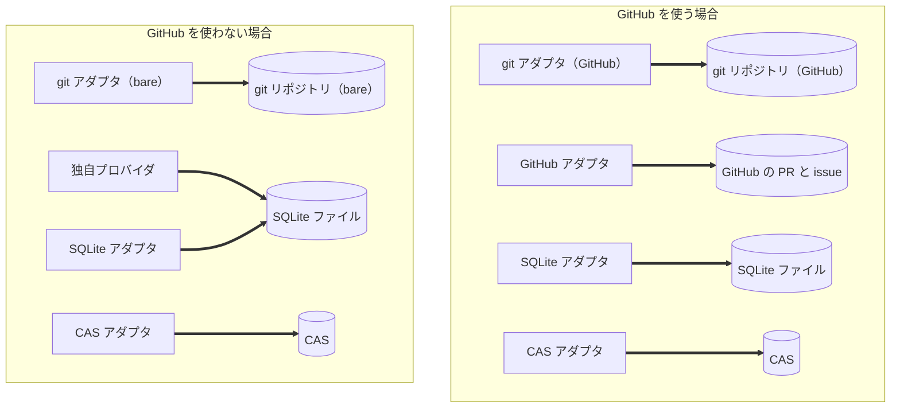

# アダプタ

バックエンドのポートを、何で実装するかを決めるときと、アダプタを作るときに読む。
ポートの定義は、[ポート](../backend/ports/README.md) が正本である。

## 一覧

| ポート | アダプタ | ページ |
|---|---|---|
| 木の読み書き | git（GitHub のリモート）、git（ローカルの bare リポジトリ） | [git アダプタ](git.md) |
| やりとり | GitHub アダプタ、独自プロバイダ | [GitHub アダプタ](github.md)、[独自プロバイダ](native.md) |
| サーバの状態 | SQLite | [SQLite アダプタ](sqlite.md) |
| ファイルの保管 | CAS（内容アドレス方式のストレージ）アダプタ（ローカルのディレクトリ、S3（Amazon のオブジェクトストレージ）互換のストレージ） | [CAS アダプタ](cas.md) |

## 組み合わせ

- 太い矢印は、アダプタがデータストアを読み書きすることを表す。
- GitHub を使わない場合は、独自プロバイダとサーバの状態が、同じ SQLite ファイルに表を分けて置く。

- やりとりのアダプタ（プロバイダ）は、サーバの設定で 1 つに決める。
  - なぜ：repository ごとにプロバイダを選べると、組み合わせが増えて単純さを失うから。
- GitHub アダプタを使うときは、木の読み書きに git（GitHub のリモート）を使う。
- 独自プロバイダを使うときは、木の読み書きに git（ローカルの bare リポジトリ）を使う。
- GitHub で PR（pull request）や issue としてやりとりを見たいなら、GitHub アダプタを使う。
- GitHub を使わずに動かしたいなら、独自プロバイダを使う。

## repository の登録

repository の名前の正本は、アダプタごとに次のとおりである。

- GitHub アダプタ：サーバの設定（repository の名前と `owner/name` の組）
  - 管理者が GitHub リポジトリを作り、書き込み主体を入れて、この組を登録する（[GitHub アダプタ](github.md)）。
- 独自プロバイダ：bare リポジトリのディレクトリ名
  - 管理者は、bare リポジトリを置くディレクトリだけを設定する。利用者が作るときに、bare リポジトリを作る（[git アダプタ](git.md)）。

サーバの状態の登録は、これらから作り直すキャッシュである（[サーバの状態](../backend/ports/server-state.md)）。
- 利用者は、名前と根の主文だけで repository を作る。

## 設定と秘密情報

次のものは、サーバの設定ファイルか環境変数に置く。git リポジトリには置かない。

- GitHub の書き込み主体の認証情報（GitHub App の秘密鍵など）
- GitHub の webhook の secret
- SQLite ファイルのパス（サーバの状態と独自プロバイダで同じファイル）
- CAS の場所と認証情報
- 版の署名の鍵（[記録の形式](../files/revisions.md)）

- なぜ：git リポジトリは、人やエージェントが読めるから。
