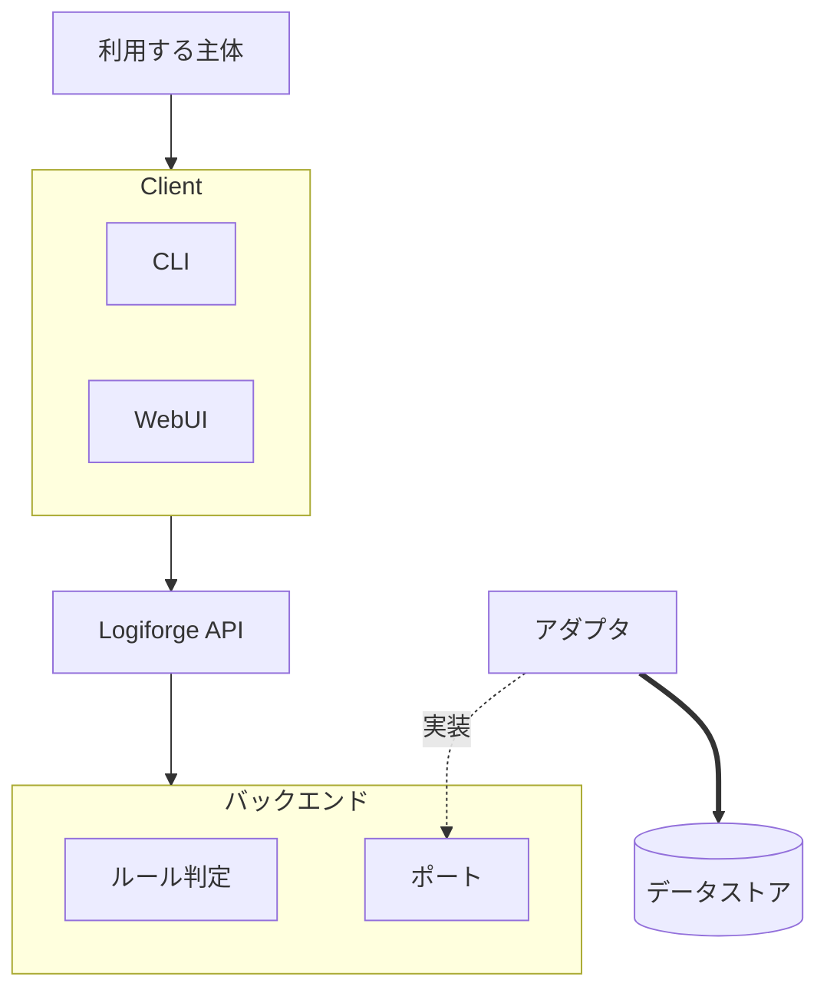

# レイヤー構成

Logiforge のバックエンドを、どのレイヤーとポートに分けるかを確かめるときに読む。
要件として必要な構成は、[全体構成](../docs/architecture/README.md) が正本である。このページは、その実現のしかたを書く。

## 図

バックエンドの中にあるのは、ルール判定とポート（何をしてほしいかの約束）だけで、保存の実体はアダプタとデータストアにある。

矢印は 3 種類である。

- `-->`：呼び出し
- `-.->`：実装。依存が逆向きで、アダプタがバックエンドのポートを実装する
- `==>`：データの読み書き

## レイヤー

- **利用する主体**：エージェントと外の仕組みは CLI を、人は WebUI を使う。クライアントではない。
- **Client**：CLI と WebUI。API だけを使う（[クライアントの要件との対応](api/clients.md)）。
- **Logiforge API**：どのアダプタでも同じ API（[API](api/README.md)）。
- **バックエンド（core）**：ルールと 4 つのポートを持ち、複数の repository を扱う（[バックエンド](backend/README.md)）。
  - ポートと、それを実装するアダプタの図は、[ポート](backend/ports/README.md) にある。
  - 反映の流れの図は、[反映の手順](backend/merge.md) にある。
- **アダプタ**：ポートを実装する。やりとりのアダプタをプロバイダと呼ぶ。
  - アダプタとデータストアの対応の図は、[アダプタ](adapters/README.md) にある。
- **データストア**：アダプタが読み書きする先（git リポジトリ、GitHub、SQLite ファイル、CAS（内容アドレス方式のストレージ））。

## 決まり

- 依存の向きは、アダプタからバックエンドのポートへの 1 方向である（ports and adapters）。
  - なぜ：アダプタを差し替えても、バックエンドを変えずに済むようにするため。
- ルールはバックエンドにだけある。
  - なぜ：アダプタを差し替えても、同じルールで判定されるようにするため。
  - アダプタは、ルールを判定しない。
- 木の読み書きのポートは、git の形式で実装する（[木のファイル配置](files/README.md)）。
  - なぜ：変更の履歴、差分、任意の時点の木を、git の仕組みでそのまま扱えるから。
- `main` を進めるのは、バックエンドの [反映の手順](backend/merge.md) だけである。
  - なぜ：不変条件を確かめずに木が変わることを防ぐため。
