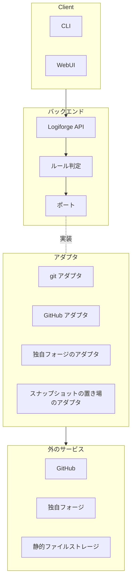

# レイヤー構成

Logiforge のバックエンドを、どのレイヤーに分けたかと、その理由を確かめるときに読む。
要件として必要な構成は、[全体構成](../docs/architecture/README.md) が正本である。このページは、その実現のしかたを書く。

## 図

- 上から、呼ぶ側から外のサービスの順に並べた。
- 実線の矢印は呼び出しを表す。
- 点線は実装を表す。下のアダプタが、上のポートを実装する。
- エージェントと外の仕組みは CLI を、人（利用者）は WebUI を使う。どれもクライアントではなく、クライアントを使う側である。
- 外のサービスは、構成ごとに使うものが決まる（[組み合わせ](adapters/README.md)）。
- 独自フォージを使う構成では、静的ファイルストレージの代わりに、手元のディレクトリを使う。
- [worker](backend/worker.md) は、バックエンドと同じコードの、別のプロセスである。図には描かない。GitHub を使う構成で、反映によらない `main` の変化からスナップショットを作る。
- ポートの一覧とアダプタの対応は、[ポート](backend/ports/README.md) に書く。

## レイヤー

- **Client**：CLI と WebUI。バックエンドの API だけを使う（[クライアントの要件との対応](api/clients.md)）。
- **バックエンド（core）**：外向きのインターフェースが API、内向きのインターフェースがポートである。その間でルールを判定する。
  - API：[API](api/README.md)
  - ルール：[バックエンド](backend/README.md)、反映の流れは [反映の手順](backend/merge.md)
  - ポート：[ポート](backend/ports/README.md)
- **アダプタ**：ポートを実装する（[アダプタ](adapters/README.md)）。
- **外のサービス**：git リポジトリ、やりとり、主体とトークンを持つ GitHub か [独自フォージ](forge/README.md)。読むための木を置く静的ファイルストレージ。

## このレイヤー構造にした理由

ねらいは、GitHub を使う構成と独自フォージを使う構成を、同じ API・同じルールのまま差し替えられることである。

- バックエンドの API を 1 つにする。
  - なぜ：CLI と WebUI が、どちらの構成でも同じ API を使えるようにするため。
- ルール判定は、バックエンドにだけ置く。
  - なぜ：構成を差し替えても、同じルールで判定されるようにするため。
  - アダプタと外のサービスは、ルールを判定しない。
- ポートを置き、依存の向きを、アダプタからポートへの 1 方向にする（ports and adapters）。
  - なぜ：構成を、バックエンドを変えずに差し替えられるようにするため。
- 独自フォージは、GitHub と同じ役割の、別のプロセスのサービスにする。
  - なぜ：どちらの構成でも、git リポジトリ・やりとり・主体の正本をバックエンドの外に置けるから。バックエンドの形が、構成によって変わらない。
- 木の読み書きは、どちらの構成でも、リモートの git リポジトリを git で読み書きする（[git アダプタ](adapters/git.md)）。
  - なぜ：木を git リポジトリで管理するという要件（[木の置き場所](../docs/architecture/README.md)）を満たし、変更の履歴と任意の時点の木を、git の仕組みでそのまま扱うため。
  - なぜ：リモートが GitHub でも独自フォージでも、同じ実装で済むから。
- 認証も、ポートにする（[認証](backend/ports/authentication.md)）。
  - なぜ：主体の正本が、GitHub か独自フォージにあり、どちらに問い合わせるかをアダプタの差し替えだけで吸収するため。
- 木を読むときは、git ではなく、コミットごとの [スナップショット](backend/snapshot.md) を、スナップショットの置き場から読む。
  - なぜ：バックエンドの台数と repository の数を掛けた数の clone を持たずに済み、GitHub の API のレート制限にも当たらないから。
  - なぜ：SHA ごとに中身が変わらないので、どのプロセスでもそのままキャッシュできるから。
  - スナップショットの置き場をポートにする。複数人の構成では静的ファイルストレージ、1 台の構成では手元のディレクトリに差し替えるため。
- バックエンドのプロセスは、共有の状態を持たない（[状態を持たない](backend/README.md)）。
  - なぜ：プロセスを何台並べても、そのまま動くようにするため。
  - 書き込みの正しさは、ロックではなく、git の CAS で守る（[同時に走る反映](backend/merge.md)）。
- バックエンドが持つ正本は、設定と署名の鍵だけである（[設定と秘密情報](adapters/README.md)）。

## 起動時の組み立て

- サーバの起動処理（composition root）が、設定を読む。
- 起動処理は、構成（GitHub を使う / 独自フォージを使う）に合ったアダプタを作り、バックエンドのポートに差し込む（依存性の注入）。
  - 構成とアダプタの組み合わせは、[組み合わせ](adapters/README.md) に書く。
  - 読む設定は、[設定と秘密情報](adapters/README.md) に書く。
- 起動処理は、バックエンドの外側に置く。
  - なぜ：バックエンドの中に置くと、バックエンドがアダプタを知ることになり、依存の向きが崩れるから。

依存性の逆転と依存性の注入は、別のことである。

- 依存性の逆転：設計上の依存の向き。アダプタがバックエンドのポートに依存し、バックエンドはアダプタに依存しない。
- 依存性の注入：実行時の組み立て。起動処理が、作ったアダプタをバックエンドに渡す。

## 決まり

- `main` を進めるのは、バックエンドの [反映の手順](backend/merge.md) だけである。
  - なぜ：不変条件を確かめずに木が変わることを防ぐため。
