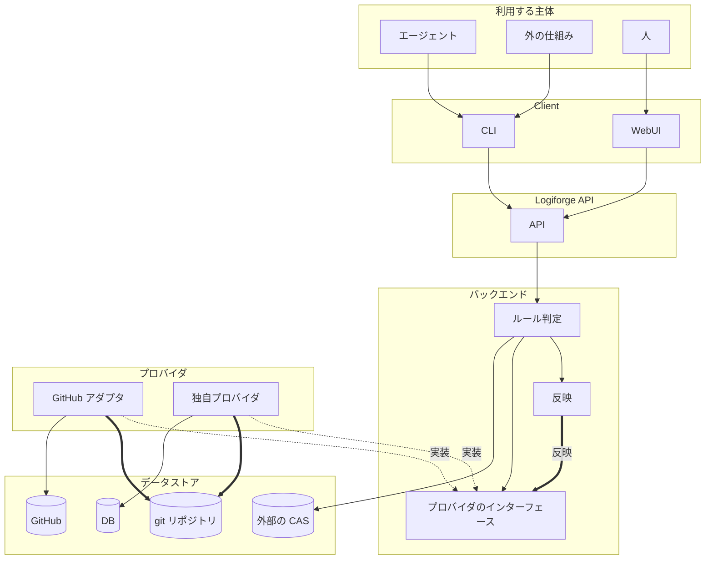

# レイヤー構成

Logiforge のバックエンドを、どのレイヤーに分けるかを確かめるときに読む。
要件として必要な構成は、[全体構成](../docs/architecture/README.md) が正本である。このページは、その実現のしかたを書く。

## 図

## レイヤー

- **利用する主体**：クライアントを使う側であり、クライアントではない。
  - エージェント（opener と reviewer）と、外の仕組み（論理レビューの起動など）は、CLI を使う。
  - 人（利用者）は、WebUI を使う。
- **Client**：CLI と WebUI の 2 つ。API だけを使う。
  - クライアントの仕様は書かない。API との対応だけを [クライアントの要件との対応](api/clients.md) に書く。
- **Logiforge API**：どのプロバイダを使っても同じ API。
  - 正本は [openapi.yaml](api/openapi.yaml)。概要は [API](api/README.md) と [API の一覧](api/endpoints/README.md)。
- **バックエンド（core）**：ルールを持つ、ただ 1 つのレイヤー。main への反映も、ここが repository ごとに 1 件ずつ行う。
  - 1 つのバックエンドが、複数の repository を扱う。
  - プロバイダのインターフェースも、バックエンドが持つ（[プロバイダのインターフェース](backend/provider-interface.md)）。
  - [バックエンド](backend/README.md)
- **プロバイダ**：バックエンドのインターフェースを実装するアダプタ。提案と版、レビュー、人への依頼、イベントを置く場所を、差し替えられるようにする。
  - [プロバイダ](providers/README.md)（[GitHub アダプタ](providers/github.md)、[独自プロバイダ](providers/native.md)）
- **データストア**：木は、どのプロバイダでも git リポジトリに置く。
  - git リポジトリ：木と、小さな artifact（[木のファイル配置](files/README.md)）。repository ごとに 1 つ。
  - 外部の CAS：大きな artifact（[artifact の置き方](files/artifacts.md)）
  - GitHub：GitHub アダプタのときの、提案・レビュー・人への依頼
  - DB：独自プロバイダのときの、提案・レビュー・人への依頼

## 3 つの決まり

- 依存の向きは、プロバイダからバックエンドのインターフェースへの 1 方向である（ports and adapters）。
  - なぜ：プロバイダを差し替えても、バックエンドを変えずに済むようにするため。

- ルールはバックエンドにだけある。
  - なぜ：プロバイダを差し替えても、同じルールで判定されるようにするため。
  - プロバイダは、ルールを判定しない。受け取ったものを置き、イベントを伝えるだけである。
- main への書き込みの経路は、バックエンドの反映から、インターフェースを実装したプロバイダの反映を通る 1 本だけである。
  - なぜ：不変条件を確かめずに木が変わることを防ぐため（[反映の手順](backend/merge.md)）。
