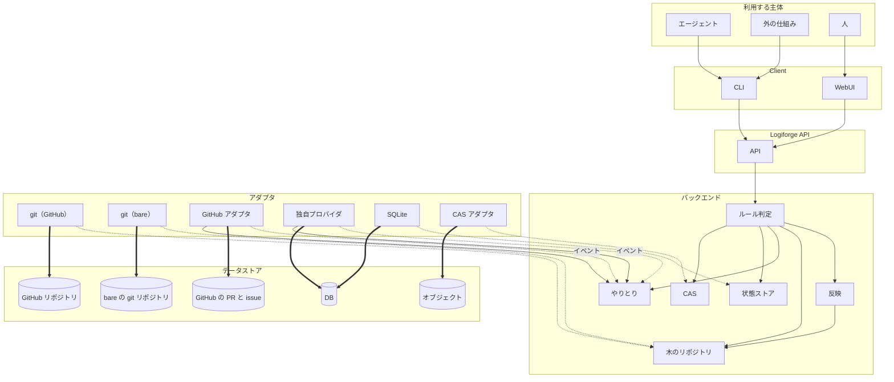

# レイヤー構成

Logiforge のバックエンドを、どのレイヤーとポートに分けるかを確かめるときに読む。
要件として必要な構成は、[全体構成](../docs/architecture/README.md) が正本である。このページは、その実現のしかたを書く。

## 図

矢印は 3 種類である。

- `-->`：呼び出し
- `-.->`：実装（アダプタがポートを実装する）
- `==>`：データの読み書き

## レイヤー

- **利用する主体**：クライアントを使う側であり、クライアントではない。
  - エージェント（opener と reviewer）と、外の仕組み（論理レビューの起動など）は、CLI を使う。
  - 人（利用者）は、WebUI を使う。
- **Client**：CLI と WebUI の 2 つ。API だけを使う。
  - クライアントの仕様は書かない。API との対応だけを [クライアントの要件との対応](api/clients.md) に書く。
- **Logiforge API**：どのアダプタを使っても同じ API。
  - 正本は [openapi.yaml](api/openapi.yaml)。概要は [API](api/README.md) と [API の一覧](api/endpoints/README.md)。
- **バックエンド（core）**：ルールと、4 つのポートを持つ（[バックエンド](backend/README.md)、[ポート](backend/ports/README.md)）。
  - 1 つのバックエンドが、複数の repository を扱う。
- **アダプタ**：ポートを実装する（[アダプタ](adapters/README.md)）。
  - やりとりのポートを実装するアダプタを、プロバイダと呼ぶ（GitHub アダプタと独自プロバイダ）。
- **データストア**：アダプタが読み書きする先。
  - GitHub リポジトリか bare の git リポジトリ：木と、小さな artifact。repository ごとに 1 つ。
  - GitHub の PR と issue、または DB：提案、レビュー、人への依頼
  - DB：状態ストア
  - オブジェクト：CAS の中身

## 決まり

- 依存の向きは、アダプタからバックエンドのポートへの 1 方向である（ports and adapters）。
  - なぜ：アダプタを差し替えても、バックエンドを変えずに済むようにするため。
- ルールはバックエンドにだけある。
  - なぜ：アダプタを差し替えても、同じルールで判定されるようにするため。
  - アダプタは、ルールを判定しない。
- 木のリポジトリのポートは、git の形式で実装する（[木のファイル配置](files/README.md)）。
  - なぜ：変更の履歴、差分、任意の時点の木を、git の仕組みでそのまま扱えるから。
- `main` を進めるのは、バックエンドの [反映の手順](backend/merge.md) だけである。
  - なぜ：不変条件を確かめずに木が変わることを防ぐため。
