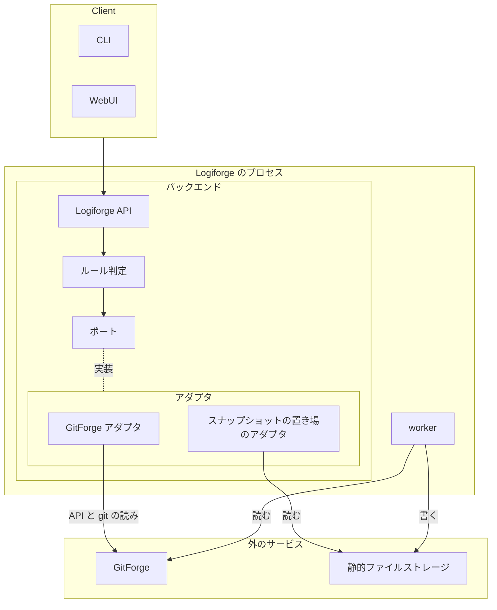

# レイヤー構成

Logiforge のバックエンドを、どのレイヤーに分けたかと、その理由を確かめるときに読む。
要件として必要な構成は、[全体構成](../docs/architecture/README.md) が正本である。このページは、その実現のしかたを書く。

## 図

- 上から、Client、Logiforge のプロセス（バックエンドと worker）、外のサービスの順に並べた。
- 実線の矢印は呼び出しを表す。
- 点線は実装を表す。下のアダプタが、上のポートを実装する。
- エージェントと外の仕組みは CLI を、人（利用者）は WebUI を使う。どれもクライアントではなく、クライアントを使う側である。
- Logiforge のプロセスは、バックエンドと [worker](backend/worker.md) の 2 つである。どちらも同じバイナリで、別のコンテナで動く（[動かし方](deploy.md)）。
  - バックエンドと worker は、互いを呼ばない。worker は git を見回って置き場に書き、バックエンドは置き場を読むだけである（[worker](backend/worker.md)）。
  - バックエンドは、apply request の作成のときだけ、作業用の git の複製から GitForge の git を読んで検査する（[作業用の git の複製](backend/apply-request.md#作業用の-git-の複製)）。
  - 図の GitForge アダプタから GitForge への線（「API と git の読み」）は、GitForge の API の呼び出しと、この git の読みの両方を表す。git の URL と、読むだけの資格情報は、GitForge アダプタが渡す。
  - worker は、GitForge の git を読み、スナップショットを静的ファイルストレージに書く。git には書かない。
- 外のサービスは、構成ごとに使うものが決まる（[組み合わせ](adapters/README.md)）。
- 1 台で動かす構成では、静的ファイルストレージの代わりに、手元のディレクトリを使う。
- ポートの一覧とアダプタの対応は、[ポート](backend/ports/README.md) に書く。

## レイヤー

- **Client**：CLI と WebUI。バックエンドの API を使う（[クライアントの要件との対応](api/clients.md)）。
  - CLI は、git とセットで使う。木を変えるときは、git でブランチを、GitForge に push する（[CLI](cli/README.md)）。図では、この線を省いた。
- **Logiforge のプロセス**：バックエンドと worker。
  - バックエンド（core）：外向きのインターフェースが API、内向きのインターフェースがポートである。その間でルールを判定する。ポートを実装するアダプタも、バックエンドのプロセスの中にある。
    - API：[API](api/README.md)
    - ルール：[バックエンド](backend/README.md)、反映の流れは [反映の手順](backend/merge.md)
    - ポート：[ポート](backend/ports/README.md)
    - アダプタ：[アダプタ](adapters/README.md)
  - worker：git を読んでスナップショットを作る（[worker](backend/worker.md)）。
- **外のサービス**：git リポジトリ、pull request とやりとり、主体とトークンを持つ [GitForge](README.md#用語)。スナップショットを置く静的ファイルストレージ。

バックエンドはデータを保持しない。保持するのは、外のサービス（正本）、worker（clone）、静的ファイルストレージ（スナップショット）である。
バックエンドの作業用の git の複製は、使い捨てのキャッシュで、正本ではない。消えても、次の要求で作り直す。

## このレイヤー構造にした理由

ねらいは、GitForge と置き場を、同じ API・同じルールのまま差し替えられることである。

- バックエンドの API を 1 つにする。
  - なぜ：CLI と WebUI が、どちらの構成でも同じ API を使えるようにするため。
- ルール判定は、バックエンドにだけ置く。
  - なぜ：構成を差し替えても、同じルールで判定されるようにするため。
  - アダプタと外のサービスは、ルールを判定しない。
- ポートを置き、依存の向きを、アダプタからポートへの 1 方向にする（ports and adapters）。
  - なぜ：構成を、バックエンドを変えずに差し替えられるようにするため。
- git のホスティング、pull request、レビュー、issue、主体は、自前で作らず、GitForge に任せる。
  - なぜ：GitForge がすでに持つものを作り直さずに済むから。どの GitForge でも、同じ pull request の形で扱える。
  - なぜ：git リポジトリ・やりとり・主体の正本を、バックエンドの外に置けるから。バックエンドの形が、GitForge によって変わらない。
  - どの GitForge を使うかは、[アダプタ](adapters/README.md) に書く。
- apply request は、GitForge の pull request に寄せる（[apply request と pull request](backend/apply-request.md)）。
  - 木を変えるのは、利用者が push したブランチと、バックエンドが API で行う pull request の merge である。サーバの側が git に書くのは、merge と repository の用意だけである。
  - なぜ：ブランチの先頭のコミット、反映、衝突の扱いを、GitForge の pull request の仕組みにそのまま任せ、バックエンドが git の ref を自前で扱わずに済むようにするため。
  - なぜ git か：木を git リポジトリで管理するという要件（[木の置き場所](../docs/architecture/README.md)）を満たし、変更の履歴と任意の時点の木を、git の仕組みでそのまま扱うため。
- 認証も、ポートにする（[認証](backend/ports/authentication.md)）。
  - なぜ：主体の正本が GitForge にあり、GitForge の違いをアダプタの差し替えだけで吸収するため。
- 木を読むときは、git ではなく、worker が書いた [スナップショット](backend/snapshot.md) のスナップショットツリーを、置き場から読む。
  - なぜ：バックエンドの台数と repository の数を掛けた数の clone を持たずに済むから。
  - なぜ：木の読みでは、GitForge の API のレート制限に当たらないから。
  - やりとりは、GitForge から要求ごとに読む。そのレート制限は、今は考えない（[費用と規模の見積もり](estimates.md)）。
  - スナップショットの置き場をポートにする。複数人の構成では静的ファイルストレージ、1 台の構成では手元のディレクトリに差し替えるため。
- 置き場に書くのは、worker だけにする。バックエンドは、apply request の作成のときに、作業用の git の複製から git を読んで検査してよい。worker は、バックエンドの外の、別のプロセスにする。worker は git に書かない。
  - なぜ：スナップショットを作るところを、1 か所にまとめるため。置き場に書く鍵を持つのも、worker だけにできる。
  - なぜ：永続する clone を持つのは worker だけにするため。clone は、永続するストレージに置く。バックエンドの作業用の複製は、一時的なディスクに置く使い捨てのキャッシュで、正本ではない。
  - なぜ：worker は、1 つだけ動かすため（[worker](backend/worker.md)）。バックエンドの中に置くと、バックエンドの台数だけ worker が動いてしまう。
  - なぜ、作成の検査をバックエンドで行うか：worker を待たずに済み、バックエンドを増やすだけで、作成の数に合わせて広げられるから。要求ごとに clone せず、fetch だけにするので、重くならない。
  - 解析のコードは、worker、バックエンド、CLI の `check` で 1 つにする。
  - 書く鍵を持つものも、バックエンドだけにできる。
  - そのかわり、書いたものが読む側に出るのは、worker が追いついてからになる（[書いた直後の読み](api/writes.md)）。
- バックエンドは、データを保持しない（[状態を持たない](backend/README.md)）。
  - なぜ：プロセスを何台並べても、そのまま動くようにするため。
  - 書き込みの取り合いは、ロックではなく、GitForge の pull request の merge と git の衝突で決まる（[衝突](backend/merge.md)）。
- バックエンドが持つのは、設定と鍵だけである（[設定と秘密情報](adapters/README.md)）。

## 起動時の組み立て

- サーバの起動処理（composition root）が、設定を読む。
- 起動処理は、構成に合ったアダプタを作り、バックエンドのポートに差し込む（依存性の注入）。
  - 構成とアダプタの組み合わせは、[組み合わせ](adapters/README.md) に書く。
  - 読む設定は、[設定と秘密情報](adapters/README.md) に書く。
- 起動処理は、バックエンドの外側に置く。
  - なぜ：バックエンドの中に置くと、バックエンドがアダプタを知ることになり、依存の向きが崩れるから。

依存性の逆転と依存性の注入は、別のことである。

- 依存性の逆転：設計上の依存の向き。アダプタがバックエンドのポートに依存し、バックエンドはアダプタに依存しない。
- 依存性の注入：実行時の組み立て。起動処理が、作ったアダプタをバックエンドに渡す。

## 動かし方（コンテナ）

- イメージは 1 つで、バックエンドと worker は、コンテナのコマンドだけを変える（`logiforge serve`、`logiforge worker`）。
- 1 つのタスクに、バックエンドのコンテナと worker のコンテナを並べる。タスクのレプリカは 1 にする。
- バックエンドだけを増やしたくなったら、バックエンドと worker を別のタスクに分ける。コードは、そのままで分けられる。
- 詳しくは、[動かし方（コンテナ）](deploy.md) に書く。

## 決まり

- `main` を進めるのは、バックエンドの [反映の手順](backend/merge.md) だけである。
  - なぜ：不変条件を確かめずに木が変わることを防ぐため。
