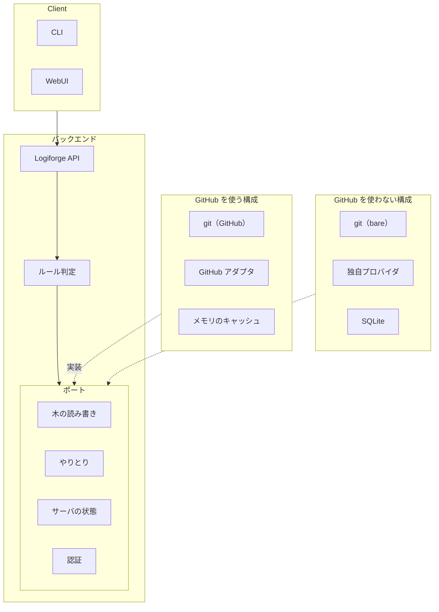

# レイヤー構成

Logiforge のバックエンドを、どのレイヤーに分けたかと、その理由を確かめるときに読む。
要件として必要な構成は、[全体構成](../docs/architecture/README.md) が正本である。このページは、その実現のしかたを書く。

## 図

- 実線の矢印は呼び出し、点線の矢印は実装（アダプタがポートを実装する）を表す。
- エージェントと外の仕組みは CLI を、人（利用者）は WebUI を使う。どれもクライアントではなく、クライアントを使う側である。
- SQLite は、GitHub を使わない構成だけで使う（[組み合わせ](adapters/README.md)）。

## レイヤー

- **Client**：CLI と WebUI。バックエンドの API だけを使う（[クライアントの要件との対応](api/clients.md)）。
- **バックエンド（core）**：外向きのインターフェースが API、内向きのインターフェースがポートである。その間でルールを判定する。
  - API：[API](api/README.md)
  - ルール：[バックエンド](backend/README.md)、反映の流れは [反映の手順](backend/merge.md)
  - ポート：[ポート](backend/ports/README.md)
- **アダプタ**：ポートを実装する。GitHub を使う構成のものと、使わない構成のものがある（[アダプタ](adapters/README.md)）。
- **データストア**：アダプタが読み書きする先。アダプタの名前に含まれるので、図では省いた（[組み合わせ](adapters/README.md)）。

## このレイヤー構造にした理由

ねらいは、GitHub を使う構成と使わない構成を、同じ API・同じルールのまま差し替えられることである。

- バックエンドの API を 1 つにする。
  - なぜ：CLI と WebUI が、どちらの構成でも同じ API を使えるようにするため。
- ルール判定は、バックエンドにだけ置く。
  - なぜ：構成を差し替えても、同じルールで判定されるようにするため。
  - アダプタは、ルールを判定しない。
- ポートを置き、依存の向きを、アダプタからポートへの 1 方向にする（ports and adapters）。
  - なぜ：GitHub を使う構成と使わない構成を、バックエンドを変えずに差し替えられるようにするため。
- 木の読み書きは、どちらの構成でも git で実装する（[木のファイル配置](files/README.md)）。
  - なぜ：木を git リポジトリで管理するという要件（[木の置き場所](../docs/architecture/README.md)）を満たし、変更の履歴と任意の時点の木を、git の仕組みでそのまま扱うため。
- 認証も、ポートにする（[認証](backend/ports/authentication.md)）。
  - なぜ：GitHub を使う構成では GitHub に任せ、使わない構成ではサーバが持つ、という違いを、アダプタの差し替えだけで吸収するため。
- 主体の正本は、GitHub を使う構成では GitHub に、使わない構成ではサーバにある。
  - そのため、GitHub を使う構成では、サーバに正本を持たない。サーバの状態は、メモリのキャッシュで足りる。
  - GitHub を使わない構成では、サーバの状態・認証・独自プロバイダを、同じ SQLite ファイルに置く。

## 起動時の組み立て

- サーバの起動処理（composition root）が、設定を読む。
- 起動処理は、構成（GitHub を使う / 使わない）に合ったアダプタを作り、バックエンドのポートに差し込む（依存性の注入）。
  - 構成とアダプタの組み合わせは、[組み合わせ](adapters/README.md) に書く。
  - 読む設定は、[設定と秘密情報](adapters/README.md) に書く。
- 起動処理は、バックエンドの外側に置く。
  - なぜ：バックエンドの中に置くと、バックエンドがアダプタを知ることになり、依存の向きが崩れるから。

依存性の逆転と依存性の注入は、別のことである。

- 依存性の逆転：設計上の依存の向き。アダプタがバックエンドのポートに依存し、バックエンドはアダプタに依存しない。
- 依存性の注入：実行時の組み立て。起動処理が、作ったアダプタをバックエンドに渡す。

## 決まり

- `main` を進めるのは、バックエンドの [反映の手順](backend/merge.md) だけである。
  - なぜ：不変条件を確かめずに木が変わることを防ぐため。
