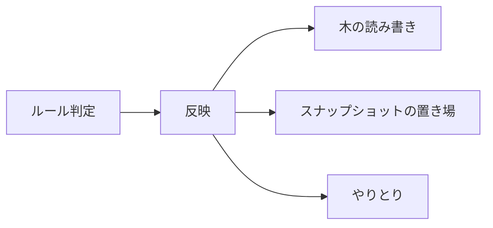

# 反映の手順

apply request を main に反映するとき、バックエンドが何を確かめ、どう書き込むかを確かめるために読む。
要件は、[反映](../../docs/apply-request/README.md) と [反映の条件](../../docs/apply-request/review.md) が正本である。

## 流れ

- 反映は、ルール判定のあとに行う。
- 反映は、木の読み書きで `main` を進め、スナップショットを置き、やりとりに記録する（下の「手順」）。

## 手順

`approve` を受け付けたら、バックエンドは次の順に処理する。

1. 今の版が有効かを確かめる。
   - 版のリビジョンに、バックエンドの署名があり、正しい（[記録の形式](../files/revisions.md)）。
2. 反映の条件を満たすかを、[やりとり](ports/interaction.md) から読んだ版とレビューで確かめる。
   - 今の版に対する最後のレビューが `approve` である。
   - その reviewer のセッションが、どの版を書いたセッションとも違う。
3. 「今の main を読む」で、今の `main` を得る。そのスナップショットがなければ、先に作る（[スナップショット](snapshot.md)）。
4. すでに反映されていないかを確かめる。
   - base から今の `main` までのコミットの記録に、この apply request の `Logiforge-Apply-Request:` があれば、手順 9 に進む。
   - なぜ：前の反映が、push のあとで止まったときに、二重に反映しないため。
5. 対象ノードが変わっていないかを確かめる（下の「対象ノードの変化」）。
6. 新しいリビジョンを作る。
   - 使い捨ての clone で、base から版までの差分を、今の `main` に当てはめ、「リビジョンを作る」で作る。名前は付けない。
   - 親は、今の `main` の 1 つだけにする。
     - なぜ：`main` の並びを first-parent だけで読め、反映によらない変更を見分ける検査も単純になるから。
     - どの版を反映したかは、trailer に書く（[記録の形式](../files/revisions.md)）。
   - 署名と trailer を付ける（[記録の形式](../files/revisions.md)）。
7. 新しいリビジョンに対して、[差分の検査](checks.md) を行う。
8. 「main を進める」で、手順 3 の `main` から新しいリビジョンへ進める。
   - 「`main` が期待する親でない」で失敗したら、別の書き込みに負けたので、手順 3 からやり直す。
9. 新しいリビジョンの [スナップショット](snapshot.md) を置き、`latest` を進める。
10. やりとりに、提案が反映されたことを記録する。
11. 手順 5 か 7 で反映できなければ、`main` を動かさず、失敗の理由をやりとりに記録する。
    - apply request は open のまま残る。

- base は、版のコミットの親である。版は、作ったときの `main` を親にして作るから（[apply request の作成と更新](apply-request.md)）。
- 手順 9 と 10 は、失敗しても回復する。
  - なぜ：反映の正本は `main` で、手順 8 が済めば反映は確定しているから。
  - 手順 9 は、次の書き込みか [worker](worker.md) が直す。手順 10 は、次の反映の手順 4 か worker が直す。

## 同時に走る反映

- 反映は、ロックを取らない。同じ repository の反映が、同時に走ってよい。
  - なぜ：バックエンドのプロセスに共有の状態を持たせず、何台でも並べられるようにするため。
- 正しさは、手順 8 の CAS で守る。
  - 2 つの反映が同じ `main` から始めると、先に手順 8 を終えた方だけが進む。
  - 負けた方は、手順 3 からやり直す。新しい `main` に対して、手順 4 と 5 を確かめ直すので、古い状態を前提にした反映は入らない。
- 同じ apply request の反映が 2 つ同時に走っても、負けた方はやり直しの手順 4 で反映済みとわかり、二重には入らない。
- 反映と、同じ apply request の close が同時に走ることがある。
  - `main` に入った反映が正本なので、やりとりの「反映されたことを記録する」は、close 済みの提案も merged にする。
- 反映と、同じ apply request の更新が同時に走ることがある。
  - 反映は、手順 2 で読んだ版で行い、反映した版を trailer に書く。そのあとに足された版は、反映されない。

## ファイルの衝突だけでは足りない

ファイルのマージで衝突が出るのは、同じファイルの同じ箇所を変えたときだけである。
要件の「対象ノードが変わった」は、それより広い。

- 衝突しないが、要件では「変わった」にあたる例
  - 同じ仮説の下に、2 つの apply request が別々のストーリーを加えた。
  - 対象の仮説の祖先のストーリーが、別の apply request で inactive になった。
- 衝突するが、要件でも「変わった」にあたる例
  - 2 つの apply request が、同じ `background.md` の末尾に文章を加えた。

そのため、反映の判定は、ファイルの衝突に頼らず、バックエンドが行う。

## 対象ノードの変化

- 各操作の対象ノードについて、「変わった」とみなすパスを決める。
  - 仮説：自分の `hypothesis.md`、`background.md`、`verdicts/`、子ストーリーの `story.md` と `inactivated.md`、祖先のストーリーの `inactivated.md`
  - ストーリー：自分の `story.md` と `inactivated.md`、祖先のストーリーの `inactivated.md`
- base から今の `main` までのコミットの記録の `changes` に、そのパスを変えたものがあれば、反映しない（[スナップショット](snapshot.md)）。
  - base が今の `main` から親をたどった先になければ（force push で消えたとき）、変わったものとみなす。
- 伝播で値だけが変わることは、ファイルに現れないので、「変わった」に含まれない。
  - なぜ：値は保存しないから（[保存しないもの](../files/layout.md)）。

## 反映できなかったとき

- apply request は、open のまま残る。
- opener は、最新の `main` に合わせて差分を作り直す。
  - 作り直した差分は、新しい版である。
  - それまでの approve は、新しい版には効かない（[反映の条件](../../docs/apply-request/review.md)）。
