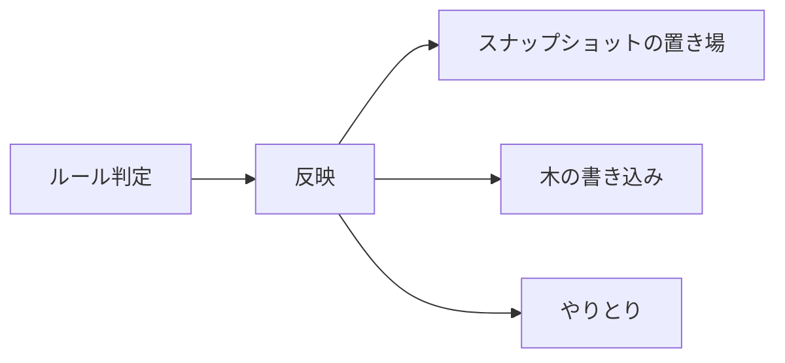

# 反映の手順

apply request を main に反映するとき、バックエンドが何を確かめ、どう書き込むかを確かめるために読む。
要件は、[反映](../../docs/apply-request/README.md) と [反映の条件](../../docs/apply-request/review.md) が正本である。

## 流れ

- 反映は、ルール判定のあとに行う。
- 反映は、スナップショットの上で確かめ、git に書き、やりとりに記録する（下の「手順」）。
- バックエンドは、git のファイルを読まない。確かめることは、どれもスナップショットの上で行う（[スナップショット](snapshot.md)）。

## 手順

`approve` を受け付けたら、バックエンドは次の順に処理する。

1. 版と反映の条件を、[ref の一覧](snapshot.md)、スナップショット、プロバイダから読んだレビューで確かめる。
   - 今の版（`head`）のスナップショットの `signed` が真である（[記録の形式](../files/revisions.md)）。
   - 今の版に対する最後のレビューが `approve` である。
   - その reviewer のセッションが、どの版を書いたセッションとも違う。
2. `latest` を読み、その SHA を今の `main` とみなす。
3. すでに反映されていないかを確かめる。
   - 今の `main` のスナップショットの `history` で、base より後に、この apply request の項目があれば、手順 8 に進む。
   - なぜ：前の反映が、push のあとで止まったときに、二重に反映しないため。
4. 対象ノードが変わっていないかを確かめる（下の「対象ノードの変化」）。
5. 今の `main` のスナップショットに、版の差分を当てはめ、[差分の検査](checks.md) を行う。
6. 当てはめた結果の、変わったファイルだけを書き出し、今の `main` を親とする新しいリビジョンを作る。名前は付けない。
   - 親は、今の `main` の 1 つだけにする。
     - なぜ：`main` の並びを first-parent だけで読め、反映によらない変更を見分ける検査も単純になるから。
   - どの版を反映したかは、trailer に書く。署名と trailer を付ける（[記録の形式](../files/revisions.md)）。
7. 次の 2 つを、1 回の atomic な push で書く（[git アダプタ](../adapters/git.md)）。
   - `main`：手順 2 の SHA を期待して、新しいリビジョンに進める
   - `head`：手順 1 の版のコミットを期待して、消す
8. やりとりに、提案が反映されたことを記録する。worker を起こし、`latest` が追いつくまで待ってから応答する（[書いた直後の読み](../api/writes.md)）。
9. 手順 4 か 5 で反映できなければ、git を動かさず、失敗の理由をやりとりに記録する。apply request は open のまま残る。

- base は、版のコミットの親である（[apply request の作成と更新](apply-request.md)）。
- 手順 7 が、`main` が手順 2 の SHA でないことで失敗したら、`latest` が git に追いついていない。
  - worker を起こし、`latest` が進むのを待って、手順 2 からやり直す。
  - 待つ時間の上限を過ぎたら、反映の失敗の理由を `snapshot_pending` として記録する。apply request は open のまま残る。opener か reviewer は、少し待ってから `approve` し直す。
  - なぜ：今の `main` のスナップショットがないと、手順 3〜5 を確かめられないから。
- 手順 7 が、`head` が期待した版でないことで失敗したら、先に更新か close が通っている。反映しない。
- 手順 8 は、失敗しても回復する。反映の正本は `main` で、提案の状態は `main` から求めるから（[状態](apply-request.md)）。

## 同時に走る反映

- 反映は、ロックを取らない。同じ repository の書き込みが、同時に走ってよい。
  - なぜ：バックエンドのプロセスに状態を持たせず、何台でも並べられるようにするため。
- 正しさは、手順 7 の atomic な CAS で守る。
  - 2 つの反映が同じ `main` から始めると、先に手順 7 を終えた方だけが進む。負けた方は、手順 2 からやり直す。
  - 同じ apply request の反映が 2 つ同時に走っても、`head` の削除は 1 回しか通らないので、二重には入らない。
  - 反映と、同じ apply request の更新か close が同時に走っても、`head` を期待した値で書き換えるのは、どちらか 1 つだけである。

## ファイルの衝突だけでは足りない

ファイルのマージで衝突が出るのは、同じファイルの同じ箇所を変えたときだけである。
要件の「対象ノードが変わった」は、それより広い。

- 衝突しないが、要件では「変わった」にあたる例
  - 同じ仮説の下に、2 つの apply request が別々のストーリーを加えた。
  - 対象の仮説の祖先のストーリーが、別の apply request で inactive になった。
- 衝突するが、要件でも「変わった」にあたる例
  - 2 つの apply request が、同じ `background.md` の末尾に文章を加えた。

そのため、反映の判定は、ファイルの衝突に頼らず、バックエンドが行う。

## 対象ノードの変化

- 各操作の対象ノードについて、「変わった」とみなすパスを決める。
  - 仮説：自分の `hypothesis.md`、`background.md`、`verdicts/`、子ストーリーの `story.md` と `inactivated.md`、祖先のストーリーの `inactivated.md`
  - ストーリー：自分の `story.md` と `inactivated.md`、祖先のストーリーの `inactivated.md`
- 今の `main` のスナップショットで、対象ノードの [ノードの変更の一覧](snapshot.md) に、base の番号より大きい番号があれば、反映しない。
  - base が今の `main` の `history` になければ（force push で消えたとき）、変わったものとみなす。
- 伝播で値だけが変わることは、ファイルに現れないので、「変わった」に含まれない。
  - なぜ：値は保存しないから（[保存しないもの](../files/layout.md)）。

## 反映できなかったとき

- apply request は、open のまま残る。
- opener は、最新の `main` に合わせて差分を作り直す。
  - 作り直した差分は、新しい版である。
  - それまでの approve は、新しい版には効かない（[反映の条件](../../docs/apply-request/review.md)）。
