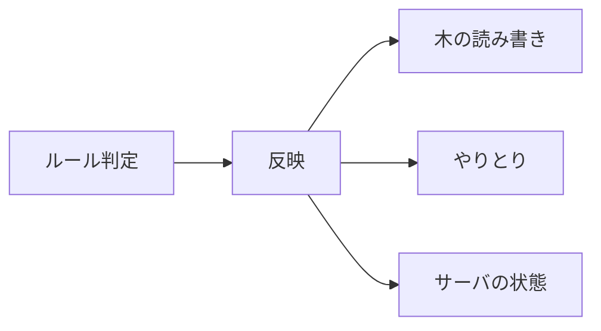

# 反映の手順

apply request を main に反映するとき、バックエンドが何を確かめ、どう書き込むかを確かめるために読む。
要件は、[反映](../../docs/apply-request/README.md) と [反映の条件](../../docs/apply-request/review.md) が正本である。

## 流れ

- 反映は、ルール判定のあとに行う。
- 反映は、木の読み書きで `main` を進め、やりとりとサーバの状態に記録する（下の「手順」）。

## 手順

`approve` を受け付けたら、バックエンドは次の順に処理する。

1. 今の版が有効かを確かめる。
   - 版のリビジョンに、バックエンドの署名があり、正しい（[記録の形式](../files/revisions.md)）。
2. 反映の条件を満たすかを、[やりとり](ports/interaction.md) から読んだ版とレビューで確かめる。
   - 今の版に対する最後のレビューが `approve` である。
   - その reviewer のセッションが、どの版を書いたセッションとも違う。
3. 対象ノードが変わっていないかを確かめる（下の「対象ノードの変化」）。
4. 新しいリビジョンを作る。
   - base から版までの差分を、今の `main` に当てはめ、「リビジョンを作る」で作る。
   - 署名と trailer を付ける（[記録の形式](../files/revisions.md)）。
5. 新しいリビジョンに対して、[差分の検査](checks.md) を行う。
6. 「main を進める」で、今の `main` から新しいリビジョンへ進める。
   - 期待する親は、手順 4 で使った `main` のリビジョンである。
7. やりとりに、提案が反映されたことを記録し、イベントのログにも記録する。
8. 失敗したら、`main` を動かさず、失敗の理由をやりとりに記録する。
   - apply request は open のまま残る。

- 反映は、repository ごとに 1 件ずつ直列に行う。
  - repository が違えば、並行して反映してよい。
  - なぜ：検査と書き込みの間に、同じ repository の別の反映が割り込まないようにするため。
- 手順 6 は、`main` が動いていれば失敗する。直列にしたうえでの、最後の守りである。
- 手順 7 とイベントの記録は、失敗しても [突き合わせ](README.md) で回復する。
  - なぜ：反映の正本は `main` で、手順 6 が済めば反映は確定しているから。

## ファイルの衝突だけでは足りない

ファイルのマージで衝突が出るのは、同じファイルの同じ箇所を変えたときだけである。
要件の「対象ノードが変わった」は、それより広い。

- 衝突しないが、要件では「変わった」にあたる例
  - 同じ仮説の下に、2 つの apply request が別々のストーリーを加えた。
  - 対象の仮説の祖先のストーリーが、別の apply request で inactive になった。
- 衝突するが、要件でも「変わった」にあたる例
  - 2 つの apply request が、同じ `background.md` の末尾に文章を加えた。

そのため、反映の判定は、ファイルの衝突に頼らず、バックエンドが行う。

## 対象ノードの変化

- 各操作の対象ノードについて、「変わった」とみなすパスを決める。
  - 仮説：自分の `hypothesis.md`、`background.md`、`verdicts/`、子ストーリーの `story.md` と `inactivated.md`、祖先のストーリーの `inactivated.md`
  - ストーリー：自分の `story.md` と `inactivated.md`、祖先のストーリーの `inactivated.md`
- base は、版のリビジョンと今の `main` の、「共通の祖先を求める」で得る。
- base から今の `main` までに、そのパスを変えたリビジョンがあれば（「変更を列挙する」）、反映しない。
- 伝播で値だけが変わることは、ファイルに現れないので、「変わった」に含まれない。
  - なぜ：値は保存しないから（[保存しないもの](../files/layout.md)）。

## 反映できなかったとき

- apply request は、open のまま残る。
- opener は、最新の `main` に合わせて差分を作り直す。
  - 作り直した差分は、新しい版である。
  - それまでの approve は、新しい版には効かない（[反映の条件](../../docs/apply-request/review.md)）。
