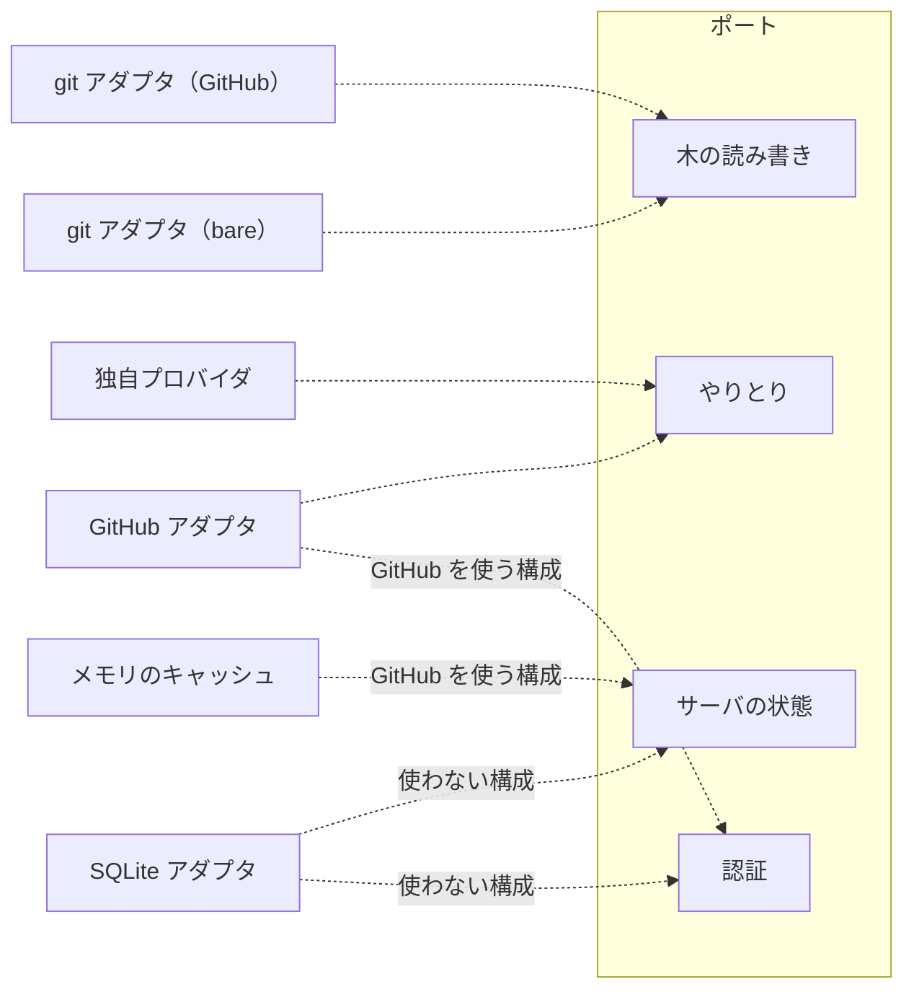

# ポート

バックエンドが外のものを使うときの、ポート（バックエンドが持つインターフェース）を確かめるときに読む。
依存の向きと、ポートを置く理由は、[レイヤー構成](../../architecture.md) が正本である。

## ポートの一覧

| ポート | 扱うもの | ページ |
|---|---|---|
| 木の読み書き | 木のファイルと、そのリビジョン | [木の読み書き](tree-read-write.md) |
| やりとり | 提案と版、レビュー、人への依頼 | [やりとり](interaction.md) |
| サーバの状態 | サーバが持つ状態（repository の登録、突き合わせの状態、Idempotency-Key） | [サーバの状態](server-state.md) |
| 認証 | API の要求を送った主体 | [認証](authentication.md) |

## ポートとアダプタ

- 点線の矢印は、アダプタがポートを実装することを表す。
- 矢印のラベルは、その構成でだけ使うことを表す。
- 各アダプタの詳細は、[アダプタ](../../adapters/README.md) に書く。
