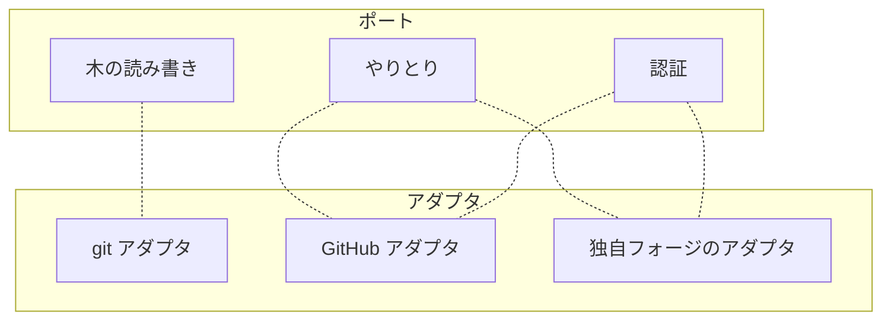

# ポート

バックエンドが外のものを使うときの、ポート（バックエンドが持つインターフェース）を確かめるときに読む。
依存の向きと、ポートを置く理由は、[レイヤー構成](../../architecture.md) が正本である。

## ポートの一覧

| ポート | 扱うもの | ページ |
|---|---|---|
| 木の読み書き | 木のファイルと、そのリビジョン | [木の読み書き](tree-read-write.md) |
| やりとり | 提案と版、レビュー、人への依頼 | [やりとり](interaction.md) |
| 認証 | API の要求を送った主体 | [認証](authentication.md) |

- サーバの状態は、ポートにしない（[サーバの状態](../server-state.md)）。

## ポートとアダプタ

- 点線は実装を表す。下のアダプタが、上のポートを実装する。
- git アダプタは、どちらの構成でも同じものを使う。
- やりとりと認証は、構成に合わせて、GitHub アダプタか独自フォージのアダプタの一方を使う。
- 各アダプタの詳細は、[アダプタ](../../adapters/README.md) に書く。
