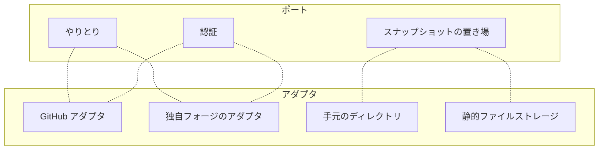

# ポート

バックエンドが外のものを使うときの、ポート（バックエンドが持つインターフェース）を確かめるときに読む。
依存の向きと、ポートを置く理由は、[レイヤー構成](../../architecture.md) が正本である。

## ポートの一覧

| ポート | 扱うもの | ページ |
|---|---|---|
| やりとり | repository の用意、提案（pull request）の作成・反映・close、レビュー、人への依頼 | [やりとり](interaction.md) |
| スナップショットの置き場 | スナップショットとブランチの履歴を読み、worker にブランチの取り込みを頼む（書くのは worker） | [スナップショットの置き場](snapshot-store.md) |
| 認証 | API の要求を送った主体 | [認証](authentication.md) |

- バックエンドは、データを保持しない。そのため、サーバの状態のポートはない（[状態を持たない](../README.md)）。
- git に書くのは、やりとりのポートの「repository を用意する」と「反映する」だけである。どちらも、プロバイダの pull request と repository の操作である。
  - なぜ：版や `main` の更新を、プロバイダの仕組みに任せるため。バックエンドは、git の ref を自前で扱わない。
- [worker](../worker.md) は、ポートを通さずに、git を読み、置き場に書く（[依存するもの](../worker.md)）。

## ポートとアダプタ

- 点線は実装を表す。下のアダプタが、上のポートを実装する。
- やりとりと認証は、構成に合わせて、GitHub アダプタか独自フォージのアダプタの一方が実装する。
- スナップショットの置き場は、構成に合わせて、静的ファイルストレージか手元のディレクトリの一方を使う。どちらも、[worker の内部 API](../worker-api.md) を呼ぶ部分を持つ。
- 各アダプタの詳細は、[アダプタ](../../adapters/README.md) に書く。
