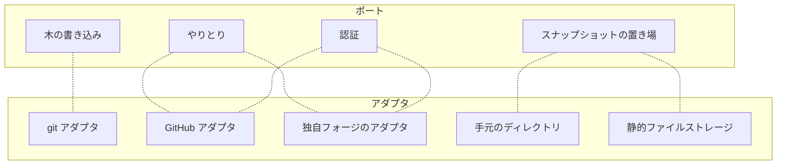

# ポート

バックエンドが外のものを使うときの、ポート（バックエンドが持つインターフェース）を確かめるときに読む。
依存の向きと、ポートを置く理由は、[レイヤー構成](../../architecture.md) が正本である。

## ポートの一覧

| ポート | 扱うもの | ページ |
|---|---|---|
| 木の書き込み | 木の変更を git に書く | [木の書き込み](tree-write.md) |
| やりとり | 提案、レビュー、人への依頼を、プロバイダに書き、読む | [やりとり](interaction.md) |
| スナップショットの置き場 | スナップショットと ref の一覧を読む（書くのは worker） | [スナップショットの置き場](snapshot-store.md) |
| 認証 | API の要求を送った主体 | [認証](authentication.md) |

- バックエンドは、データを保持しない。そのため、サーバの状態のポートはない（[状態を持たない](../README.md)）。
- [worker](../worker.md) は、同じコードの置き場のアダプタで、置き場に書く。

## ポートとアダプタ

- 点線は実装を表す。下のアダプタが、上のポートを実装する。
- git アダプタは、どちらの構成でも同じものを使う。
- やりとりと認証は、構成に合わせて、GitHub アダプタか独自フォージのアダプタの一方を使う。
- スナップショットの置き場は、構成に合わせて、静的ファイルストレージか手元のディレクトリの一方を使う。
- 各アダプタの詳細は、[アダプタ](../../adapters/README.md) に書く。
