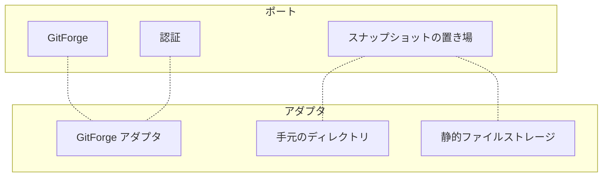

# ポート

バックエンドが外のものを使うときの、ポート（バックエンドが持つインターフェース）を確かめるときに読む。
依存の向きと、ポートを置く理由は、[レイヤー構成](../../architecture.md) が正本である。

## ポートの一覧

| ポート | 扱うもの | ページ |
|---|---|---|
| GitForge | repository の用意、提案（pull request）の作成・反映・close、レビュー、人への依頼 | [GitForge](gitforge.md) |
| スナップショットの置き場 | スナップショットとブランチの履歴を読む（書くのは worker） | [スナップショットの置き場](snapshot-store.md) |
| 認証 | API の要求を送った主体 | [認証](authentication.md) |

- バックエンドは、データを保持しない。そのため、サーバの状態のポートはない（[状態を持たない](../README.md#状態を持たない)）。
- git に書くのは、GitForge のポートの「repository を用意する」と「反映する」だけである（[状態を持たない](../README.md#状態を持たない)）。
- [worker](../worker/README.md) は、ポートにしない。バックエンドは、worker を呼ばない。worker が書いた置き場を、スナップショットの置き場のポートで読むだけである。
- apply request の作成で git を読む作業用の複製も、ポートにしない（[作業用の git の複製](../apply-request/create.md#作業用の-git-の複製)）。
  - なぜ：git は、どの GitForge でも、同じ smart HTTP の fetch で読めるから。違うのは、URL と資格情報だけで、それは GitForge アダプタが渡す。

## ポートとアダプタ

- 点線は実装を表す。下のアダプタが、上のポートを実装する。
- GitForge と認証のポートは、構成に合った 1 つの GitForge アダプタが実装する。GitForge アダプタの種類と各アダプタの詳細は、[アダプタ](../../adapters/README.md) に書く。
- スナップショットの置き場は、構成に合わせて、静的ファイルストレージか手元のディレクトリの一方を使う。どちらも、読むだけである。
