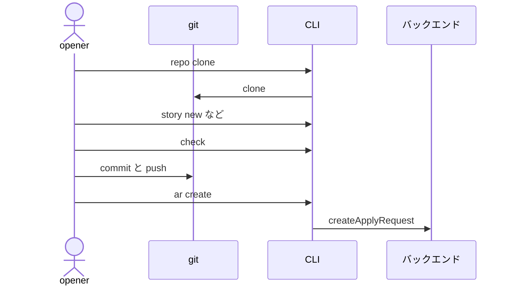

# CLI

opener と reviewer が使う CLI（`logiforge`）を作るときと、使い方を確かめるときに読む。
要件は [CLI](../../docs/cli/README.md) が正本である。このページは、その実現のしかたを書く。

## 形

- CLI は、git とセットで使う。
  - 木を変えるときは、git で clone し、ファイルを変えてコミットし、ブランチを push する。CLI は、ファイルのひな形を作ることと、push したブランチから apply request を作ることを受け持つ。
  - なぜ：gh と同じく、コミットや push は git に任せ、エージェントが使い慣れた手順のままにするため。
- remote は、[GitForge](../README.md#用語) の git リポジトリである。API の `Repository` の `git_url` から求める（[openapi.yaml](../api/openapi.yaml)）。
- CLI のほかのコマンドは、バックエンドの API を呼ぶだけである（[コマンドの一覧](commands.md)）。

## 流れ

- ひな形と `check` は、手元のファイルだけを扱う（[ひな形と check](local.md)）。
- apply request を更新するときは、同じブランチに push するだけである。push された先頭のコミットが、新しい先頭のコミットになる（[先頭のコミット](../backend/apply-request.md#先頭のコミット)）。
- apply request は、GitForge の pull request である。GitForge の画面でも見られる。

## 認証

- CLI は、GitForge のトークンを、バックエンドの API と git の両方で使う。
- Forgejo を使う構成では、トークンのスコープを `read:user`、`read:organization`、`write:repository`、`write:issue` にする。
  - `read:user` と `read:organization`：バックエンドが、`GET /user` と `GET /user/teams` で主体を確かめるため（[Forgejo アダプタ](../adapters/forgejo.md) の「認証」）。
  - `write:repository`：git でブランチを push し、バックエンドが pull request を作り、レビューを書き、merge するため。バックエンドは、主体のトークンで GitForge に書く（[GitForge アダプタの共通の書き方](../adapters/pull-requests.md)）。
  - `write:issue`：バックエンドが、記録のコメントと人への依頼を、主体のトークンで書くため。
  - このトークンは、利用者が Forgejo で書けるすべての repository に書ける。範囲は広いが、受け入れる。なぜ：Forgejo のスコープは repository ごとに絞れないから。
    - 範囲を絞りたいときは、Logiforge のためだけの Forgejo のユーザーを作り、そのトークンを使う。
  - このスコープで push と API が通ることは、動く Forgejo ではまだ確かめていない。
- GitHub を使う構成では、CLI の主体は `client` になる（[GitHub アダプタ](../adapters/github.md) の「認証」）。
  - エージェント（機械用アカウント）には、fine-grained personal access token を使う。Repository access は、登録した repository だけにし、権限は Contents、Issues、Pull requests の Read and write と、Metadata の Read にする。
    - なぜ Issues と Pull requests も書くか：バックエンドが、主体のトークンで、pull request、記録のコメント、レビューを書き、reviewer のトークンで merge するから（[GitForge アダプタの共通の書き方](../adapters/pull-requests.md)）。
  - 人は、gh のトークン（`gh auth token`）でよい。スコープ `repo` は、その人が書けるすべてのリポジトリに及ぶ。人が自分の gh でふだん使っているトークンと同じ範囲なので、受け入れる。
- トークンの置き場所は、次の順に探す。
  1. 環境変数 `LOGIFORGE_TOKEN`
  2. 設定ファイル（`~/.config/logiforge/config.yaml`）の `token`
- `logiforge auth login --with-token` は、トークンを標準入力から読んで、設定ファイルに書く。設定ファイルは、本人だけが読めるようにする。
  - `--token <トークン>` でも渡せるが、コマンドの履歴に残るので、`--with-token` を勧める。
- git には、CLI の credential helper で同じトークンを渡す（`logiforge auth setup-git`）。
  - GitForge には、git の HTTP の Basic 認証のパスワードに、トークンを入れて読み書きできることを求める（[アダプタ](../adapters/README.md)）。ユーザー名は `logiforge` にする。
  - helper は、GitForge の URL にだけ設定する（`credential.<URL>.helper`）。ほかの URL に、トークンを渡さないため。URL は、`--url` か、repository の `git_url` から求める。
  - URL が https でなければ、`--insecure` なしでは設定しない。トークンが平文で流れるため。
  - helper の本体は、`logiforge auth git-credential` である。
- バックエンドの URL は、環境変数 `LOGIFORGE_HOST` か、設定ファイルの `host` に置く。

## repository

- repository の名前は、次の順に探す。
  1. フラグ `--repo`
  2. 環境変数 `LOGIFORGE_REPO`
  3. clone の git の設定 `logiforge.repository`（`repo clone` が書く）
- なぜ：clone の中では、名前を毎回書かずに済むようにするため。

## セッション

- 書き込みのコマンドは、セッション ID を必ず送る（[セッション ID](../api/README.md)）。
- コミットを書いたセッションは、先頭のコミットのメッセージの trailer `Logiforge-Session-Id:` に書く（[セッション](../files/revisions.md#セッション)）。
  - `logiforge commit` は、`git commit` にこの trailer を付けて呼ぶ。`git commit --trailer "Logiforge-Session-Id: <ID>"` と同じである。
  - `check` は、ブランチの先頭のコミットに trailer がなければ、警告する。trailer のない先頭のコミットは `approve` できない。
- セッション ID は、次の順に探す。見つからなければ、書き込みのコマンドは失敗する。
  1. フラグ `--session`
  2. 環境変数 `LOGIFORGE_SESSION_ID`
- CLI は、セッション ID を作らない。
  - なぜ：差分を書いたセッションと reviewer のセッションを分けるのは、CLI を使う側の責任だから（[保証の範囲](../../docs/apply-request/review.md)）。

## 出力

- どのコマンドも、`--json` を付けると、JSON を 1 つ、標準出力に書く。
  - API を呼ぶコマンドは、API の応答をそのまま書く。
  - ひな形のコマンドは、作ったファイルのパスと、決めた識別子を書く。
  - `check` は、見つけた誤りの一覧を書く。
- エラーのときは、終了コードを 0 以外にし、`--json` では API の `Problem` をそのまま書く。
  - CLI の中のエラー（git の失敗など）は、`code` が `cli_error` の `Problem` の形で書く。
  - repository が壊れているときは、木を読むコマンドは、最後に正しかった時点の木を書いたうえで、`code` が `repository_broken` の `Problem` を標準エラーに書き、終了コード 1 で終わる（[壊れた repository](../backend/broken.md)）。
- 終了コードは、成功が 0、エラー（API のエラー、`check` の誤り、git の失敗）が 1、使い方の誤り（知らないコマンド、引数の誤り）が 2 である。

## 要件との対応

| 要件（[CLI](../../docs/cli/README.md)） | 実現 |
|---|---|
| gh に似た CLI | `logiforge <名詞> <動詞>` の形（[コマンドの一覧](commands.md)） |
| すべてのコマンドに `--json` | 上の「出力」 |
| 木を変えるときは apply request を作るか更新する | git で push したブランチから `ar create`。更新は同じブランチへの push |
| 着手できる作業を問い合わせる | `work list` |
| 特定のディレクトリで使う | 木の repository の clone の中で使う |
