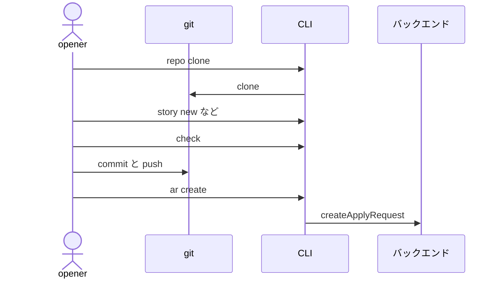

# CLI

opener と reviewer が使う CLI（`logiforge`）を作るときと、使い方を確かめるときに読む。
要件は [CLI](../../docs/cli/README.md) が正本である。
このページには、その実現のしかたを書く。

## 形

- CLI は、git とセットで使う。
  - 木を変えるときは、git で clone し、ファイルを変えてコミットし、ブランチを push する。
  - CLI は、ファイルのひな形を作ることと、push したブランチから apply request を作ることを受け持つ。
  - なぜ：gh と同じく、コミットや push は git に任せ、エージェントが使い慣れた手順のままにするため。
- remote は、[GitForge](../README.md#用語) の git リポジトリである。
  - remote の URL は、API の `Repository` の `git_url` から求める（[openapi.yaml](../api/openapi.yaml)）。
- CLI のほかのコマンドは、バックエンドの API を呼ぶだけである（[コマンドの一覧](commands.md)）。

## 流れ

- ひな形と `check` は、手元のファイルだけを扱う（[ひな形と check](local.md)）。
- apply request を更新するときは、同じブランチに push するだけである。
  - push された先頭のコミットが、新しい先頭のコミットになる（[先頭のコミット](../backend/apply-request/README.md#先頭のコミット)）。
- apply request は、GitForge の pull request である。
  - そのため、GitForge の画面でも見られる。

## 認証

- トークンのスコープ、置き場所、git への渡し方は、[CLI の認証](auth.md) に書く。

## repository

- repository の名前は、次の順に探す。
  1. フラグ `--repo`
  2. 環境変数 `LOGIFORGE_REPO`
  3. clone の git の設定 `logiforge.repository`（`repo clone` が書く）
- なぜ：clone の中では、名前を毎回書かずに済むようにするため。

## 書いた人と確かめる人

- CLI は、セッション ID を送らず、コミットに trailer も付けない。
- 書いた人と確かめる人を分けるのは、GitForge のアカウントである。opener と reviewer は、別のアカウントのトークンで CLI を使う（[数える review](../adapters/pull-requests.md#数える-review)）。

## 出力

- どのコマンドも、`--json` を付けると、JSON を 1 つ、標準出力に書く。
  - API を呼ぶコマンドは、API の応答をそのまま書く。
  - ひな形のコマンドは、作ったファイルのパスと、決めた識別子を書く。
  - `check` は、見つけた誤りの一覧を書く。
- エラーのときは、終了コードを 0 以外にする。
  - `--json` では、API の `Problem` をそのまま書く。
  - CLI の中のエラー（git の失敗など）は、`code` が `cli_error` の `Problem` の形で書く。
- 最新のコミットが valid でないとき、git を読むコマンドと、API の木を読むコマンドは、標準エラーに警告を書き、止めずに続ける。終了コードは変えない（[CLI](../backend/invalid-main.md#cli)）。
- 終了コードは、次のとおりである。
  - 0：成功
  - 1：エラー（API のエラー、`check` の誤り、git の失敗）
  - 2：使い方の誤り（知らないコマンド、引数の誤り）

## 要件との対応

| 要件（[CLI](../../docs/cli/README.md)） | 実現 |
|---|---|
| gh に似た CLI | `logiforge <名詞> <動詞>` の形（[コマンドの一覧](commands.md)） |
| すべてのコマンドに `--json` | 上の「出力」 |
| 木を変えるときは apply request を作るか更新する | git で push したブランチから `ar create`。更新は同じブランチへの push |
| 着手できる作業を問い合わせる | `work list` |
| 特定のディレクトリで使う | 木の repository の clone の中で使う |
