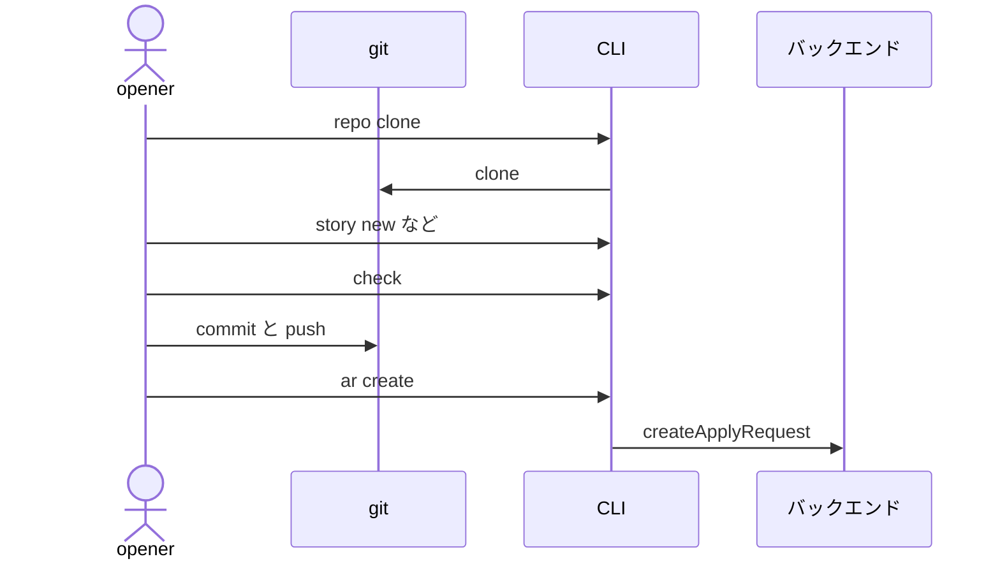

# CLI

opener と reviewer が使う CLI（`logiforge`）を作るときと、使い方を確かめるときに読む。
要件は [CLI](../../docs/cli/README.md) が正本である。このページは、その実現のしかたを書く。

## 形

- CLI は、git とセットで使う。
  - 木を変えるときは、git で clone し、ファイルを変えてコミットし、ブランチを push する。CLI は、ファイルのひな形を作ることと、push したブランチから apply request を作ることを受け持つ。
  - なぜ：gh と同じく、コミットや push は git に任せ、エージェントが使い慣れた手順のままにするため。
- remote は、GitHub を使う構成では GitHub、独自フォージを使う構成では独自フォージである。どちらも、API の `Repository` の `git_url` から求める（[openapi.yaml](../api/openapi.yaml)）。
- CLI のほかのコマンドは、バックエンドの API を呼ぶだけである（[コマンドの一覧](commands.md)）。

## 流れ

- ひな形と `check` は、手元のファイルだけを扱う（[ひな形と check](local.md)）。
- 版を更新するときは、同じブランチに push してから `ar update` を呼ぶ。

## 認証

- CLI は、プロバイダ（GitHub か独自フォージ）のトークンを、バックエンドの API と git の両方で使う。
- トークンの置き場所は、次の順に探す。
  1. 環境変数 `LOGIFORGE_TOKEN`
  2. 設定ファイル（`~/.config/logiforge/config.yaml`）の `token`
- `logiforge auth login` は、トークンを受け取って設定ファイルに書く。設定ファイルは、本人だけが読めるようにする。
- git には、CLI の credential helper で同じトークンを渡す（`logiforge auth setup-git`）。
- バックエンドの URL は、環境変数 `LOGIFORGE_HOST` か、設定ファイルの `host` に置く。

## セッション

- 書き込みのコマンドは、セッション ID を必ず送る（[セッション ID](../api/README.md)）。
- セッション ID は、次の順に探す。見つからなければ、書き込みのコマンドは失敗する。
  1. フラグ `--session`
  2. 環境変数 `LOGIFORGE_SESSION_ID`
- CLI は、セッション ID を作らない。
  - なぜ：差分を書いたセッションと reviewer のセッションを分けるのは、CLI を使う側の責任だから（[保証の範囲](../../docs/apply-request/review.md)）。

## 出力

- どのコマンドも、`--json` を付けると、JSON を 1 つ、標準出力に書く。
  - API を呼ぶコマンドは、API の応答をそのまま書く。
  - ひな形のコマンドは、作ったファイルのパスと、決めた識別子を書く。
  - `check` は、見つけた誤りの一覧を書く。
- エラーのときは、終了コードを 0 以外にし、`--json` では API の `Problem` をそのまま書く。

## 要件との対応

| 要件（[CLI](../../docs/cli/README.md)） | 実現 |
|---|---|
| gh に似た CLI | `logiforge <名詞> <動詞>` の形（[コマンドの一覧](commands.md)） |
| すべてのコマンドに `--json` | 上の「出力」 |
| 木を変えるときは apply request を作るか更新する | git で push したブランチから `ar create`、`ar update` |
| 着手できる作業を問い合わせる | `work list` |
| 特定のディレクトリで使う | 木の repository の clone の中で使う |
