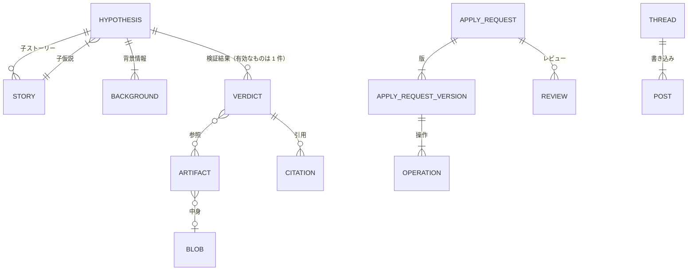

# データ構造

Logiforge が持つデータの形と、要件の不変条件をデータでどう守るかを確かめるときに読む。

## 構造化データとファイル

Logiforge のデータは、次の 2 つに分かれる。

- 構造化データ：木、検証結果、apply request、スレッド、履歴。DB に置く。
  - レポートの本文と、スレッドの書き込みの本文も、DB の行に置く。
- ファイル：artifact の中身。ファイルシステムに置く（[ファイル](files.md)）。

1 つの forge が持つ木は 1 つである（[木の形](../../docs/tree/README.md)）。

## 保存の方式

- 正本は、通常の表に置く。各行は、どのリビジョンから有効かを持つ（[リビジョン](history.md)）。
  - なぜ：「リビジョン r の時点で有効な行」を選ぶだけで、任意の時点の木を作れるから（[監査](../../docs/architecture/README.md)）。
- 作った行は、変えない。
  - 例外は、無効になったときに 1 度だけ埋める列である（[append-only](history.md)）。
- 値と、葉・要再検討・inactive などの状態は、保存せずに計算する。
  - なぜ：保存すると、正本との食い違いを防ぐ仕組みが要るから。
- 監査用に、append-only のイベントログを別に持つ（[イベントログ](history.md)）。正本にはしない。
- DB は RDB にする。既定は SQLite とする。
  - なぜ：不変条件の確認と反映を、1 つのトランザクションで行えるから。
  - なぜ：反映はもともと 1 件ずつ順に行うので、書き込みが 1 本の SQLite で足りるから。
- artifact の中身は、中身のハッシュで名前を決めて置く（[ファイル](files.md)）。
  - なぜ：artifact を変更しないこと（[artifact](../../docs/tree/verdict.md)）を、名前の付け方で守れるから。

## 全体の関係

## ページ

1. [木](tree.md)：仮説、背景情報、ストーリー
2. [検証結果と根拠](verdict.md)：検証結果、artifact、引用
3. [apply request](apply-request.md)：apply request、版、操作、レビュー
4. [スレッド](thread.md)：スレッド、書き込み
5. [リビジョンとイベントログ](history.md)
6. [ファイル](files.md)：artifact の中身
7. [不変条件の守り方](invariants.md)

## 識別子

- 識別子は、種類を表す接頭辞と ULID を `_` でつないだ文字列にする。
  - 例：`hyp_01J...`、`sto_01J...`、`apr_01J...`
  - なぜ：識別子だけで種類がわかり、作った順に並ぶから。
