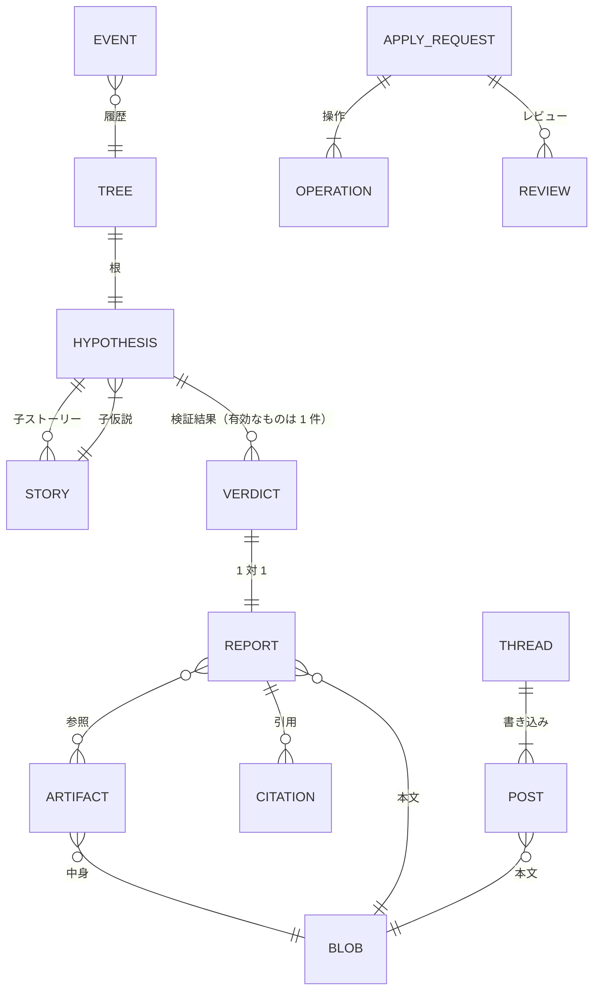

# データ構造

Logiforge が持つデータの形と、要件の不変条件をデータでどう守るかを確かめるときに読む。

## 構造化データとファイル

Logiforge のデータは、次の 2 つに分かれる。

- 構造化データ：木、apply request、スレッド、履歴など。DB に置く。
- ファイル：レポートの本文、artifact、スレッドの書き込みの本文。ファイルシステムに置く。

## 保存の方式

- 正本は、append-only のイベントログにする（[履歴](history.md)）。
  - なぜ：要件の「履歴は append-only」と「任意の時点の木を表示できる」（[監査](../../docs/architecture/README.md)）を、同じ仕組みで満たせるから。
- 現在の木と apply request は、イベントログから作る投影（projection）として持つ。
  - なぜ：参照のたびにイベントを再生すると遅いから。
- DB は RDB にする。既定は SQLite とする。
  - なぜ：不変条件の確認と反映を、1 つのトランザクションで行えるから。
  - なぜ：反映はもともと 1 件ずつ順に行うので、書き込みが 1 本の SQLite で足りるから。
- ファイルは、中身のハッシュで名前を決める CAS に置く（[ファイル](files.md)）。
  - なぜ：artifact を変更しないこと（[artifact](../../docs/tree/verdict.md)）を、名前の付け方で守れるから。

## 全体の関係

## ページ

1. [木](tree.md)：木、仮説、ストーリー
2. [検証結果と根拠](verdict.md)：検証結果、レポート、artifact、引用
3. [apply request](apply-request.md)：apply request、操作、レビュー
4. [スレッド](thread.md)：スレッド、書き込み
5. [履歴](history.md)：イベントログ、リビジョン、投影、任意の時点の再現
6. [ファイル](files.md)：ディレクトリ、命名、構造化データとの対応
7. [不変条件の守り方](invariants.md)

## 識別子

- 識別子は、種類を表す接頭辞と ULID を `_` でつないだ文字列にする。
  - 例：`hyp_01J...`、`sto_01J...`、`apr_01J...`
  - なぜ：識別子だけで種類がわかり、作った順に並ぶから。
