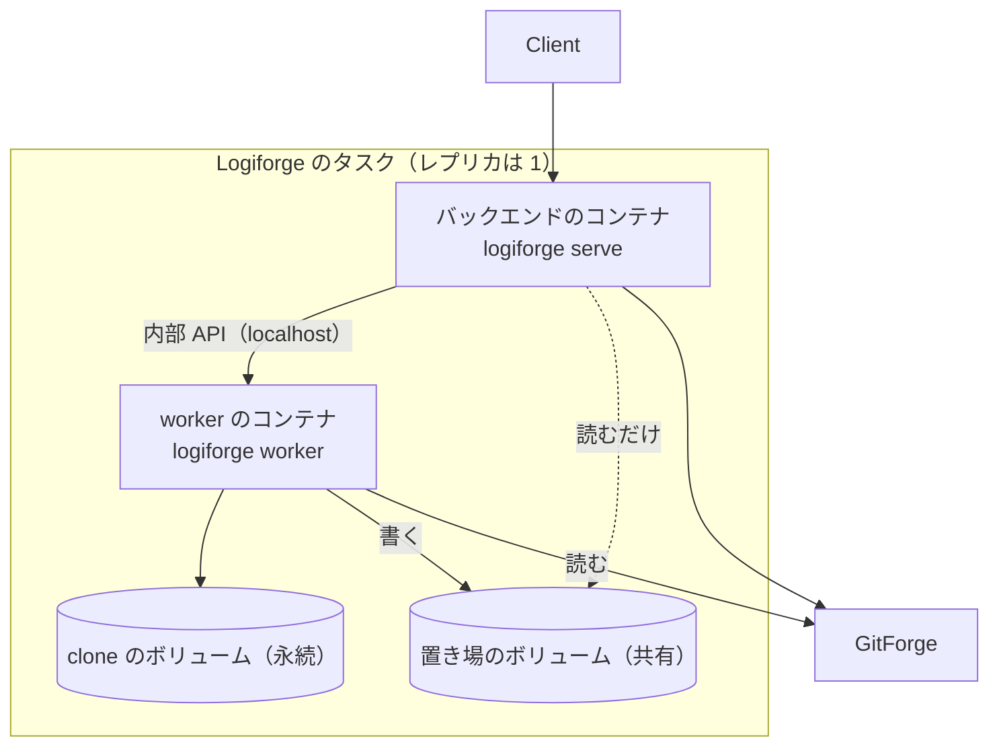

# 動かし方（コンテナ）

バックエンドと worker を、コンテナで動かすときに読む。
プロセスの分け方の理由は [レイヤー構成](architecture.md)、設定の中身は [設定と秘密情報](adapters/README.md#設定と秘密情報) に書く。

## イメージ

- イメージは 1 つである。中身は、`logiforge` のバイナリと git だけである（alpine の上に置く）。
  - なぜ alpine か：worker の git の credential helper が、sh で動くから。distroless には sh がない。
- コンテナごとに、コマンドを変える。
  - バックエンド：`logiforge serve`
  - worker：`logiforge worker`
- root では動かさない。イメージの中のユーザー（uid 10001）で動かす。
- 設定は、環境変数で渡す。秘密は、マウントしたファイルで渡す。
  - 必須の環境変数は、名前に `_FILE` を付けると、その値をファイルのパスとして読み、ファイルの中身を設定にする（例：`LOGIFORGE_WRITER_TOKEN_FILE=/run/secrets/writer_token`）。
  - なぜ：秘密を、コンテナの定義や `docker inspect` の出力に書かずに済むから。

## タスクの形

1 つのタスク（Kubernetes の Pod、ECS のタスク）に、バックエンドのコンテナと worker のコンテナを並べる。



- バックエンドと worker は、同じタスクの中で、localhost の [内部 API](backend/worker-api.md) でつなぐ。
  - worker の内部 API は、`127.0.0.1` で待ち受ける。タスクの外には出さない。
- worker は、clone を置く永続のボリュームを持つ。
  - clone は正本ではない。失っても、worker が clone し直す。ただし、作り直すあいだ、読む側が遅れる。
- 置き場を手元のディレクトリにするとき（Forgejo を使う構成）は、タスクの中で共有のボリュームにする。
  - worker は読み書きし、バックエンドは読むだけでマウントする。
  - 置き場の `branches/` は、バックアップを取る（[組み合わせ](adapters/README.md#組み合わせ)）。そのため、このボリュームも永続にする。
- このタスクは、レプリカを 1 にする。
  - なぜ：worker は 1 つだけ動かすから（[worker](backend/worker.md)）。2 つ目の worker は、ロックが取れずに止まる。
- なぜ 1 つのタスクにまとめるか：内部 API を localhost に閉じ、ボリュームをタスクの中で共有するだけで動くから。動かすものの数が少ない。

### バックエンドだけを増やすとき

バックエンドと worker を、別のタスクに分ける。コードは、そのままで分けられる。

- バックエンドのタスク：レプリカは何台でもよい。バックエンドはデータを保持しない（[状態を持たない](backend/README.md)）。
- worker のタスク：レプリカは 1 にする。永続のボリュームを持つ。
- 内部 API は、タスクの間のネットワークでつなぐ。
  - worker は、`LOGIFORGE_WORKER_ADDR` で、タスクの外から届くアドレスで待ち受ける。
  - 内部 API に届くのは、バックエンドのタスクだけにする（ネットワークの規則で絞る）。内部 API の鍵でも確かめる。
- 置き場は、どのタスクからも読める場所にする（静的ファイルストレージ、[組み合わせ](adapters/README.md#組み合わせ)）。

## ヘルスチェック

| コンテナ | 口 | 認証 |
|---|---|---|
| バックエンド | `GET /healthz`（API と同じポート） | 要らない |
| worker | `GET /healthz`（内部 API と同じポート） | 要らない |

- どちらも、プロセスが要求を受けられれば `200` を返す。
- GitForge や置き場に届くかは、確かめない。
  - なぜ：外のサービスが止まったときに、コンテナを再起動し続けないようにするため。外のサービスに届かないときは、API が `unavailable` を返す（[API](api/README.md)）。
- worker のヘルスチェックは、内部 API と同じく、タスクの中から呼ぶ（例：コンテナの中で `wget`）。

## 環境変数と秘密

Forgejo を使う構成のものを書く。✓ の行は秘密である。秘密は、`_FILE` を付けて、ファイルで渡す。

バックエンド（`logiforge serve`）：

| 名前 | 秘密 | 中身 |
|---|---|---|
| `LOGIFORGE_ADDR` | | 待ち受けるアドレス。既定は `127.0.0.1:8080`。コンテナでは `0.0.0.0:8080` にする |
| `LOGIFORGE_STORE_DIR` | | 置き場（手元のディレクトリ）のパス。読むだけ |
| `LOGIFORGE_WORKER_URL` | | worker の内部 API の URL（例：`http://127.0.0.1:8081`） |
| `LOGIFORGE_INTERNAL_KEY` | ✓ | 内部 API の鍵。worker と同じもの |
| `LOGIFORGE_FORGEJO_URL` | | Forgejo の URL。クライアントに返す git の URL にも使う |
| `LOGIFORGE_FORGEJO_ORG` | | repository を置く organization |
| `LOGIFORGE_USER_TEAM` | | `user` とみなす team |
| `LOGIFORGE_WRITER` | | 書き込み主体（Forgejo のユーザー） |
| `LOGIFORGE_WRITER_TOKEN` | ✓ | 書き込み主体のトークン |
| `LOGIFORGE_WORKER_LOGIN` | | worker のユーザー。API の主体としては受け付けない |
| `LOGIFORGE_RECORD_KEYS` | ✓ | 記録の MAC の鍵（`鍵の ID=鍵,…`。最初のものを書くときに使う） |
| `LOGIFORGE_WAIT_TIMEOUT` | | 書いたものが読む側に出るまで待つ上限。既定は `10s` |

worker（`logiforge worker`）：

| 名前 | 秘密 | 中身 |
|---|---|---|
| `LOGIFORGE_WORKER_ADDR` | | 内部 API を待ち受けるアドレス。既定は `127.0.0.1:8081` |
| `LOGIFORGE_WORKER_DIR` | | clone を置く、永続のボリュームのパス |
| `LOGIFORGE_STORE_DIR` | | 置き場（手元のディレクトリ）のパス。読み書きする |
| `LOGIFORGE_INTERNAL_KEY` | ✓ | 内部 API の鍵。バックエンドと同じもの |
| `LOGIFORGE_FORGEJO_URL` | | Forgejo の URL |
| `LOGIFORGE_FORGEJO_ORG` | | repository を置く organization |
| `LOGIFORGE_WORKER_LOGIN` | | worker のユーザー |
| `LOGIFORGE_WORKER_TOKEN` | ✓ | worker のユーザーのトークン（`read:repository` と `read:organization` だけ） |
| `LOGIFORGE_WORKER_INTERVAL` | | 巡回の間隔。既定は `1m` |
| `LOGIFORGE_READ_BRANCH_TIMEOUT` | | 「ブランチを読む」で `main` の取り込みを待つ上限。既定は `60s` |
| `LOGIFORGE_GIT_ALLOW_PROTOCOL` | | git で使える転送の方式。既定は `https:file`。`http` は、テストのときだけ足す |

## 例：Kubernetes の Pod

秘密は Secret `logiforge`、置き場と clone は PersistentVolumeClaim に置く例である。

```yaml
apiVersion: v1
kind: Pod
metadata:
  name: logiforge
spec:
  securityContext:
    runAsNonRoot: true
    runAsUser: 10001
    fsGroup: 10001
  containers:
    - name: backend
      image: logiforge:latest
      args: ["serve"]
      ports:
        - containerPort: 8080
      env:
        - { name: LOGIFORGE_ADDR, value: "0.0.0.0:8080" }
        - { name: LOGIFORGE_STORE_DIR, value: /var/lib/logiforge/store }
        - { name: LOGIFORGE_WORKER_URL, value: "http://127.0.0.1:8081" }
        - { name: LOGIFORGE_INTERNAL_KEY_FILE, value: /run/secrets/logiforge/internal_key }
        - { name: LOGIFORGE_FORGEJO_URL, value: "https://forgejo.example.com" }
        - { name: LOGIFORGE_FORGEJO_ORG, value: logiforge }
        - { name: LOGIFORGE_USER_TEAM, value: logiforge-users }
        - { name: LOGIFORGE_WRITER, value: logiforge-writer }
        - { name: LOGIFORGE_WRITER_TOKEN_FILE, value: /run/secrets/logiforge/writer_token }
        - { name: LOGIFORGE_WORKER_LOGIN, value: logiforge-reader }
        - { name: LOGIFORGE_RECORD_KEYS_FILE, value: /run/secrets/logiforge/record_keys }
      livenessProbe:
        httpGet: { path: /healthz, port: 8080 }
      volumeMounts:
        - { name: store, mountPath: /var/lib/logiforge/store, readOnly: true }
        - { name: secrets, mountPath: /run/secrets/logiforge, readOnly: true }
    - name: worker
      image: logiforge:latest
      args: ["worker"]
      env:
        - { name: LOGIFORGE_WORKER_DIR, value: /var/lib/logiforge/worker }
        - { name: LOGIFORGE_STORE_DIR, value: /var/lib/logiforge/store }
        - { name: LOGIFORGE_INTERNAL_KEY_FILE, value: /run/secrets/logiforge/internal_key }
        - { name: LOGIFORGE_FORGEJO_URL, value: "https://forgejo.example.com" }
        - { name: LOGIFORGE_FORGEJO_ORG, value: logiforge }
        - { name: LOGIFORGE_WORKER_LOGIN, value: logiforge-reader }
        - { name: LOGIFORGE_WORKER_TOKEN_FILE, value: /run/secrets/logiforge/worker_token }
      livenessProbe:
        exec: { command: ["wget", "-q", "-O", "/dev/null", "http://127.0.0.1:8081/healthz"] }
      volumeMounts:
        - { name: worker, mountPath: /var/lib/logiforge/worker }
        - { name: store, mountPath: /var/lib/logiforge/store }
        - { name: secrets, mountPath: /run/secrets/logiforge, readOnly: true }
  volumes:
    - name: worker
      persistentVolumeClaim: { claimName: logiforge-worker }
    - name: store
      persistentVolumeClaim: { claimName: logiforge-store }
    - name: secrets
      secret: { secretName: logiforge }
```

- Pod を直接置くのは、例を短くするためである。動かすときは、レプリカを 1 にした StatefulSet か Deployment（`strategy: Recreate`）で包む。
  - なぜ `Recreate` か：入れ替えのときに、古い worker と新しい worker が同時に動かないようにするため。
- worker の `livenessProbe` は、`exec` でコンテナの中から `wget` で呼ぶ。
  - なぜ：worker の内部 API は `127.0.0.1` で待ち受けるので、kubelet の `httpGet` は届かないから。

## ローカルと E2E：compose

リポジトリの根の `compose.yaml` は、Forgejo、バックエンド、worker の 3 つのサービスを、1 つのタスクに見立てて動かす。

- バックエンドと worker は、Forgejo のネットワークを共有する（`network_mode: service:forgejo`）。
  - なぜ：Forgejo の URL を、手元のマシンからもコンテナからも、同じ `http://localhost:3000` にするため。バックエンドがクライアントに返す git の URL が、手元のマシンでもそのまま使える。
  - worker の内部 API は `127.0.0.1:8081` で待ち受け、公開しない。届くのは、同じネットワークの中だけである。
- worker は、clone と置き場に、永続のボリュームを持つ。バックエンドは、置き場を読むだけでマウントする。
- 秘密は、compose の `secrets` で、ファイルとして渡す。秘密と、Forgejo の organization、team、ユーザー、トークンは、`scripts/compose-setup.sh` が作る。
- CI は、イメージをビルドし、compose で動かして、repository の作成と読みを確かめる。
- 動かす手順は、[README](../README.md) に書く。
