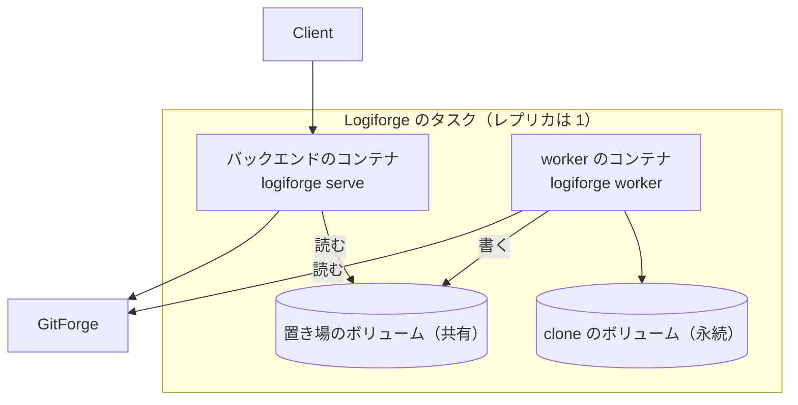

# 動かし方（コンテナ）

バックエンドと worker を、コンテナで動かすときに読む。
プロセスの分け方の理由は [レイヤー構成](architecture.md)、設定の中身は [設定と秘密情報](adapters/README.md#設定と秘密情報) に書く。

## イメージ

- イメージは 1 つである。中身は、`logiforge` のバイナリ（WebUI を含む）と git だけである（alpine の上に置く）。
  - なぜ alpine か：worker の git の credential helper が、sh で動くから。distroless には sh がない。
  - base のイメージは、digest で固定する。なぜ：同じタグのまま中身が変わっても、ビルドの結果が変わらないようにするため。
- コンテナごとに、コマンドを変える。
  - バックエンド：`logiforge serve`
  - worker：`logiforge worker`
- root では動かさない。イメージの中のユーザー（uid 10001）で動かす。
- イメージの `logiforge version` には、ビルドの引数（`VERSION`、`COMMIT`）で、版とコミットを入れる。compose は `LOGIFORGE_VERSION` と `LOGIFORGE_COMMIT` を渡し、CI は `git describe` と `git rev-parse` の値を渡す。渡さなければ `dev` である。
- 同じバイナリを、GitHub Releases にも置く（Linux・macOS・Windows × amd64・arm64、README の「インストール」）。opener と reviewer は、ここから CLI として取る。イメージは、Releases には置かない。
  - なぜ：配り方は Releases に決めたから（issue #27）。コンテナイメージの push、`go install`、Homebrew は、今はしない。
- 設定は、環境変数で渡す。秘密は、マウントしたファイルで渡す。
  - 必須の環境変数は、名前に `_FILE` を付けると、その値をファイルのパスとして読み、ファイルの中身を設定にする（例：`LOGIFORGE_WORKER_TOKEN_FILE=/run/secrets/worker_token`）。
  - なぜ：秘密を、コンテナの定義や `docker inspect` の出力に書かずに済むから。

## タスクの形

1 つのタスク（Kubernetes の Pod、ECS のタスク）に、バックエンドのコンテナと worker のコンテナを並べる。



- バックエンドと worker は、互いを呼ばない。置き場のボリュームを共有するだけである。
  - worker は、どのポートでも待ち受けない（[worker](backend/worker.md)）。
- worker は、clone を置く永続のボリュームを持つ。
  - clone は正本ではない。失っても、worker が clone し直す。ただし、作り直すあいだ、読む側が遅れる。
- 置き場を手元のディレクトリにするとき（Forgejo を使う構成）は、タスクの中で共有のボリュームにする。
  - worker は読み書きし、バックエンドは読むだけでマウントする。
  - 置き場の `branches/` は、バックアップを取る（[組み合わせ](adapters/README.md#組み合わせ)）。そのため、このボリュームも永続にする。
- このタスクは、レプリカを 1 にする。
  - なぜ：worker は 1 つだけ動かすから（[worker](backend/worker.md)）。2 つ目の worker は、ロックが取れずに止まる。
- なぜ 1 つのタスクにまとめるか：ボリュームをタスクの中で共有するだけで動くから。動かすものの数が少ない。

### バックエンドだけを増やすとき

バックエンドと worker を、別のタスクに分ける。コードは、そのままで分けられる。

- バックエンドのタスク：レプリカは何台でもよい。バックエンドはデータを保持しない（[状態を持たない](backend/README.md)）。
- worker のタスク：レプリカは 1 にする。永続のボリュームを持つ。
- 置き場は、どのタスクからも読める場所にする。
  - 今の実装でできるのは、共有のボリューム（NFS、EFS など、複数のノードから mount できるもの。Kubernetes では `ReadWriteMany`）である。worker は読み書きで、バックエンドは読むだけで mount する。
  - 静的ファイルストレージ（[組み合わせ](adapters/README.md#組み合わせ)）は、そのアダプタを作ってからの選択肢である。
- 共有のボリュームでは、ファイルのロック（flock）が効かないことがある。worker が 2 つ動いても、起動のときのロックで止められるとは限らない。
  - そのため、worker が 1 つという決まりは、worker のタスクのレプリカを 1 にし、入れ替えを `Recreate`（か StatefulSet）にすることで守る。
  - 誤って 2 つ動いても、スナップショットツリーもブランチの履歴も壊れない（[worker を 1 つだけ動かす](backend/worker.md#worker-を-1-つだけ動かす)）。
- バックエンドと worker の間のネットワークは、要らない。どちらも置き場と GitForge に届けばよい。

## ヘルスチェック

| コンテナ | 確かめ方 | 認証 |
|---|---|---|
| バックエンド | `GET /healthz`（API と同じポート） | 要らない |
| worker | コンテナの中で `logiforge worker-health` を動かす（exec probe） | 要らない |

- バックエンドは、プロセスが要求を受けられれば `200` を返す。
- `logiforge worker-health` は、worker のハートビートのファイルを見る。新しければ 0、古ければ 0 以外で終わる（[ハートビート](backend/worker.md#ハートビート)）。
  - なぜファイルか：worker は、どのポートでも待ち受けないから。
- GitForge や置き場に届くかは、確かめない。
  - なぜ：外のサービスが止まったときに、コンテナを再起動し続けないようにするため。外のサービスに届かないときは、API が `unavailable` を返す（[API](api/README.md)）。

## 環境変数と秘密

Forgejo を使う構成のものを書く。✓ の行は秘密である。秘密は、`_FILE` を付けて、ファイルで渡す。

バックエンド（`logiforge serve`）：

| 名前 | 秘密 | 中身 |
|---|---|---|
| `LOGIFORGE_ADDR` | | 待ち受けるアドレス。既定は `127.0.0.1:8080`。コンテナでは `0.0.0.0:8080` にする |
| `LOGIFORGE_STORE_DIR` | | 置き場（手元のディレクトリ）のパス。読むだけ |
| `LOGIFORGE_FORGEJO_URL` | | Forgejo の URL。クライアントに返す git の URL にも使う |
| `LOGIFORGE_FORGEJO_ORG` | | repository を置く organization |
| `LOGIFORGE_USER_TEAM` | | `user` とみなす team |
| `LOGIFORGE_WORKER_LOGIN` | | worker のユーザー。API の主体としては受け付けない。apply request の作成で git を読むのにも使う |
| `LOGIFORGE_WORKER_TOKEN` | ✓ | worker のユーザーのトークン（読むだけ）。apply request の作成で、作業用の git の複製に fetch するのに使う |
| `LOGIFORGE_GIT_CACHE_DIR` | | 作業用の git の複製を置く、一時的なディレクトリ。既定は OS の一時ディレクトリ（`/tmp`） |
| `LOGIFORGE_GIT_ALLOW_PROTOCOL` | | git で使える転送の方式。worker と同じ |
| `LOGIFORGE_RECORD_KEYS` | ✓ | 記録の署名の秘密（`鍵の ID=秘密,…`。最初のものを書くときに使う）。Ed25519 の秘密鍵は、秘密の SHA-256 から作る。worker に渡す公開鍵は、`logiforge record-public-keys` が、この環境変数から作って書く |
| `LOGIFORGE_WAIT_TIMEOUT` | | 書いたものが読む側に出るまで待つ上限。既定は `10s` |
| `LOGIFORGE_OAUTH_CLIENT_ID` | | WebUI のサインインに使う、Forgejo の OAuth2 のアプリケーションの client_id（[サインインの中継](webui/oauth-relay.md)） |
| `LOGIFORGE_OAUTH_CLIENT_SECRET` | ✓ | その client secret |
| `LOGIFORGE_OAUTH_REDIRECT_URI` | | Forgejo に登録した `redirect_uri`。登録したものと完全に一致させる |
| `LOGIFORGE_FORGEJO_PUBLIC_URL` | | ブラウザから Forgejo への URL。WebUI のサインインで、authorize に使う。既定は `LOGIFORGE_FORGEJO_URL`。BE から Forgejo への URL（内部の名前など）と、ブラウザからの URL が違う配置で付ける |

worker（`logiforge worker`）：

| 名前 | 秘密 | 中身 |
|---|---|---|
| `LOGIFORGE_WORKER_DIR` | | clone を置く、永続のボリュームのパス |
| `LOGIFORGE_STORE_DIR` | | 置き場（手元のディレクトリ）のパス。読み書きする |
| `LOGIFORGE_FORGEJO_URL` | | Forgejo の URL |
| `LOGIFORGE_FORGEJO_ORG` | | repository を置く organization |
| `LOGIFORGE_WORKER_LOGIN` | | worker のユーザー |
| `LOGIFORGE_WORKER_TOKEN` | ✓ | worker のユーザーのトークン（`read:repository`、`read:organization`、`read:issue` だけ） |
| `LOGIFORGE_RECORD_PUBLIC_KEYS` | | 記録の署名の公開鍵（`鍵の ID=base64,…`。`logiforge record-public-keys` の出力）。反映かの判定で、記録を確かめるのに使う（[反映かの判定](backend/verify.md)）。秘密ではないが、なければ起動しない |
| `LOGIFORGE_WORKER_RECORD_INTERVAL` | | 記録を読んで控えに足す間隔。既定は見回りの間隔。GitHub では `30s`（[記録の控え](backend/verify.md#記録の控え)） |
| `LOGIFORGE_WORKER_INTERVAL` | | 見回りの間隔。既定は `1s`（[見回り](backend/worker.md#見回り)） |
| `LOGIFORGE_WORKER_LIST_INTERVAL` | | repository の一覧を読み直す間隔。既定は `10s`（[見回り](backend/worker.md#見回り)） |
| `LOGIFORGE_GIT_TIMEOUT` | | git の操作 1 回の時間の上限。既定は `10m`（[すること](backend/worker.md#すること)） |
| `LOGIFORGE_GIT_ALLOW_PROTOCOL` | | git で使える転送の方式。既定は `https:file`。`http` は、テストのときだけ足す |

## 例：Kubernetes の Pod

秘密は Secret `logiforge`、置き場と clone は PersistentVolumeClaim に置く例である。

```yaml
apiVersion: v1
kind: Pod
metadata:
  name: logiforge
spec:
  securityContext:
    runAsNonRoot: true
    runAsUser: 10001
    fsGroup: 10001
    seccompProfile: { type: RuntimeDefault }
  containers:
    - name: backend
      image: logiforge:latest
      args: ["serve"]
      securityContext:
        allowPrivilegeEscalation: false
        readOnlyRootFilesystem: true
        capabilities: { drop: [ALL] }
      ports:
        - containerPort: 8080
      env:
        - { name: LOGIFORGE_ADDR, value: "0.0.0.0:8080" }
        - { name: LOGIFORGE_STORE_DIR, value: /var/lib/logiforge/store }
        - { name: LOGIFORGE_FORGEJO_URL, value: "https://forgejo.example.com" }
        - { name: LOGIFORGE_FORGEJO_ORG, value: logiforge }
        - { name: LOGIFORGE_USER_TEAM, value: logiforge-users }
        - { name: LOGIFORGE_WORKER_LOGIN, value: logiforge-reader }
        - { name: LOGIFORGE_WORKER_TOKEN_FILE, value: /run/secrets/logiforge/worker_token }
        - { name: LOGIFORGE_RECORD_KEYS_FILE, value: /run/secrets/logiforge/record_keys }
      livenessProbe:
        httpGet: { path: /healthz, port: 8080 }
      readinessProbe:
        httpGet: { path: /healthz, port: 8080 }
      volumeMounts:
        - { name: store, mountPath: /var/lib/logiforge/store, readOnly: true }
        - { name: tmp, mountPath: /tmp }
        - { name: secrets, mountPath: /run/secrets/logiforge, readOnly: true }
    - name: worker
      image: logiforge:latest
      args: ["worker"]
      securityContext:
        allowPrivilegeEscalation: false
        readOnlyRootFilesystem: true
        capabilities: { drop: [ALL] }
      env:
        - { name: LOGIFORGE_WORKER_DIR, value: /var/lib/logiforge/worker }
        - { name: LOGIFORGE_STORE_DIR, value: /var/lib/logiforge/store }
        - { name: LOGIFORGE_FORGEJO_URL, value: "https://forgejo.example.com" }
        - { name: LOGIFORGE_FORGEJO_ORG, value: logiforge }
        - { name: LOGIFORGE_WORKER_LOGIN, value: logiforge-reader }
        - { name: LOGIFORGE_WORKER_TOKEN_FILE, value: /run/secrets/logiforge/worker_token }
        - { name: LOGIFORGE_RECORD_PUBLIC_KEYS_FILE, value: /run/secrets/logiforge/record_public_keys }
      livenessProbe:
        exec: { command: ["logiforge", "worker-health"] }
      volumeMounts:
        - { name: worker, mountPath: /var/lib/logiforge/worker }
        - { name: store, mountPath: /var/lib/logiforge/store }
        - { name: tmp, mountPath: /tmp }
        - { name: secrets, mountPath: /run/secrets/logiforge, readOnly: true }
  volumes:
    - name: worker
      persistentVolumeClaim: { claimName: logiforge-worker }
    - name: store
      persistentVolumeClaim: { claimName: logiforge-store }
    - name: secrets
      secret: { secretName: logiforge }
    - name: tmp
      emptyDir: {}
```

- Pod を直接置くのは、例を短くするためである。動かすときは、レプリカを 1 にした StatefulSet か Deployment（`strategy: Recreate`）で包む。
  - なぜ `Recreate` か：入れ替えのときに、古い worker と新しい worker が同時に動かないようにするため。
- ルートのファイルシステムは、読むだけにする（`readOnlyRootFilesystem`）。書く場所は、ボリュームと、`/tmp` の `emptyDir` だけである。
  - バックエンドの `/tmp` には、作業用の git の複製を置く（[作業用の git の複製](backend/apply-request.md#作業用の-git-の複製)）。
    - 目安の大きさは、repository の数 × clone 1 つの大きさである。clone は、artifact の中身を含むので、repository ごとに数十 MB から数百 MB である（[費用と規模の見積もり](estimates.md)）。repository 30 個で、数 GB になる。
    - 複製を消す仕組みは、作らない。`emptyDir` の大きさの上限（`sizeLimit`）は、目安に余裕を足して決める。
    - 上限を超えると、Pod が作り直される。複製は使い捨てのキャッシュなので、作り直された Pod は、要求ごとに空から clone し直す。そのあいだ、初めての `ar create` が遅くなるだけで、壊れるものはない。
    - バックエンドは、起動のときに、`LOGIFORGE_GIT_CACHE_DIR` の下の古い複製（`workcopy-*`）を消す。そのため、`LOGIFORGE_GIT_CACHE_DIR` は、プロセスごとの場所にする。1 台のマシンで、コンテナに分けずにバックエンドを何台か動かすときは、それぞれに別の場所を渡す。
- worker の `livenessProbe` は、`exec` で `logiforge worker-health` を動かす（[ヘルスチェック](#ヘルスチェック)）。

## ローカルと E2E：compose

リポジトリの根の `compose.yaml` は、Forgejo、バックエンド、worker の 3 つのサービスを、1 つのタスクに見立てて動かす。

- バックエンドと worker は、Forgejo のネットワークを共有する（`network_mode: service:forgejo`）。
  - なぜ：Forgejo の URL を、手元のマシンからもコンテナからも、同じ `http://localhost:3000` にするため。バックエンドがクライアントに返す git の URL が、手元のマシンでもそのまま使える。
- worker は、clone と置き場に、永続のボリュームを持つ。バックエンドは、置き場を読むだけでマウントする。
- 秘密は、compose の `secrets` で、ファイルとして渡す。秘密と、Forgejo の organization、team、ユーザー、トークンは、`scripts/compose-setup.sh` が作る。setup に使った admin のトークンは、最後に消す。
- バックエンドと worker は Forgejo のネットワークを共有するので、Forgejo だけが再起動したときは、2 つを作り直す（手順は README）。
- CI は、イメージをビルドし、compose で動かして、repository の作成と読みを確かめる。
- 動かす手順は、[README](../README.md) に書く。
