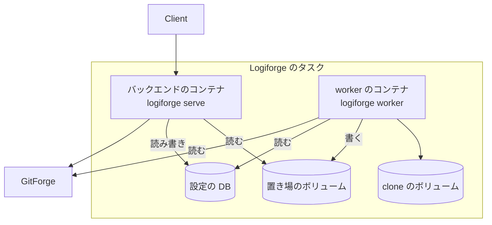

# 動かし方（コンテナ）

バックエンドと worker を、コンテナで動かすときに読む。
プロセスの分け方の理由は [レイヤー構成](../architecture.md)、設定の中身は [設定](../settings/README.md) に書く。

- 起動時に渡す環境変数の一覧は、[環境変数](env.md) に書く。
- Kubernetes で動かす例は、[例：Kubernetes の Pod](kubernetes.md) に書く。

## イメージ

- イメージは 1 つである。中身は、`logiforge` のバイナリ（WebUI を含む）と git だけである（alpine の上に置く）。
  - なぜ alpine か：worker の git の credential helper が、sh で動くから。distroless には sh がない。
  - base のイメージは、digest で固定する。なぜ：同じタグのまま中身が変わっても、ビルドの結果が変わらないようにするため。
- コンテナごとに、コマンドを変える。
  - バックエンド：`logiforge serve`
  - worker：`logiforge worker`
- root では動かさない。イメージの中のユーザー（uid 10001）で動かす。
- イメージの `logiforge version` には、ビルドの引数（`VERSION`、`COMMIT`）で、版とコミットを入れる。compose は `LOGIFORGE_VERSION` と `LOGIFORGE_COMMIT` を渡し、CI は `git describe` と `git rev-parse` の値を渡す。渡さなければ `dev` である。
- 同じバイナリを、GitHub Releases にも置く（Linux・macOS・Windows × amd64・arm64、[インストール](../../docs/install.md)）。opener と reviewer は、ここから CLI として取る。
- イメージは、Releases には置かない。
- コンテナイメージの registry への push、`go install`、Homebrew では配らない。
- 起動時に渡すもの（設定の DB の場所、2 つの鍵、ホストに結び付くもの）は、環境変数で渡す。ほかの設定は、設定の DB に置く（[設定](../settings/README.md)）。
  - 鍵は、マウントしたファイルで渡す（`_FILE`。[環境変数](env.md)）。
  - バックエンドには、バックエンドの鍵と共有の鍵の 2 つを渡す。worker には、共有の鍵だけを渡す（[秘密の暗号化](../settings/secrets.md#2-つの鍵)）。

## タスクの形

1 つのタスク（Kubernetes の Pod、ECS のタスク）に、バックエンドのコンテナと worker のコンテナを並べる。

- バックエンドと worker は、互いを呼ばない。置き場のボリュームと、設定の DB のファイルを共有するだけである。
  - worker は、どのポートでも待ち受けない（[worker](../backend/worker/README.md)）。
- worker は、clone を置く永続のボリュームを持つ。
  - clone は正本ではない。失っても、worker が clone し直す。ただし、作り直すあいだ、読む側が遅れる。
- 置き場を手元のディレクトリにするときは、タスクの中で共有のボリュームにする。
  - worker は読み書きし、バックエンドは読むだけでマウントする。
  - 置き場の `keep/` は、バックアップを取る（[組み合わせ](../adapters/README.md#組み合わせ)）。そのため、このボリュームも永続にする。
- 設定の DB のファイルは、置き場と同じ永続のボリュームか、タスクの中で共有する別の永続のボリュームに置く。
  - バックエンドは読み書きし、worker は読むだけで開く（[設定の DB](../settings/database.md#db-の種類)）。
  - NFS など、ネットワークのファイルシステムのボリュームには置かない。なぜ：SQLite のロックが効かないことがあるから。
  - 設定の DB は、バックアップを取る（[バックアップ](../settings/README.md#バックアップ)）。
- このタスクは、レプリカを 1 にする。
  - なぜ：worker は 1 つだけ動かすから（[worker](../backend/worker/README.md)）。2 つ目の worker は、ロックが取れずに止まる。
- なぜ 1 つのタスクにまとめるか：ボリュームをタスクの中で共有するだけで動くから。動かすものの数が少ない。

## バックエンドだけを増やすとき

バックエンドと worker を、別のタスクに分ける。コードは、そのままで分けられる。

- バックエンドのタスク：レプリカは何台でもよい。バックエンドはデータを保持しない（[状態を持たない](../backend/README.md)）。
- worker のタスク：レプリカは 1 にする。永続のボリュームを持つ。
- 置き場は、どのタスクからも読める場所にする。
  - 共有のボリューム（NFS、EFS など、複数のノードから mount できるもの。Kubernetes では `ReadWriteMany`）。worker は読み書きで、バックエンドは読むだけで mount する。
  - 静的ファイルストレージ（[スナップショットの置き場のアダプタ](../adapters/snapshot-store.md)）。
- 共有のボリュームでは、ファイルのロック（flock）が効かないことがある。worker が 2 つ動いても、起動のときのロックで止められるとは限らない。
  - そのため、worker が 1 つという決まりは、worker のタスクのレプリカを 1 にし、入れ替えを `Recreate`（か StatefulSet）にすることで守る。
  - 誤って 2 つ動いても、スナップショットツリーもブランチの履歴も壊れない（[worker を 1 つだけ動かす](../backend/worker/operation.md#worker-を-1-つだけ動かす)）。
- 分けたタスクは、同じノードに置き、設定の DB のファイルを、そのノードのボリュームで共有する。
  - なぜ：設定の DB は SQLite で、ネットワークのファイルシステムに置けず、複数のノードから開けないから（[設定の DB](../settings/database.md#db-の種類)）。
  - 複数のノードに並べるには、設定の DB に、ほかの DB のアダプタが要る。
- バックエンドと worker の間のネットワークは、要らない。どちらも置き場、設定の DB、GitForge に届けばよい。

## ヘルスチェック

| コンテナ | 確かめ方 | 認証 |
|---|---|---|
| バックエンド | `GET /healthz`（API と同じポート） | 要らない |
| worker | コンテナの中で `logiforge worker-health` を動かす（exec probe） | 要らない |

- バックエンドは、プロセスが要求を受けられれば `200` を返す。
- `logiforge worker-health` は、worker のハートビートのファイルを見る。新しければ 0、古ければ 0 以外で終わる（[ハートビート](../backend/worker/operation.md#ハートビート)）。
  - なぜファイルか：worker は、どのポートでも待ち受けないから。
- セットアップが終わるまでも、ヘルスチェックは通る。
  - バックエンドは、`/healthz` に `200` を返し、ほかの API には `setup_required` を返す（[セットアップの API](../api/endpoints/setup.md#セットアップが終わるまでのほかの-api)）。
  - worker は、見回りをせずに待ち、ハートビートは書き続ける（[ハートビート](../backend/worker/operation.md#ハートビート)）。
  - なぜ：セットアップのあいだに、コンテナが再起動され続けないようにするため。
- GitForge や置き場に届くかは、確かめない。
  - なぜ：外のサービスが止まったときに、コンテナを再起動し続けないようにするため。外のサービスに届かないときは、API が `unavailable` を返す（[API](../api/README.md)）。

## ローカルと E2E：compose

リポジトリの根の `compose.yaml` は、Forgejo、バックエンド、worker の 3 つのサービスを、1 つのタスクに見立てて動かす。

- バックエンドと worker は、Forgejo のネットワークを共有する（`network_mode: service:forgejo`）。
  - なぜ：Forgejo の URL を、手元のマシンからもコンテナからも、同じ `http://localhost:3000` にするため。バックエンドがクライアントに返す git の URL が、手元のマシンでもそのまま使える。
- worker は、clone と置き場に、永続のボリュームを持つ。バックエンドは、置き場を読むだけでマウントする。
- 秘密は、compose の `secrets` で、ファイルとして渡す。秘密と、Forgejo の organization、team、ユーザー、トークンは、`scripts/compose-setup.sh` が作る。setup に使った admin のトークンは、最後に消す。
- バックエンドと worker は Forgejo のネットワークを共有するので、Forgejo だけが再起動したときは、2 つを作り直す（[compose で動かす](../../docs/development/compose.md)）。
- CI は、イメージをビルドし、compose で動かして、repository の作成と読みを確かめる。
- 動かす手順は、[compose で動かす](../../docs/development/compose.md) に書く。
