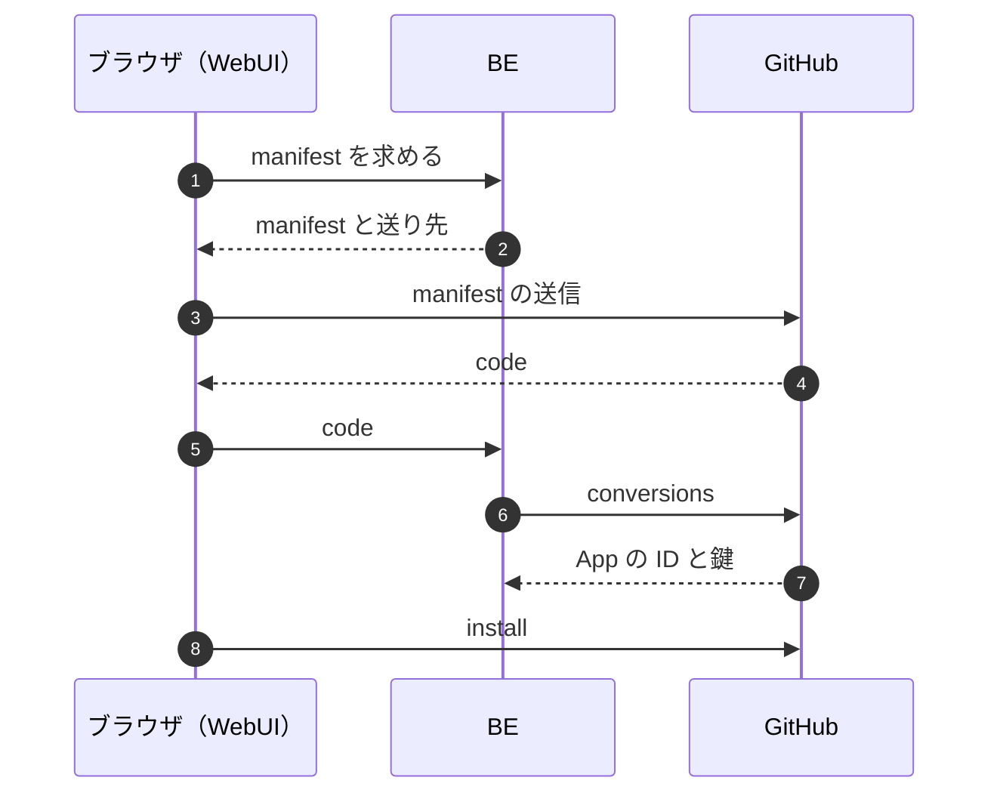

# 初回のセットアップ

設定の DB が空のときに、最初の設定と最初の利用者を決める流れを確かめるときに読む。
画面は、[セットアップの画面](../../docs/webui/setup.md) に書く。API は、[セットアップの API](../api/endpoints/setup.md) に書く。

## だれがセットアップできるか

- セットアップが終わるまでは、だれでも `/setup` を開き、最初の段から進められる。
- 最後の段でサインインした人が、最初の利用者になる（[流れ](#流れ) の 5）。
- セットアップが終わったら、セットアップの API は `setup_done`（409）を返す。画面は使えなくなる。

### 受け入れる危険

- ほかの人が、先にセットアップを終えることがある。
- そうなったら、設定の DB を消し、バックエンドを起動し直して、セットアップをやり直す。
- なぜ受け入れるか：セットアップの前は、サーバにデータがなく、失うものがないから。セットアップをコードで守るのは、守るものに比べて重すぎる。

## 流れ

1. サーバを起動する人が、設定の DB の場所と 2 つの鍵だけを渡して、バックエンドと worker を起動する。
2. WebUI のセットアップの画面で、構成（GitHub か Forgejo）を選び、GitForge の設定を入れる（下の 2 つの節）。
3. GitHub の構成では、最初の repository を登録する（名前と `owner/name`。ディレクトリの repository ならパスも。[repository の登録](../adapters/README.md#repository-の登録)）。
4. その GitForge でサインインする（[サインイン](../webui/auth.md)）。
5. バックエンドは、サインインした主体が `user` であることを確かめる（[利用者の決め方](users.md#利用者の決め方)）。記録の署名の鍵を 1 つ作る。セットアップを終わりにする。
   - GitHub の構成では、3 の repository に Write 以上がなければ、断る（`forbidden`）。
   - Forgejo の構成では、organization の team で `write` 以上がなければ、断る。
   - 置き場に、すでに取り込んだ repository があれば（置き場の `repositories` か `keep/records` がある）、断る（`validation_failed`）。3 で登録しただけの repository は、まだ置き場にない。worker は、セットアップが終わるまで見回らないから。
   - なぜ：新しい鍵では、それまでの記録を確かめられず、repository が壊れた状態になるから。初回のセットアップは、空の置き場で行う。
6. 利用者が、[設定の画面](../../docs/webui/settings.md) で、ほかの repository を登録する。

- 3 までに入れた設定は、そのつど設定の DB に置く。途中でページを閉じても、バックエンドを起動し直しても、続きから進める。

## GitHub を使う構成：App を manifest flow で作る

1. App を作る owner（organization かアカウント）と、WebUI の URL を入れる。
2. BE は、manifest と、送り先の URL を返す。
   - organization なら `https://github.com/organizations/<org>/settings/apps/new`、アカウントなら `https://github.com/settings/apps/new` である。
3. ブラウザは、manifest をフォームで GitHub に送る。GitHub の画面で App を作る。
   - App を作る owner の admin の権限が要る（organization なら organization の owner）。
   - 送り先の URL に `state` を付ける。`state` は、ブラウザが作る乱数で、`sessionStorage` に置く。
4. GitHub は、manifest の `redirect_url`（WebUI の `/setup/github/callback`）に、`code` と `state` を付けて戻す。
   - ブラウザは、`state` が置いたものと合わなければ、`code` を BE に送らない。
5. ブラウザは、`code` を BE に送る。
6. BE は、`POST /app-manifests/{code}/conversions` を呼び、App の ID、slug、client_id、client secret、秘密鍵を、設定の DB に置く。
   - code は 1 時間で切れる。切れたら、2 からやり直す。
   - webhook の secret は、置かない。Webhook を使わないから。
7. App を、登録する GitHub リポジトリの owner に install する。
   - install する owner の admin の権限が要る（organization なら organization の owner）。

manifest の中身：

- 権限は、[GitHub App](../adapters/github-app.md#github-app) の表のとおりにする。
- `default_events` は空にする。Webhook は使わない。
- Webhook の設定（`hook_attributes`）は manifest に入れない。
  - なぜ：GitHub は、`active` が `false` でも hook の URL を確かめ、`127.0.0.1` のようなインターネットから届かない URL を断るから。
- `callback_urls` は、WebUI の `/oauth/callback` にする（[サインインの流れ](../webui/signin-flow.md)）。
- `public` は、ほかの owner にも install するときだけ `true` にする。画面で選ぶ。
  - なぜ：`public` が `false` の App は、App を作った owner にしか install できないから。

## Forgejo を使う構成

1. Forgejo の URL（BE から、ブラウザから）と organization を入れる。
2. Forgejo で OAuth2 のアプリケーション（confidential client）を作り、client_id と client secret を入れる。
   - 画面は、登録する `redirect_uri`（WebUI の `/oauth/callback`）を示す。
3. worker のユーザーとトークン（`read:repository`、`read:organization`、`read:issue`）を入れる。worker のユーザーは、organization の読むだけの team にだけ入れる（[worker のトークンを確かめる](../adapters/forgejo.md#worker-のトークンを確かめる)）。
4. BE は、置く前に、トークンでそのユーザーと organization を読めることを確かめる。読めなければ `validation_failed` を返す。
