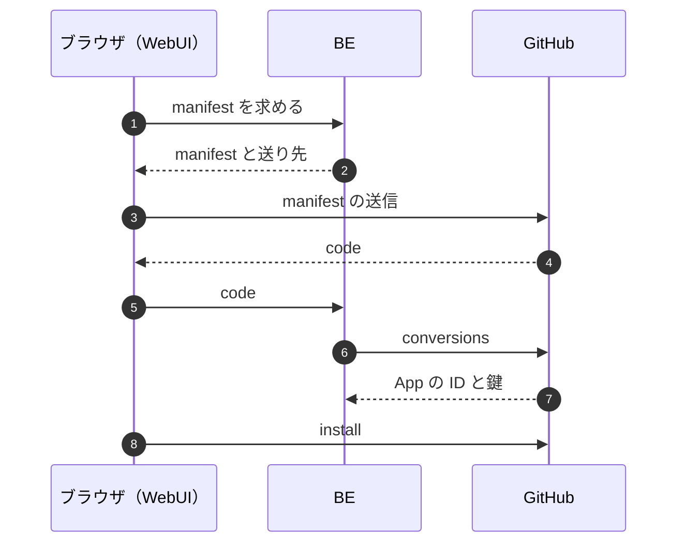

# 初回のセットアップ

設定の DB が空のときに、最初の設定と最初の利用者を決める流れを確かめるときに読む。
画面は、[セットアップの画面](../../docs/webui/setup.md) に書く。API は、[セットアップの API](../api/endpoints/setup.md) に書く。

## セットアップのコード

- バックエンドは、起動したときにセットアップが終わっていなければ、セットアップのコードを作り、ログに出す。
  - コードは、128 ビットの乱数を base32 にしたものである。
  - 設定の DB には、コードの SHA-256 だけを置く（[設定の DB](database.md) の `setup`）。
  - 起動するたびに作り直す。前のコードは使えなくなる。
  - 同じ設定の DB を使うバックエンドが何台かあるときは、最後に起動したバックエンドのログのコードだけが使える。
- セットアップの API は、どれも、このコードを `Logiforge-Setup-Code` ヘッダーで求める。合わなければ `unauthenticated`（401）を返す。
  - 比べるときは、かかる時間がコードによらない比べ方をする。
  - 送り元の IP ごとに、1 分に 10 回までにする。
- なぜログに出すコードで守るか：サーバのログを読めるのは、サーバを動かす人だけだから。最初の利用者が決まる前に、ほかの人に設定を取られないようにするため。
- セットアップが終わったら、コードは使えなくなる。セットアップの API は `setup_done`（409）を返す。

## 流れ

1. サーバを動かす人が、設定の DB の場所と 2 つの鍵だけを渡して、バックエンドと worker を起動する。
2. サーバを動かす人が、ログのコードを、WebUI のセットアップの画面に入れる。
3. サーバを動かす人が、構成（GitHub か Forgejo）を選び、GitForge の設定を入れる（下の 2 つの節）。
4. GitHub の構成では、最初の repository を登録する（名前と `owner/name`。ディレクトリの repository ならパスも。[repository の登録](../adapters/README.md#repository-の登録)）。
5. サーバを動かす人が、その GitForge でサインインする（[サインイン](../webui/auth.md)）。
6. バックエンドは、サインインした主体が `user` であることを確かめる（[利用者の決め方](users.md#利用者の決め方)）。記録の署名の鍵を 1 つ作る。セットアップを終わりにする。
   - GitHub の構成では、4 の repository に Write 以上がなければ、断る（`forbidden`）。
   - Forgejo の構成では、organization の team で `write` 以上がなければ、断る。
   - 置き場に、すでに取り込んだ repository があれば（置き場の `repositories` か `keep/records` がある）、断る（`validation_failed`）。4 で登録しただけの repository は、まだ置き場にない。worker は、セットアップが終わるまで見回らないから。
   - なぜ：新しい鍵では、それまでの記録を確かめられず、repository が壊れた状態になるから。初回のセットアップは、空の置き場で行う。
7. 利用者が、[設定の画面](../../docs/webui/settings.md) で、ほかの repository を登録する。

- 3 までに入れた設定は、そのつど設定の DB に置く。途中で起動し直しても、新しいコードで続きから進める。

## GitHub を使う構成：App を manifest flow で作る

1. サーバを動かす人が、App を作る owner（organization かアカウント）と、WebUI の URL を入れる。
2. BE は、manifest と、送り先の URL を返す。
   - organization なら `https://github.com/organizations/<org>/settings/apps/new`、アカウントなら `https://github.com/settings/apps/new` である。
3. ブラウザは、manifest をフォームで GitHub に送る。サーバを動かす人が、GitHub の画面で App を作る。
   - App を作る owner の管理者の権限が要る。
   - 送り先の URL に `state` を付ける。`state` は、ブラウザが作る乱数で、`sessionStorage` に置く。
4. GitHub は、manifest の `redirect_url`（WebUI の `/setup/github/callback`）に、`code` と `state` を付けて戻す。
   - ブラウザは、`state` が置いたものと合わなければ、`code` を BE に送らない。
5. ブラウザは、`code` を BE に送る。
6. BE は、`POST /app-manifests/{code}/conversions` を呼び、App の ID、slug、client_id、client secret、秘密鍵を、設定の DB に置く。
   - code は 1 時間で切れる。切れたら、2 からやり直す。
   - webhook の secret は、置かない。Webhook を使わないから。
7. サーバを動かす人が、App を、登録する GitHub リポジトリの owner に install する。
   - install する owner の管理者の権限が要る。

manifest の中身：

- 権限は、[GitHub App](../adapters/github-app.md#github-app) の表のとおりにする。
- `default_events` は空にし、Webhook は使わない（`hook_attributes` の `active` を `false`）。
- `callback_urls` は、WebUI の `/oauth/callback` にする（[サインインの流れ](../webui/signin-flow.md)）。
- `public` は、ほかの owner にも install するときだけ `true` にする。画面で選ぶ。
  - なぜ：`public` が `false` の App は、App を作った owner にしか install できないから。

## Forgejo を使う構成

1. サーバを動かす人が、Forgejo の URL（BE から、ブラウザから）と organization を入れる。
2. サーバを動かす人が、Forgejo で OAuth2 のアプリケーション（confidential client）を作り、client_id と client secret を入れる。
   - 画面は、登録する `redirect_uri`（WebUI の `/oauth/callback`）を示す。
3. サーバを動かす人が、worker のユーザーとトークン（`read:repository`、`read:organization`、`read:issue`）を入れる。worker のユーザーは、organization の読むだけの team にだけ入れる（[worker のトークンを確かめる](../adapters/forgejo.md#worker-のトークンを確かめる)）。
4. BE は、置く前に、トークンでそのユーザーと organization を読めることを確かめる。読めなければ `validation_failed` を返す。
