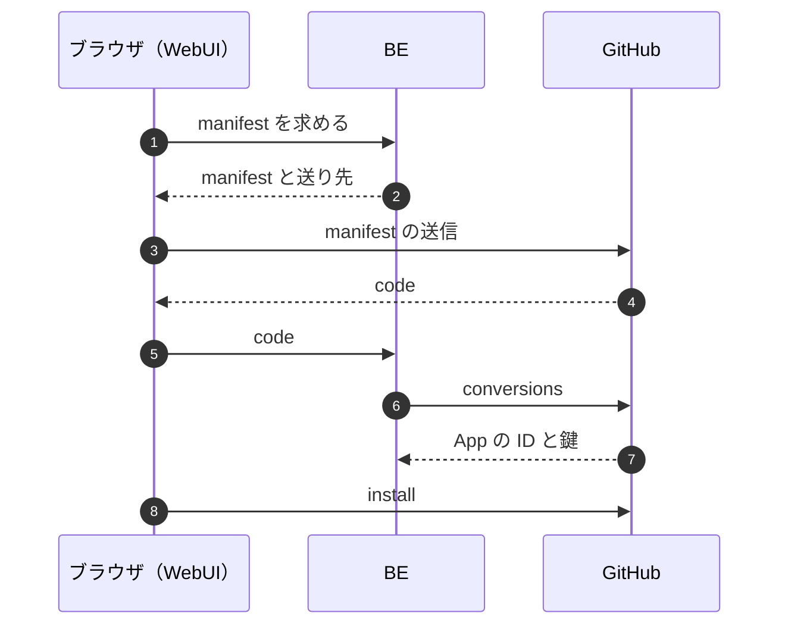

# 初回のセットアップ

設定の DB が空のときに、最初の設定と最初の管理者を決める流れを確かめるときに読む。
画面は、[セットアップの画面](../../docs/webui/setup.md) に書く。API は、[セットアップの API](../api/endpoints/setup.md) に書く。

## セットアップのコード

- バックエンドは、起動したときにセットアップが終わっていなければ、セットアップのコードを作り、ログに出す。
  - コードは、128 ビットの乱数を base32 にしたものである。
  - 設定の DB には、コードの SHA-256 だけを置く（[設定の DB](database.md) の `setup`）。
  - 起動するたびに作り直す。前のコードは使えなくなる。
- セットアップの API は、どれも、このコードを `Logiforge-Setup-Code` ヘッダーで求める。合わなければ `unauthenticated`（401）を返す。
  - 比べるときは、かかる時間がコードによらない比べ方をする。
  - 送り元の IP ごとに、1 分に 10 回までにする。
- なぜログに出すコードで守るか：サーバのログを読めるのは、サーバを動かす管理者だけだから。最初の管理者が決まる前に、ほかの人に設定を取られないようにするため。
- セットアップが終わったら、コードは使えなくなる。セットアップの API は `setup_done`（409）を返す。

## 流れ

1. 管理者が、設定の DB の場所と 2 つの鍵だけを渡して、バックエンドと worker を起動する。
2. 管理者が、ログのコードを、WebUI のセットアップの画面に入れる。
3. 管理者が、構成（GitHub か Forgejo）を選び、GitForge の設定を入れる（下の 2 つの節）。
4. 管理者が、その GitForge でサインインする（[サインイン](../webui/auth.md)）。
5. バックエンドは、サインインした主体を、最初の管理者と `user` にする。記録の署名の鍵を 1 つ作る。セットアップを終わりにする。
6. 管理者が、[設定の画面](../../docs/webui/settings.md) で、repository と `user` を登録する。

- 3 までに入れた設定は、そのつど設定の DB に置く。途中で起動し直しても、新しいコードで続きから進める。

## GitHub を使う構成：App を manifest flow で作る

1. 管理者が、App を作る owner（organization かアカウント）と、WebUI の URL を入れる。
2. BE は、manifest と、送り先の URL を返す。
   - organization なら `https://github.com/organizations/<org>/settings/apps/new`、アカウントなら `https://github.com/settings/apps/new` である。
3. ブラウザは、manifest をフォームで GitHub に送る。管理者が、GitHub の画面で App を作る。
   - 送り先の URL に `state` を付ける。`state` は、ブラウザが作る乱数で、`sessionStorage` に置く。
4. GitHub は、manifest の `redirect_url`（WebUI の `/setup/github/callback`）に、`code` と `state` を付けて戻す。
   - ブラウザは、`state` が置いたものと合わなければ、`code` を BE に送らない。
5. ブラウザは、`code` を BE に送る。
6. BE は、`POST /app-manifests/{code}/conversions` を呼び、App の ID、slug、client_id、client secret、秘密鍵を、設定の DB に置く。
   - code は 1 時間で切れる。切れたら、2 からやり直す。
   - webhook の secret は、置かない。Webhook を使わないから。
7. 管理者が、App を、登録する GitHub リポジトリの owner に install する。

manifest の中身：

- 権限は、[GitHub App](../adapters/github-app.md#github-app) の表のとおりにする。
- `default_events` は空にし、Webhook は使わない（`hook_attributes` の `active` を `false`）。
- `callback_urls` は、WebUI の `/oauth/callback` にする（[サインインの流れ](../webui/signin-flow.md)）。
- `public` は、ほかの owner にも install するときだけ `true` にする。画面で選ぶ。
  - なぜ：`public` が `false` の App は、App を作った owner にしか install できないから。

## Forgejo を使う構成

1. 管理者が、Forgejo の URL（BE から、ブラウザから）と organization を入れる。
2. 管理者が、Forgejo で OAuth2 のアプリケーション（confidential client）を作り、client_id と client secret を入れる。
   - 画面は、登録する `redirect_uri`（WebUI の `/oauth/callback`）を示す。
3. 管理者が、worker のユーザーとトークン（`read:repository`、`read:organization`、`read:issue`）を入れる（[Forgejo アダプタ](../adapters/forgejo.md)）。
4. BE は、置く前に、トークンでそのユーザーと organization を読めることを確かめる。読めなければ `validation_failed` を返す。
