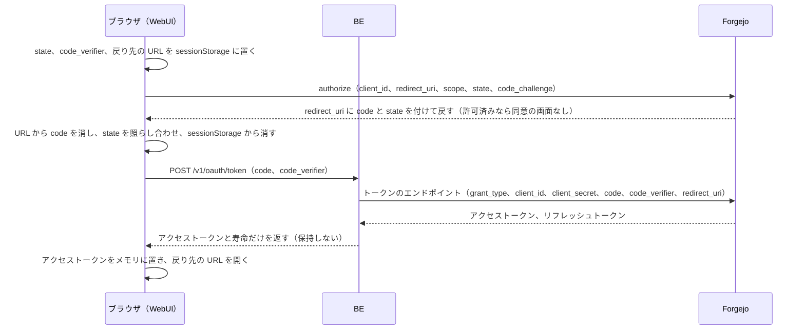

# サインイン

WebUI のサインインと、トークンの扱いを実装するときに読む。
BE が主体を確かめる方法は、[認証](../backend/ports/authentication.md) と [Forgejo アダプタの認証](../adapters/forgejo.md#認証) に書く。
スクリプトの注入への備えは、[スクリプトの注入への備えと、ファイルの開き方](security.md) に書く。

## 方式

- Forgejo の OAuth2（認可コードと PKCE）でサインインする。トークンを貼る形は作らない。
- Forgejo には、WebUI を confidential client（client secret を持つクライアント）として登録する。
- トークンの交換は、BE が中継する（[サインインの中継](oauth-relay.md)）。client secret は、BE の設定に置く。
- ブラウザが持つのは、アクセストークンだけである。リフレッシュトークンは、ブラウザに渡さない（下の「トークンの持ち方」）。
- client secret の役目は、Forgejo に同意の画面を省かせることだけである。守りにはならない。
  - なぜ守りにならないか：中継があるので、code を持っていれば、だれでも BE を通して交換できるから。
  - 守りは、`redirect_uri` の完全一致、PKCE、`state` である。PKCE と confidential client の組み合わせは、OAuth 2.1 と OAuth の Security BCP が勧める形である。
  - なぜ同意の画面を省かせるか：Forgejo 17 で確かめたところ、許可済みの利用者が authorize に来たとき、confidential client では同意の画面を出さずにすぐ戻るが、public client（client secret なし）では毎回同意の画面を出す。トークンをメモリだけに持つので、新しいタブ、リロード、共有されたリンク、アクセストークンの期限のたびに authorize に行く。そのたびに押させないためである。
- なぜ BE が中継するか：
  - client secret を、ブラウザに渡さずに済むから。
  - WebUI と BE は同じオリジンなので、Forgejo の CORS と、CSP の `connect-src` を広げずに済むから。Forgejo の CORS の設定は、Forgejo の API 全体に効く。
- GitHub を使う構成のサインインは、[GitHub アダプタ](../adapters/github.md#認証) と一緒に作る。この WebUI の範囲ではない。

## スコープ

- スコープは、`read:user` と `read:organization` だけにする。
  - なぜ：BE は、利用者のトークンを、主体を確かめるのにだけ使う（`GET /user`、`GET /user/teams`）。repository を読めるかは、主体が organization にいることで決まり、利用者のトークンで Forgejo を呼ばない（[Forgejo アダプタの認証](../adapters/forgejo.md#認証)）。GitForge への書き込みは、書き込み主体が行う（[書き込み主体と主体](../adapters/forgejo.md#書き込み主体と主体)）。
  - なぜ `read:repository` を求めないか：そのスコープは、利用者が Forgejo で読めるすべての repository（個人の private や、ほかの organization のもの）の中身まで読めるからである。盗まれたときに読まれる範囲を、Logiforge の外に広げない。
  - Forgejo 17 で、このスコープのトークンで `GET /user` と `GET /user/teams` が通り、書き込みと repository の読みは `403` になることを確かめた。

## サインインの流れ

- WebUI は、次のとき、サインインの画面を出さずに、そのまま authorize に行く。許可済みなら、押す操作なしに、今の URL に戻る。
  - メモリにアクセストークンがないとき（新しいタブ、リロード、共有されたリンク）
  - アクセストークンの期限が来たとき
  - API が `unauthenticated`（401）を返したとき。ただし、そのアクセストークンで、API が 1 度は成功したあとに限る（下を見る）
- `state`、`code_verifier`、戻り先の URL は、`sessionStorage` に置き、戻ってきたら消す。
  - なぜ `sessionStorage` でよいか：トークンではなく、1 回のサインインのあいだだけ使う値だから。戻り先の URL を `state` に結び付けて持つので、共有されたリンクの画面に戻れる。
- 戻ってきたら、交換の前に、`history.replaceState` で URL から `code` と `state` を消す。
  - なぜ：code が、履歴や、画面を共有したときに残らないようにするため。
- 次のときは、交換せずに、サインインの画面を出す。自動で authorize に行き直さない。
  - `state` がない、または `sessionStorage` のものと合わない。
  - Forgejo が `error` を付けて戻した（利用者が拒んだときなど）。
  - BE の交換が `unauthenticated` を返した。
  - なぜ：自動で行き直すと、行き来が止まらなくなるから。
- 交換の直後、そのアクセストークンでまだ API が 1 度も成功していないあいだに `unauthenticated`（401）が返ったら、authorize に行き直さない。サインインの画面に「Logiforge の organization に入っていません」と示す。
  - なぜ：Forgejo の認可は、organization に入っていない人でも通る。BE は、organization に属さない主体を `unauthenticated` で受け付けない（[Forgejo アダプタの認証](../adapters/forgejo.md#認証)）。行き直すと、交換と 401 が止まらずに繰り返される。
- 主体が `user` でないとき（利用者の team に入っていない人）は、サインインはできるが、repository の作成と、人への依頼への回答で `forbidden`（403）になる。そのときは、利用者の team に入っていないことを示す。
- `redirect_uri` は、`https://<WebUI のホスト>/oauth/callback` で、Forgejo には完全に一致する形で登録する。
- Forgejo にまだログインしていなければ、Forgejo のログインの画面が出る。初めてのときだけ、Forgejo の同意の画面が出る。

モバイルで、共有されたリンクを開いたときは、次のとおりになる。

- そのブラウザで Forgejo にログインしていて、許可済みなら、Forgejo へ行って、押す操作なしに、リンクの画面に戻る。
  - Forgejo の中の時間は約 3 ms だった（Forgejo 17）。あとは、画面の行き来 2 回と、BE への 1 回の要求である。実機の時間は、実装で確かめる（[最初に作る範囲](first-release.md)）。
- チャットのアプリの中のブラウザは、ふだんのブラウザと cookie が別である。初めて開いたときは、Forgejo のログインの画面が出る。

## トークンの持ち方

- アクセストークンは、メモリ（JavaScript の変数）だけに持つ。`localStorage`、`sessionStorage`、cookie には保存しない。
- リフレッシュトークンは、ブラウザに渡さない。BE は、Forgejo の応答から除いて返し、保持もしない。
  - なぜ：盗まれたときに使える期間を、アクセストークンの寿命（Forgejo 17 で 1 時間）までに収めるため。リフレッシュトークンを盗まれると、更新を続けて、利用者が Forgejo で許可を取り消すまで使われる。
  - なぜタブどうしで困らないか：タブごとに、それぞれ交換したアクセストークンを持つから。Forgejo 17 で、同じ利用者が 3 回交換しても、先に交換したアクセストークンが使えたままであることを確かめた。
- API を呼ぶたびに、`Authorization: Bearer <アクセストークン>` を付ける。
- 期限ごとに authorize へのページの移動が起きるので、書きかけを失わないようにする。
  - 人への依頼の回答の書きかけ（本文と添付の名前）は、移動の前に `sessionStorage` に置き、戻ったら戻す。トークンではないので、置いてよい。添付のファイルの中身は置かない。戻ったら、選び直すように示す。
  - 回答を送る直前に、アクセストークンの残りが 5 分より少なければ、先に authorize に行く。

## サインアウト

- サインアウトは、メモリのアクセストークンを消し、サインインの画面（「Forgejo でサインイン」のボタンだけ）を出す。
- Forgejo のログインは残る。そのため、新しいタブを開いたり、ボタンを押したりすると、押す操作なしにサインインし直す。
  - 本当に外れるには、Forgejo からログアウトする。サインインの画面に、そのためのリンクを置く。

## 受け入れた危険

- スクリプトが注入されると、そのページが開いているあいだ、メモリのアクセストークンは読まれ、Logiforge の API がその利用者として使われうる（スナップショットツリーを読む、人への依頼に回答する、repository を作る）。
- CSP の `default-src 'self'` は、`fetch` や画像で外のオリジンへ送ることを防ぐ。ただし、ページの移動（`location.href` や `window.open` で外の URL を開く）でトークンを外へ送ることは、止めない（[スクリプトの注入への備え](security.md)）。
- 外へ渡ったときに使えるのは、アクセストークンの寿命（1 時間）までである。リフレッシュトークンはブラウザにないので、それより延びない。
- トークンを保存しないので、ページを閉じたあとに端末から盗まれることはない。
