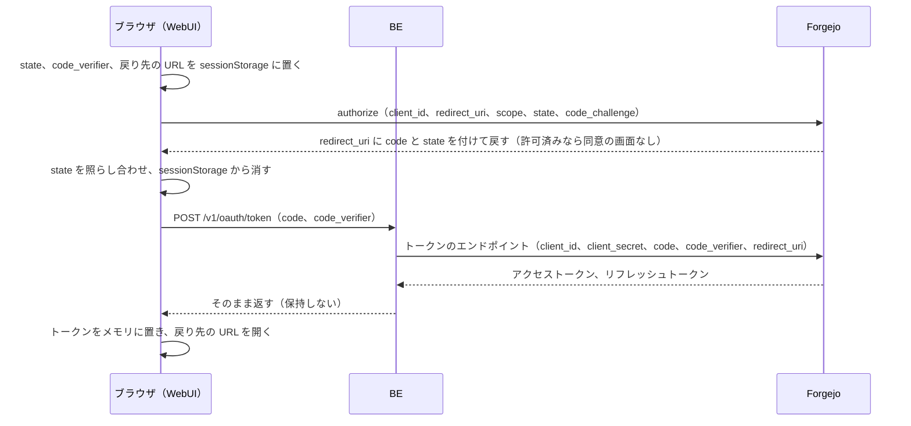

# サインイン

WebUI のサインインと、トークンの扱いを実装するときに読む。
BE が主体を確かめる方法は、[認証](../backend/ports/authentication.md) と [Forgejo アダプタの認証](../adapters/forgejo.md#認証) に書く。
スクリプトの注入への備えは、[スクリプトの注入への備えと、ファイルの開き方](security.md) に書く。

## 方式

- Forgejo の OAuth2（認可コードと PKCE）でサインインする。トークンを貼る形は作らない。
- Forgejo には、WebUI を confidential client（client secret を持つクライアント）として登録する。
- トークンの交換と更新は、BE が中継する（下の「BE の中継」）。client secret は、BE の設定に置く。
- なぜ confidential client か：Forgejo 17 で確かめたところ、許可済みの利用者が authorize に来たとき、confidential client では同意の画面を出さずにすぐ戻るが、public client（client secret なし）では毎回同意の画面を出す。トークンをメモリだけに持つので、新しいタブ、リロード、共有されたリンクのたびに authorize に行く。そのたびに同意の画面で押させないためである。
- なぜ BE が中継するか：
  - client secret を、ブラウザに渡さずに済むから。
  - WebUI と BE は同じオリジンなので、Forgejo の CORS と、CSP の `connect-src` を広げずに済むから。Forgejo の CORS の設定は、Forgejo の API 全体に効く。
- GitHub を使う構成のサインインは、[GitHub アダプタ](../adapters/github.md#認証) と一緒に作る。この WebUI の範囲ではない。

## スコープ

- スコープは、`read:user` と `read:organization` だけにする。
  - なぜ：BE は、利用者のトークンを、主体を確かめるのにだけ使う（`GET /user`、`GET /user/teams`）。GitForge への書き込みは、書き込み主体が行う（[書き込み主体と主体](../adapters/forgejo.md#書き込み主体と主体)）。
  - Forgejo 17 で、このスコープのトークンで `GET /user` と `GET /user/teams` が通り、書き込みと repository の読みは `403` になることを確かめた。BE の認証は、今のままでよい。

## サインインの流れ

- WebUI は、メモリにトークンがないとき（新しいタブ、リロード、共有されたリンク）、自動で authorize に行く。
- `state`、`code_verifier`、戻り先の URL は、`sessionStorage` に置き、戻ってきたら消す。
  - なぜ `sessionStorage` でよいか：トークンではなく、1 回のサインインのあいだだけ使う値だから。戻り先の URL を `state` に結び付けて持つので、共有されたリンクの画面に戻れる。
- `redirect_uri` は、`https://<WebUI のホスト>/oauth/callback` で、Forgejo には完全に一致する形で登録する。
- Forgejo にまだログインしていなければ、Forgejo のログインの画面が出る。ログインすると、同じ流れで戻る。
- 初めてのときだけ、Forgejo の同意の画面が出る。

モバイルで、共有されたリンクを開いたときは、次のとおりになる。

- そのブラウザで Forgejo にログインしていて、許可済みなら、Forgejo へ行って、押す操作なしに、リンクの画面に戻る。
  - Forgejo の中の時間は約 3 ms だった（Forgejo 17）。あとは、画面の行き来 2 回と、BE への 1 回の要求である。実機の時間は、実装で確かめる（[最初に作る範囲](first-release.md)）。
- チャットのアプリの中のブラウザは、ふだんのブラウザと cookie が別である。初めて開いたときは、Forgejo のログインの画面が出る。

## トークンの持ち方

- アクセストークンとリフレッシュトークンは、メモリ（JavaScript の変数）だけに持つ。`localStorage`、`sessionStorage`、cookie には保存しない。
- 寿命は、Forgejo 17 で、アクセストークンが 1 時間、リフレッシュトークンが約 30 日だった。
  - アクセストークンが切れる前に、`POST /v1/oauth/refresh` で更新する。リフレッシュトークンは 1 回使うと無効になるので、返った新しいものに置き換える。
- API を呼ぶたびに、`Authorization: Bearer <アクセストークン>` を付ける。
- サインアウトしたときと、`unauthenticated`（401）が返ったときは、メモリのトークンを消し、サインインの画面に戻す。
  - サインインの画面には、「Forgejo でサインイン」のボタンだけを置く。サインアウトしたあとに、すぐ自動で authorize に行かないようにするため。
  - Forgejo のログインは残る。Forgejo からもログアウトするためのリンクを、サインインの画面に置く。

## 受け入れた危険

- スクリプトが注入されると、そのページが開いているあいだ、メモリのトークンは読まれ、Logiforge の API がその利用者として使われうる（スナップショットツリーを読む、人への依頼に回答する、repository を作る）。
- CSP の `default-src 'self'` は、外のオリジンへの通信を防ぐので、トークンを外へ送ることも防ぐ（[スクリプトの注入への備え](security.md)）。
- それでも外へ渡ったときに使える期間は、アクセストークンが 1 時間まで、リフレッシュトークンが約 30 日までである。リフレッシュトークンは 1 回使うと無効になるので、利用者と盗んだ側の両方が使えば、片方が失敗する。
- トークンを保存しないので、ページを閉じたあとに端末から盗まれることはない。

## BE の中継

BE は、次の 3 つを足す。どれも認証を求めず、状態を持たない。

| 要求 | すること |
|---|---|
| `GET /v1/oauth/config` | authorize の URL、`client_id`、`redirect_uri`、スコープを返す |
| `POST /v1/oauth/token` | `code` と `code_verifier` を受け取り、client secret を足して Forgejo で交換し、応答をそのまま返す |
| `POST /v1/oauth/refresh` | リフレッシュトークンを受け取り、client secret を足して Forgejo で更新し、応答をそのまま返す |

- Forgejo が交換や更新を拒んだら（コードやリフレッシュトークンが正しくない、使い済み）、BE は `unauthenticated`（401）を返す。WebUI は、サインインの画面に戻す。
- BE は、受け取ったトークンをログに書かない。
- 詳細は、[openapi.yaml](../api/openapi.yaml) の `getOAuthConfig`、`exchangeOAuthCode`、`refreshOAuthToken` に書く。
- `client_id`、client secret、`redirect_uri` は、環境変数で渡す（[環境変数と秘密](../deploy.md#環境変数と秘密)）。
- OAuth2 のアプリケーションは、管理者が Forgejo で登録する（confidential client）。
