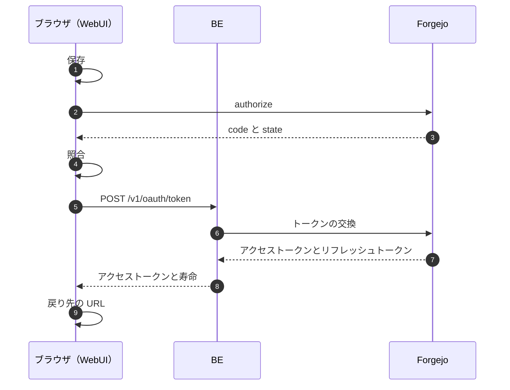

# サインインの流れ

WebUI のサインインで、authorize に行ってから戻るまでと、サインインの画面を出すときを実装するときに読む。
方式、スコープ、トークンの持ち方は、[サインイン](auth.md) に書く。BE の中継の要求は、[サインインの中継](oauth-relay.md) に書く。

## 流れ

1. ブラウザは、`state`、`code_verifier`、戻り先の URL を `sessionStorage` に置く。
2. ブラウザは、authorize に `client_id`、`redirect_uri`、`scope`、`state`、`code_challenge` を付けて行く。
3. Forgejo は、`redirect_uri` に `code` と `state` を付けて戻す。許可済みなら、同意の画面を出さない。
4. ブラウザは、URL から `code` を消し、`state` を照らし合わせ、`sessionStorage` から消す。
5. ブラウザは、BE に `code` と `code_verifier` を送る。
6. BE は、Forgejo のトークンのエンドポイントに、`grant_type`、`client_id`、`client_secret`、`code`、`code_verifier`、`redirect_uri` を送る。
7. Forgejo は、アクセストークンとリフレッシュトークンを返す。
8. BE は、アクセストークンと寿命だけを返す。BE は、どちらのトークンも保持しない。
9. ブラウザは、アクセストークンをメモリに置き、戻り先の URL を開く。

## authorize とサインインの画面

- WebUI は、次のとき、サインインの画面を出さずに、そのまま authorize に行く。許可済みなら、押す操作なしに、今の URL に戻る。
  - メモリにアクセストークンがないとき（新しいタブ、リロード、共有されたリンク）
  - アクセストークンの期限が来たとき
  - API が `unauthenticated`（401）を返したとき。ただし、そのアクセストークンで、API が 1 度は成功したあとに限る（[organization と team に入っていないとき](#organization-と-team-に入っていないとき)）
- `state`、`code_verifier`、戻り先の URL は、`sessionStorage` に置き、戻ってきたら消す。
  - なぜ `sessionStorage` でよいか：トークンではなく、1 回のサインインのあいだだけ使う値だから。戻り先の URL を `state` に結び付けて持つので、共有されたリンクの画面に戻れる。
- 戻ってきたら、交換の前に、`history.replaceState` で URL から `code` と `state` を消す。
  - なぜ：code が、履歴や、画面を共有したときに残らないようにするため。
- 次のときは、交換せずに、サインインの画面を出す。自動で authorize に行き直さない。
  - `state` がない、または `sessionStorage` のものと合わない。
  - Forgejo が `error` を付けて戻した（利用者が拒んだときなど）。
  - BE の交換が `unauthenticated` を返した。
  - なぜ：自動で行き直すと、行き来が止まらなくなるから。

## organization と team に入っていないとき

- 交換の直後、そのアクセストークンでまだ API が 1 度も成功していないあいだに `unauthenticated`（401）が返ったら、authorize に行き直さない。サインインの画面に「Logiforge の organization に入っていません」と示す。
  - なぜ：Forgejo の認可は、organization に入っていない人でも通る。BE は、organization に属さない主体を `unauthenticated` で受け付けない（[Forgejo アダプタの認証](../adapters/forgejo.md#認証)）。行き直すと、交換と 401 が止まらずに繰り返される。
- 主体が `user` でないとき（利用者の team に入っていない人）は、サインインはできるが、repository の作成と、人への依頼への回答で `forbidden`（403）になる。そのときは、利用者の team に入っていないことを示す。

## redirect_uri と Forgejo の画面

- `redirect_uri` は、`https://<WebUI のホスト>/oauth/callback` で、Forgejo には完全に一致する形で登録する。
- Forgejo にまだログインしていなければ、Forgejo のログインの画面が出る。初めてのときだけ、Forgejo の同意の画面が出る。

## モバイルで共有されたリンクを開いたとき

モバイルで、共有されたリンクを開いたときは、次のとおりになる。

- そのブラウザで Forgejo にログインしていて、許可済みなら、Forgejo へ行って、押す操作なしに、リンクの画面に戻る。
  - かかるのは、画面の行き来 2 回と、BE への 1 回の要求である。
- チャットのアプリの中のブラウザは、ふだんのブラウザと cookie が別である。初めて開いたときは、Forgejo のログインの画面が出る。
