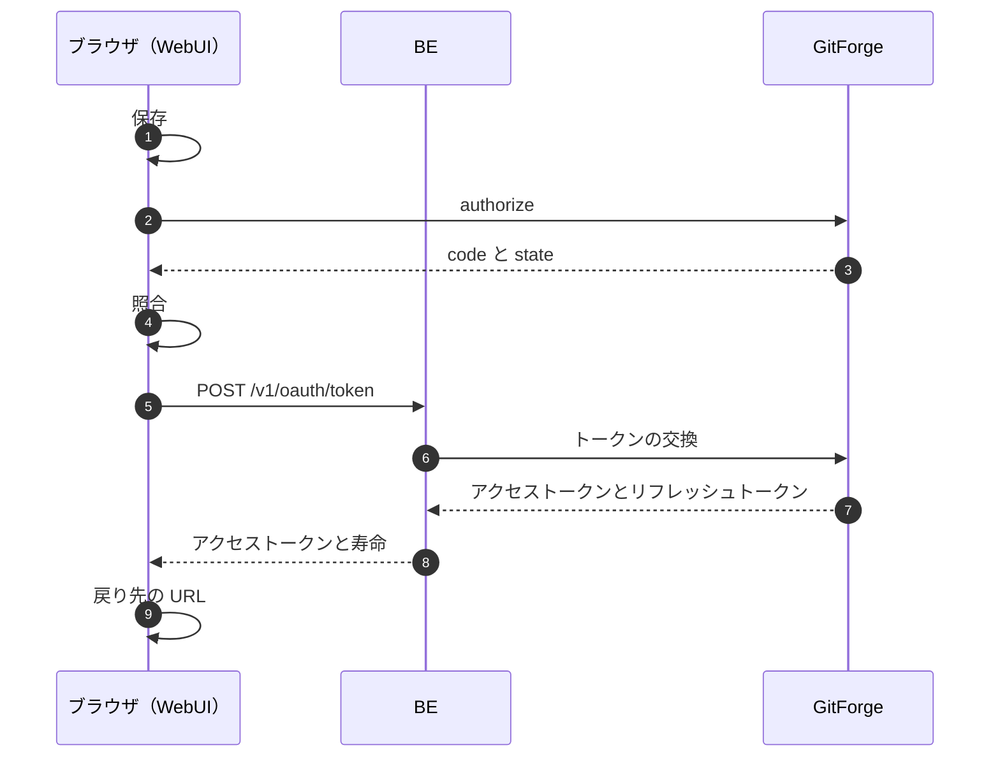

# サインインの流れ

WebUI のサインインで、authorize に行ってから戻るまでと、サインインの画面を出すときを実装するときに読む。
方式、スコープ、トークンの持ち方は、[サインイン](auth.md) に書く。BE の中継の要求は、[サインインの中継](oauth-relay.md) に書く。

## 流れ

1. ブラウザは、`state`、`code_verifier`、戻り先の URL を `sessionStorage` に置く。
2. ブラウザは、authorize に `client_id`、`redirect_uri`、`scope`、`state`、`code_challenge`、`code_challenge_method`（`S256`）を付けて行く。`scope` の値は、[スコープ](auth.md#スコープ) のとおりである。
3. GitForge は、`redirect_uri` に `code` と `state` を付けて戻す。許可済みなら、同意の画面を出さない。
4. ブラウザは、URL から `code` を消し、`state` を照らし合わせ、`sessionStorage` から消す。
5. ブラウザは、BE に `code` と `code_verifier` を送る。
6. BE は、GitForge のトークンのエンドポイントに、`grant_type`、`client_id`、`client_secret`、`code`、`code_verifier`、`redirect_uri` を送る。
7. GitForge は、アクセストークンとリフレッシュトークンを返す。
8. BE は、アクセストークンと寿命だけを返す。BE は、どちらのトークンも保持しない。
9. ブラウザは、アクセストークンをメモリに置き、戻り先の URL を開く。

- GitForge は、構成によって GitHub か Forgejo である。流れは同じである。
  - authorize とトークンのエンドポイントの違いは、[方式](auth.md#方式) に書く。
  - 交換の応答の違いは、[GitForge の応答の扱い](oauth-relay.md#gitforge-の応答の扱い) に書く。

## セットアップが終わっていないとき

- WebUI は、開いたときに、まず `getSetup` を呼ぶ。認証を求めない（[セットアップの API](../api/endpoints/setup.md)）。
- セットアップが終わっていなければ、サインインの前に、[セットアップの画面](../../docs/webui/setup.md)（`/setup`）を出す。authorize には行かない。
  - なぜ：セットアップが終わるまで、サインインに使うアプリと client_id が決まっていないから。ほかの API も `setup_required`（503）を返す。
- セットアップの最後の段で、サーバを動かす人がボタンを押したときだけ、authorize に行く。戻り先の URL は `/setup` である。
  - 戻ったら、WebUI は、アクセストークンを付けて `finishSetup` を呼ぶ。
- セットアップのコードは、セットアップのあいだ `sessionStorage` に置き、終わったら消す。
  - なぜ：App の作成、install、authorize で、ページが GitHub や Forgejo へ移動するたびに、コードを入れ直させないため。
  - なぜ置いてよいか：コードは、セットアップが終わるか、バックエンドが起動し直すと、使えなくなるから（[セットアップのコード](../settings/setup.md#セットアップのコード)）。
- 終わっていれば、下の「authorize とサインインの画面」に従う。

## authorize とサインインの画面

- WebUI は、次のとき、サインインの画面を出さずに、そのまま authorize に行く。許可済みなら、押す操作なしに、今の URL に戻る。
  - メモリにアクセストークンがないとき（新しいタブ、リロード、共有されたリンク）
  - アクセストークンの期限が来たとき
  - API が `unauthenticated`（401）を返したとき。ただし、そのアクセストークンで、API が 1 度は成功したあとに限る（[organization と team に入っていないとき](#organization-と-team-に入っていないとき)）
- `state`、`code_verifier`、戻り先の URL は、`sessionStorage` に置き、戻ってきたら消す。
  - なぜ `sessionStorage` でよいか：トークンではなく、1 回のサインインのあいだだけ使う値だから。戻り先の URL を `state` に結び付けて持つので、共有されたリンクの画面に戻れる。
- 戻ってきたら、交換の前に、`history.replaceState` で URL から `code` と `state` を消す。
  - なぜ：code が、履歴や、画面を共有したときに残らないようにするため。
- 次のときは、交換せずに、サインインの画面を出す。自動で authorize に行き直さない。
  - `state` がない、または `sessionStorage` のものと合わない。
  - GitForge が `error` を付けて戻した（利用者が拒んだときなど）。
  - BE の交換が `unauthenticated` を返した。
  - なぜ：自動で行き直すと、行き来が止まらなくなるから。

## organization と team に入っていないとき

- Forgejo を使う構成で、交換の直後、そのアクセストークンでまだ API が 1 度も成功していないあいだに `unauthenticated`（401）が返ったら、authorize に行き直さない。サインインの画面に「Logiforge の organization に入っていません」と示す。
  - なぜ：Forgejo の認可は、organization に入っていない人でも通る。BE は、organization に属さない主体を `unauthenticated` で受け付けない（[Forgejo アダプタの認証](../adapters/forgejo.md#認証)）。行き直すと、交換と 401 が止まらずに繰り返される。
- GitHub を使う構成では、organization に入っていない人も、`client` として受け付ける（[GitHub アダプタの認証](../adapters/github.md#認証)）。
  - それでも、交換の直後に `unauthenticated` が返ったら、authorize に行き直さず、サインインの画面に「サインインできませんでした。サーバを動かす人に知らせてください」と示す。なぜ：行き直しても、同じことが繰り返されるから。
- 主体が `user` でないとき（[利用者の決め方](../settings/users.md#利用者の決め方)）は、サインインはできるが、repository の作成と、人への依頼への回答で `forbidden`（403）になる。そのときは、利用者でないことを示す。

## redirect_uri と GitForge の画面

- `redirect_uri` は、`https://<WebUI のホスト>/oauth/callback` である。WebUI のホストは、設定の DB の WebUI の URL である（[設定](../settings/README.md#設定の-db-に置くもの)）。
- `redirect_uri` は、GitForge に完全に一致する形で登録する。
  - GitHub：App の `callback_urls`。manifest で入れる（[初回のセットアップ](../settings/setup.md#github-を使う構成app-を-manifest-flow-で作る)）。
  - Forgejo：OAuth2 のアプリケーションの Redirect URI。サーバを動かす人が Forgejo で入れる（[初回のセットアップ](../settings/setup.md#forgejo-を使う構成)）。
- GitForge にまだログインしていなければ、GitForge のログインの画面が出る。初めてのときだけ、GitForge の同意の画面が出る。

## モバイルで共有されたリンクを開いたとき

モバイルで、共有されたリンクを開いたときは、次のとおりになる。

- そのブラウザで GitForge にログインしていて、許可済みなら、GitForge へ行って、押す操作なしに、リンクの画面に戻る。
  - かかるのは、画面の行き来 2 回と、BE への 1 回の要求である。
- チャットのアプリの中のブラウザは、ふだんのブラウザと cookie が別である。初めて開いたときは、GitForge のログインの画面が出る。
