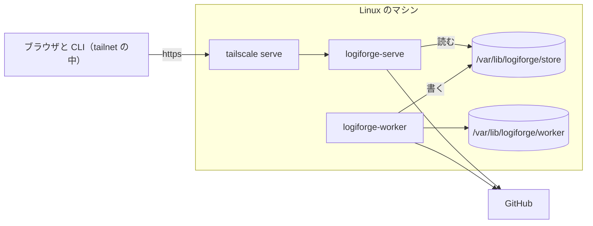

# 1 台の Linux に置く

GitHub を使う構成の Logiforge を、1 台の Linux のマシンで動かし、tailnet の中の人とエージェントだけに公開するときに読む。
[Logiforge の repository を GitHub に置く](../github/README.md) の「Logiforge を動かす」の、本番の手順である。

- 形は、[動かし方（コンテナ）](../../../design/deploy/README.md) の「タスクの形」と同じである。コンテナのかわりに、systemd のサービスを 2 つ動かす。
- 環境変数の正本は、[環境変数と秘密](../../../design/deploy/env.md) である。このページには、環境変数の中身は書かない。

## 構成



- `logiforge-serve` は、`127.0.0.1:8080` だけで待ち受ける。外から届くのは、`tailscale serve` を通した `https://<host>.<tailnet>.ts.net` だけである（[Tailscale で公開する](tailscale.md)）。
  - 証明書は、Tailscale が出す。tailnet の外からは届かない（外に出すのは `tailscale funnel` で、このページでは使わない）。
- マシンからは、`github.com` と `api.github.com` に、外向きに届けばよい。受け付けるポートは要らない。
- 要るもの：systemd 251 以上（ユニットが、資格情報のディレクトリを `%d` で指すため。Debian 12、Ubuntu 24.04、RHEL 9 は満たす）、git、Tailscale。

## 入れる

1. Releases から linux のバイナリを取り、`/usr/local/bin/logiforge` に置く（取り方は [インストール](../../install.md)）。
   - v0.3.0 以降のバイナリを使う。読むだけの GitHub App を使うためである。
2. git を入れる（例：`apt install git`）。worker とバックエンドが使う。
3. 専用のユーザーを作る。ログインはさせない。

```sh
sudo install -m 0755 logiforge /usr/local/bin/logiforge
sudo useradd --system --home-dir /var/lib/logiforge --no-create-home --shell /usr/sbin/nologin logiforge
```

## 設定と秘密

- 設定のファイルと秘密は、[設定と秘密を置く](secrets.md) の手順で置く。

## サービス

ユニットの見本は [deploy/systemd/](../../../deploy/systemd/) にある。

```sh
sudo cp deploy/systemd/logiforge-*.service deploy/systemd/logiforge-*.timer /etc/systemd/system/
sudo systemctl daemon-reload
sudo systemctl enable --now logiforge-worker logiforge-serve logiforge-worker-health.timer
```

- 書ける場所は、ユニットごとに絞る。ほかは読むだけである（`ProtectSystem=strict`）。
  - worker：`/var/lib/logiforge/worker`（clone）と `/var/lib/logiforge/store`（置き場）
  - バックエンド：`/var/cache/logiforge-serve`（作業用の git の複製）。置き場は読むだけである。
- `logiforge-serve` と `logiforge-worker` は、root では動かさない。capability は持たせない。
- 落ちたら、5 秒あとに起動し直す（`Restart=on-failure`）。
- worker は、1 つのユニットだけで動かす。2 つ目の worker は、clone のディレクトリのロックが取れずに止まる（[worker を 1 つだけ動かす](../../../design/backend/worker/operation.md#worker-を-1-つだけ動かす)）。
- worker が固まったときは、`logiforge-worker-health.timer` が見つけて、起動し直す。コンテナの livenessProbe と同じ役目である（[ヘルスチェック](../../../design/deploy/README.md#ヘルスチェック)）。
  - 1 分ごとに、`logiforge` のユーザーで `logiforge worker-health` を動かし、0 以外なら `systemctl restart logiforge-worker` をする。
  - root で動かす。worker を起動し直すのに、systemctl が要るから。
  - worker を止めているあいだは、何もしない。

## 状態を見る

```sh
curl -fsS http://127.0.0.1:8080/healthz
sudo systemd-run --pipe --wait -p User=logiforge -p EnvironmentFile=/etc/logiforge/logiforge.env /usr/local/bin/logiforge worker-health
journalctl -u logiforge-worker -u logiforge-serve
```

- `worker-health` は、ハートビートが見回りの間隔の 10 倍より古いと、0 以外で終わる（[ヘルスチェック](../../../design/deploy/README.md#ヘルスチェック)）。

## 更新

```sh
sudo install -m 0755 logiforge /usr/local/bin/logiforge
sudo systemctl restart logiforge-worker logiforge-serve
```

- `restart` は、古いプロセスを止めてから、新しいプロセスを起こす。そのため、worker が 2 つ同時に動くことはない。

## バックアップ

- 置き場の `/var/lib/logiforge/store/keep/` を、写して取る（[組み合わせ](../../../design/adapters/README.md#組み合わせ)）。
- `/etc/logiforge/secrets/record_keys` は、マシンの外にも控える。この秘密は変えないからである（[Logiforge を動かす](../github/README.md#logiforge-を動かす)）。
