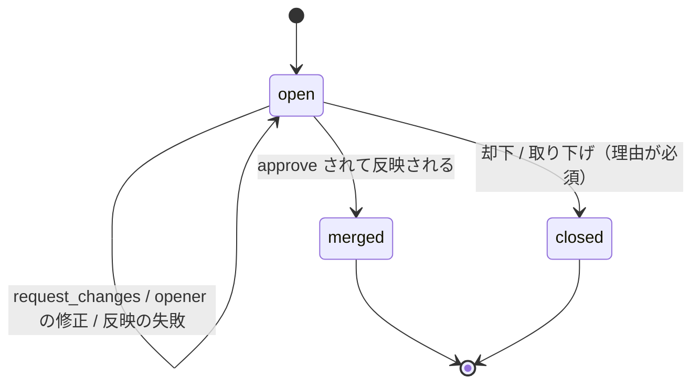

# apply request

木と検証結果を変えるときに、変更をどう提案し、どう反映するかを確かめるときに読む。

## 操作

apply request は、次の 4 種類の操作をいくつか並べた差分である。
apply request 自体は種類を持たない。

| 操作 | 内容 |
|---|---|
| `story.create` | ストーリーを、子仮説と一緒に作る |
| `story.inactivate` | ストーリーを inactive にする |
| `verdict.submit` | 葉の仮説に、検証結果を出す |
| `node.edit` | 仮説の背景情報に、文章を加える |

各操作が満たすべき決まりは、次のページに書く。

- `story.create`：[ストーリー](../tree/README.md) と [葉と検証結果](../tree/README.md)
- `story.inactivate`：[inactive 化](../tree/inactive.md)
- `verdict.submit`：[検証結果](../tree/verdict.md)

`node.edit` では、主文、タイトル、概要を変えない。

- なぜ：主文やストーリーの意味が変わると、それまでの審査と検証が成り立たなくなるから。

複数の操作を 1 つの apply request にまとめる使い方は、[流用](../tree/verdict.md) と [偽と結論する](../tree/falsification.md) に書く。

## opener と reviewer

apply request には、opener と reviewer がいる。
それぞれの決まりは、[役割](../roles/README.md) に書く。
審査の起動と観点は、[論理レビュー](review.md) に書く。

## 状態

- apply request の状態は、`open`、`merged`、`closed` の 3 つである。
- レビューの種類は、`approve`、`request_changes`、`comment` の 3 つである。
- reviewer が `approve` すると、apply request は反映される。
- reviewer の却下と、opener の取り下げは、どちらも `closed` にする。
  - どちらの場合も、理由を書く。

## 反映

- apply request の操作は、全部まとめて反映する。
  - 一部だけが反映されることはない。
- 不変条件は、apply request が反映されるたびに、常に成り立つ。
  - 反映すると不変条件を満たさなくなる apply request は、反映しない。
  - 不変条件は、[仮説とストーリーの木](../tree/README.md) と [inactive 化](../tree/inactive.md) に書く。
- 反映に失敗したら、理由を残して `open` に戻す。
  - 例：同時に別の apply request が反映され、不変条件を満たさなくなった。
