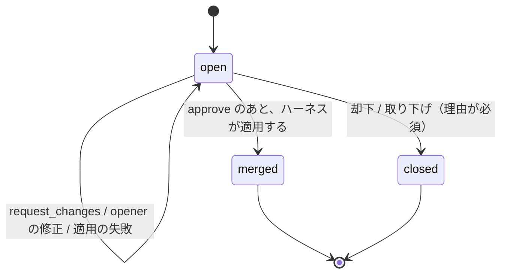

# Apply Request

木と検証結果を変えるときに、変更をどう提案し、どう適用するかを確かめるときに読む。

## 操作

Apply Request（AR）は、次の 4 種類の操作をいくつか並べた差分である。
AR 自体は種類を持たない。

| 操作 | 内容 |
|---|---|
| `story.create` | ストーリーを、子仮説と一緒に作る |
| `story.inactivate` | ストーリーを inactive にする |
| `verdict.submit` | 葉の仮説に、検証結果を出す |
| `node.edit` | 仮説の背景情報に、文章を加える |

- `story.create` を出せるのは、active で、検証結果を持たない仮説の下だけである（[葉と検証結果](../tree/README.md)）。
- `story.inactivate` には、理由の記述が要る（[inactive 化](../tree/inactive.md)）。
- `verdict.submit` は、すでにある検証結果を差し替えることもできる（[検証結果](../tree/verdict.md)）。
- `node.edit` では、主文、タイトル、概要を変えない。
  - なぜ：主文やストーリーの意味が変わると、それまでの審査と検証が成り立たなくなるから。

## 操作の組み合わせ

1 つの AR に複数の操作をまとめる例を挙げる。

- 流用を含むストーリーの作成：`story.create` と、新しい子仮説への `verdict.submit` をまとめる（[流用](../tree/verdict.md)）。
- 偽と結論する：子ストーリーの `story.inactivate` と、false の `verdict.submit` をまとめる（[偽と結論する](../tree/falsification.md)）。

## opener と reviewer

- opener は、AR を出す主体である。ふだんは Builder が担う。
- reviewer は、AR を審査する主体である。ふだんは Reviewer が担う。
- opener と reviewer は、別の主体でなければならない。
  - なぜ：仮説とストーリーを考える主体と、それを審査する主体を分けるため。

審査の観点は、[Reviewer の審査観点](review.md) に書く。

## 状態

- AR の状態は、`open`、`merged`、`closed` の 3 つである。
- レビューの種類は、`approve`、`request_changes`、`comment` の 3 つである。
- reviewer が `approve` すると、ハーネスが自動で適用する。
- reviewer の却下と、opener の取り下げは、どちらも `closed` にする。
  - どちらの場合も、理由を書く。

## 適用

- AR の操作は、全部まとめて適用する。一部だけが反映されることはない。
- validator は、提出時と適用時に、適用後の状態が不変条件を満たすかを確かめる。
  - 不変条件は、[仮説とストーリーの木](../tree/README.md) と [inactive 化](../tree/inactive.md) に書く。
- 適用に失敗したら、理由を残して `open` に戻す。
  - 例：同時に別の AR が適用され、不変条件を満たさなくなった。
- 値の計算は、適用と同じトランザクションで行う（[再計算](../tree/propagation.md)）。
