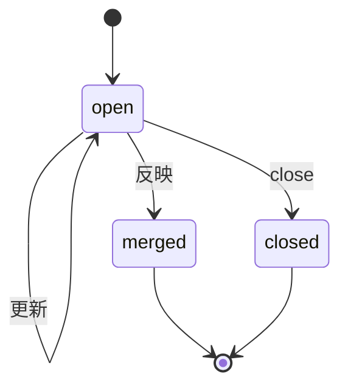

# apply request

木と検証結果を変えるときに、変更をどう提案し、どう反映するかを確かめるときに読む。

## 操作

apply request は、木への変更の差分である。
差分は、次の 4 種類の操作の組として読めるものに限る。
apply request 自体は種類を持たない。

- 差分は、木の git リポジトリのブランチとして出す（[CLI](../cli/README.md)）。
  - 4 種類の操作として読めない変化を含む差分は、受け付けない。

| 操作 | 内容 |
|---|---|
| `story.create` | ストーリーを、子仮説と一緒に作る |
| `story.inactivate` | ストーリーを inactive にする |
| `verdict.submit` | 葉の仮説に、検証結果を出す |
| `node.edit` | 仮説の背景情報に、文章を加える |

各操作が満たすべき決まりは、次のページに書く。

- `story.create`：[ストーリー](../tree/README.md) と [葉と検証結果](../tree/README.md)
- `story.inactivate`：[inactive 化](../tree/inactive.md)
- `verdict.submit`：[検証結果](../tree/verdict.md)

`node.edit` では、主文、タイトル、概要を変えない。

- なぜ：主文やストーリーの意味が変わると、それまでの審査と検証が成り立たなくなるから。

複数の操作を 1 つの apply request にまとめる使い方は、[流用](../tree/verdict.md) と [偽と結論する](../tree/falsification.md) に書く。

## opener と reviewer

apply request には、opener と reviewer がいる。

- 役割の説明は、[役割](../roles/README.md) に書く。
- 反映の条件と論理レビューの仕組みは、[論理レビュー](review.md) に書く。

## 状態

- apply request の状態は、`open`、`merged`、`closed` の 3 つである。
- `request_changes`、opener の修正、反映の失敗のときは、`open` のままである。
- レビューの種類は、`approve`、`request_changes`、`comment` の 3 つである。
- [反映の条件](review.md) を満たすと、apply request は反映される。
- reviewer の却下と、opener の取り下げは、どちらも `closed` にする。
  - どちらの場合も、理由を書く。
  - 取り下げは、apply request を作った人が行う。
  - 却下は、apply request を作った人とは別の人が行う。

## 反映

- apply request の操作は、全部まとめて反映する。
  - 一部だけが反映されることはない。
- 不変条件は、apply request が反映されるたびに、常に成り立つ。
  - 反映すると不変条件を満たさなくなる apply request は、反映しない。
  - ただし、反映の直前の確認と反映の間に、別の apply request が反映されることがある。
  - そのときに不変条件が破れたら、Logiforge は反映のあとに警告する。
  - 直すのは、新しい apply request である。
  - 不変条件は、[仮説とストーリーの木](../tree/README.md) と [inactive 化](../tree/inactive.md) に書く。
- apply request を作ったあとに、その操作の対象ノードが別の apply request によって変わっていたら、反映しない。
  - その apply request は、理由を残して `open` に戻す。
  - なぜ：古い状態を前提にした変更を、気づかないまま反映しないため。
- 反映すると不変条件を満たさなくなった場合も、理由を残して `open` に戻す。

## main への直接の変更

- `main` のコミットは、apply request の反映によらないもの（直接の push、force push など）も、そのまま受け入れる。
  - なぜ：Logiforge が守るのは、木が不変条件を満たすことだから。だれが、どう変えたかは見ない。
- 最新のコミットの木が不変条件を満たさなければ、そのコミットは「valid でない」。
  - 木のファイルを読めないときも、valid でない。
- 最新のコミットが valid でないあいだ、Logiforge は、いちばん新しい valid なコミットの木を示し、valid でないことを添える。
  - WebUI は、画面の上に示す。CLI は、標準エラーに警告を書き、止めずに続ける。
- 直すのは、木を直すコミットである。ふつうの apply request で直す。直す手順は、ほかにない。
  - valid でない `main` にも、直す apply request を反映できる。前から破れている不変条件は、その apply request が新しく破ったものとしない。
- 直したコミットが valid になれば、Logiforge は最新のコミットの木を示す。
- 振る舞いの詳細は、[最新のコミットが valid でないとき](../../design/backend/invalid-main.md) に書く。
