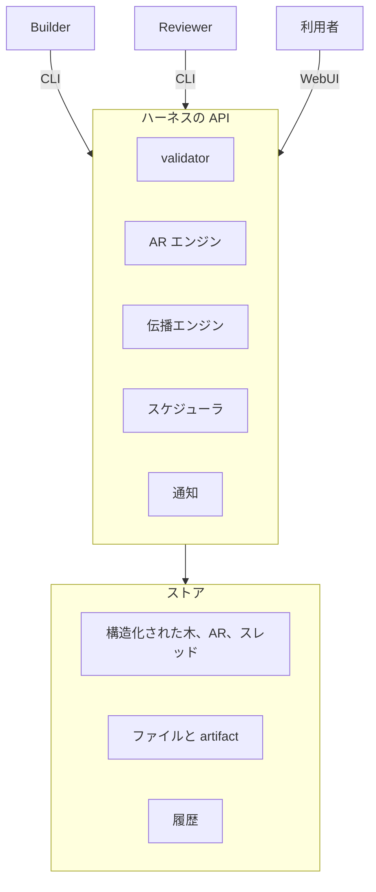

# 全体構成

ハーネスを作る前に、構成要素と、全体が満たすべき性質を確かめるときに読む。

## 構成要素

- [CLI](../cli/README.md) と [WebUI](../webui/README.md) は、同じ API を使う。
  - なぜ：エージェントと人間が、同じ規則で同じデータを扱うため。
- ストアは、GitHub に近い情報管理基盤である。
  - 構造化された木を、規則付きで管理する。
  - ファイルと artifact を保存する（[artifact](../tree/verdict.md)）。
  - 履歴を残す。

各機能の役割は、[ハーネスの機能](../agents/README.md) に書く。

## 監査

- すべての変更を履歴に残す。
- 履歴には、誰が、いつ、どの AR で変えたかを記録する。
- 履歴は append-only にする。
  - 書き換えも削除もしない。
- ノードごとの履歴を表示できる。
- 任意の時点の木を表示できる。

## 再現性

- 検証の再現に要るものは、[artifact](../tree/verdict.md) と [引用](../tree/verdict.md) の決まりで残す。

## 並行性

- 複数の Builder と Reviewer が同時に動いても、不変条件が常に成り立つ。
  - 不変条件は、[仮説とストーリーの木](../tree/README.md) と [inactive 化](../tree/inactive.md) に書く。
- タスクの割り当ては、[スケジューラ](../agents/scheduler.md) に書く。

## 権限

- 役割（Builder、Reviewer、利用者）ごとに、使える操作を分ける。
  - 各役割の操作は、[役割](../agents/README.md) に書く。

## エクスポート

- データを JSON と Markdown でエクスポートできる。
  - なぜ：ハーネスの外でも、木と根拠を読めるようにするため。
