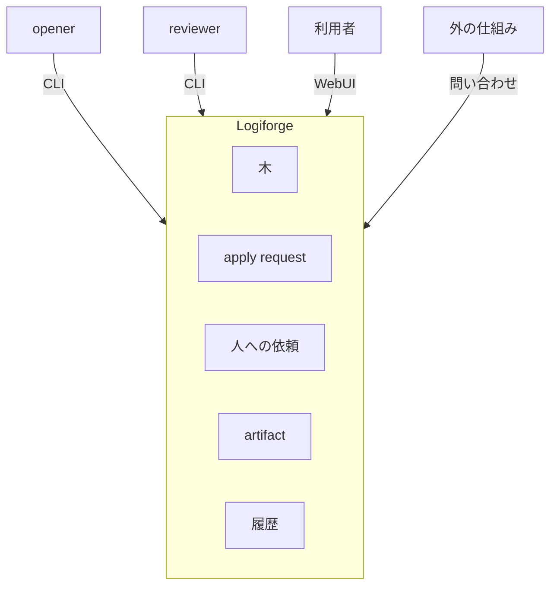

# 全体構成

Logiforge を作る前に、外から見た構成と、全体が満たすべき性質を確かめるときに読む。

## 構成

- [CLI](../cli/README.md) と [WebUI](../webui/README.md) は、同じデータを扱う。
  - なぜ：エージェントと人間が、同じ規則で同じデータを扱うため。
- Logiforge は、[GitForge](../concepts/glossary.md) に近い情報管理基盤である。
  - 構造化された木を、規則付きで管理する。
  - ファイルと artifact を保存する（[artifact](../tree/verdict.md)）。
  - 履歴を残す。
- 作業のループは、Logiforge の外の仕組みで回す（[着手できる作業](../work/README.md)）。

## 木の置き場所

- 木（仮説・ストーリー・検証結果・レポート）は、git リポジトリで管理する。
  - なぜ：既存の git の道具（clone、diff、履歴）で、状態を扱えるようにするため。
- git リポジトリは、[GitForge](../concepts/glossary.md) に置く。どの GitForge を使うかは、選べる。

## 監査

- すべての変更を履歴に残す。
- 誰が、いつ、何をしたかは、監査のための記録を新しく作らず、すでにある記録から辿る。
  - 木の変更：`main` のコミット。誰が、いつ、どの apply request で変えたかを、コミットに記録する。
  - apply request、レビュー、人への依頼：GitForge の pull request と issue の履歴。
  - なぜ：同じことを 2 か所に記録すると、食い違ったときにどちらが正しいか決まらないから。
- 履歴は append-only にする。
  - 書き換えも削除もしない。
- 反映によらない変更が `main` に入ったら、Logiforge が見つけて、その repository を壊れた状態にする（[壊れた repository を直す](../apply-request/repair.md)）。
  - GitForge の `main` を守る設定は、勧めるが求めない。
- ノードごとの履歴を表示できる。
- 任意の時点の木を表示できる。

## 再現性

- 検証の再現に要るものは、[artifact](../tree/verdict.md) と [引用](../tree/verdict.md) の決まりで残す。
- リンクの artifact の参照先が消えたり変わったりするリスクは、利用者の責任とする。sha256 を書いておけば、変化を検出できる。

## 並行性

- 複数の主体が同時に apply request を出しても、不変条件が常に成り立つ（[反映](../apply-request/README.md)）。

## 権限

- 役割（opener、reviewer、利用者）ごとに、使える操作を分ける（[役割](../roles/README.md)）。

## エクスポート

- データを JSON と Markdown でエクスポートできる。
  - なぜ：Logiforge の外でも、木と根拠を読めるようにするため。
