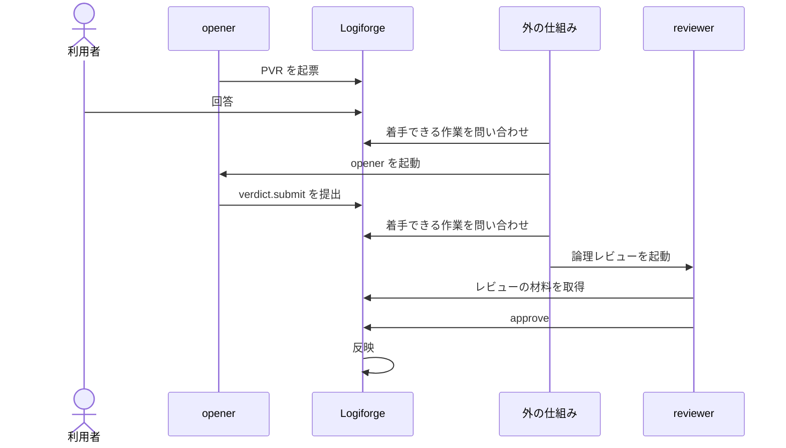

# 人への依頼（PVR と判断の依頼）

opener が人に検証や判断を頼むときと、利用者がそれに回答するときに、決まりを確かめるために読む。

## 人への依頼

人への依頼（human request）は、ノードに紐づく、1 回きりの依頼である。
種類は、次の 2 つである。

| 種類 | 用途 |
|---|---|
| `pvr` | 人による検証手順を書き、結果の記入を求める |
| `decision` | ストーリーが尽きた仮説について、人に判断を仰ぐ |

人への依頼は、次のものを持つ。

- 対象のノード
- 種類
- 本文（検証手順、または問い）
- 回答（自由記述とファイル）
- 状態（`open` または `answered`）

回答は、1 回だけである。

- 返信を重ねるやりとりは、持たない。
- 回答のあとにやりとりが要るなら、新しい依頼を起票する。
  - なぜ：依頼と回答の組を、1 つの根拠として扱えるようにするため。

## 起票と回答

- opener は、葉の仮説か、要再検討の仮説を対象に、人への依頼を起票する。
- 利用者は、依頼に回答する。
  - ファイルや写真も添付できる。大きなものは、リンクで添える（[artifact](../tree/verdict.md)）。
  - [GitForge](../concepts/glossary.md) がファイルの添付を持てないときは、添付はリンクだけである。ファイルは、利用者が外に置く。
  - 回答する利用者は、問いを持ち込んだ人でなくてもよい。
- 回答は、artifact として保存する（[artifact](../tree/verdict.md)）。
- 回答が、そのまま値になることはない。
  - opener は、回答の artifact を引用したレポートで、`verdict.submit` を出す。
  - なぜ：回答から真偽を判断する過程も、審査の対象にするため。

## PVR

PVR（物理検証リクエスト）は、種類が `pvr` の人への依頼である。
計算機の中だけでは検証できない物理的な問いを、人間に検証してもらうために使う。

- 外の仕組みは、[着手できる作業](../work/README.md) の問い合わせで、回答済みの依頼とレビュー待ちの apply request を見つける。
- 利用者は、WebUI の人への依頼の画面で、open の依頼を見つける。
- opener は、回答の artifact を引用したレポートで、`verdict.submit` の apply request を出す。
- Logiforge は、反映するときに値を計算し直す。

エージェントへの自由記述の依頼（会話）は、扱わない（[対応しないこと](../concepts/README.md)）。
