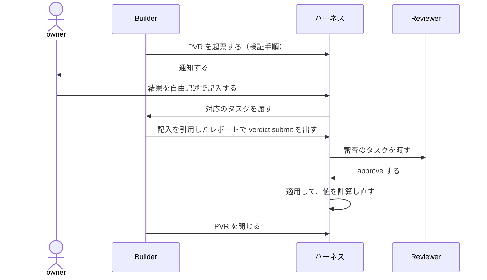

# スレッド（依頼と PVR）

人間とエージェントが、どうやりとりするかを確かめるときに読む。

## スレッド

スレッドは、人間とエージェントのやりとりである。次の 2 種類がある。

| 種類 | 用途 |
|---|---|
| `request` | 自由記述の依頼 |
| `pvr` | 物理検証リクエスト（PVR） |

- スレッドは、本文、返信、対象のノード（任意）を持つ。
- スレッドの状態は、`open` と `closed` の 2 つである。
- 本文と返信は、自由記述にする。
  - なぜ：人間からの依頼と記入は、決まった形に収まらないから。

## 依頼

- owner は、自由記述の依頼をスレッドで出す。
- Builder は、依頼に応える。
- Builder は、道筋が尽きた仮説について、owner 宛てのスレッドに状況を書く（[仮説が偽になったとき](../tree/falsification.md)）。

## PVR

PVR は、計算機の中だけでは検証できない物理的な問いを、人間に検証してもらうためのスレッドである。

- Builder は、葉の仮説を対象に、PVR を起票する。
  - 本文には、人による検証手順を書き下す。
- owner は、手順に沿って検証し、結果を自由記述で記入する。
  - ファイルや写真も添付できる。
- 人の記入は、artifact として保存する（[artifact](../tree/verdict.md)）。
- 人の記入が、そのまま値になることはない。
  - なぜ：記入から真偽を判断する過程も、審査の対象にするため。

