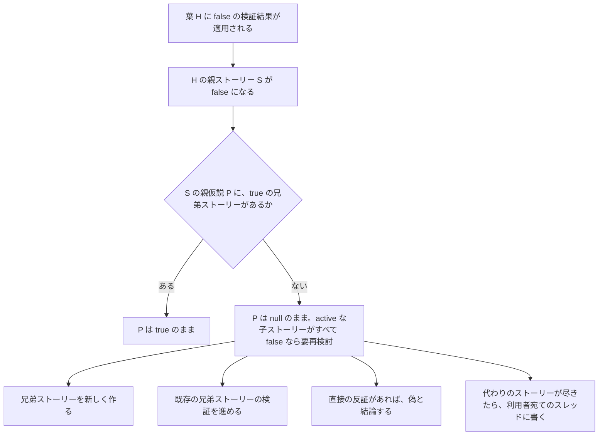

# 仮説が偽になったとき

葉に false の検証結果が出たあと、木がどう変わり、次に何をするかを確かめるときに読む。

## 流れ

- S は、AND の規則で自動的に false になる（[真偽値の伝播](propagation.md)）。
- P の棄却は確定させない。
  - なぜ：兄弟ストーリーがなくても、新しく兄弟ストーリーを作れば、別のストーリーで P を検証できる可能性が残るから。
- 偽の結果が P より上へ伝わるのは、「偽と結論する」AR が承認された場合だけである。

## 要再検討の仮説に対してすること

要再検討の仮説 P に対しては、次のどれかを行う。

- 兄弟ストーリーを新しく作る。
  - もとの兄弟ストーリーがない場合も、同じように作る。
  - 検証済みの仮説を使いたいときは、[流用](verdict.md) する。
- 既存の兄弟ストーリーの検証を進める。
- P を直接否定する証拠があれば、偽と結論する。
- 代わりのストーリーが尽きたが、直接の反証はない場合は、利用者宛ての[スレッド](../threads/README.md)に状況を書く。
  - P は `null` のまま残る。

これを誰が担うかは、[役割](../agents/README.md) に書く。

## 偽になったストーリー

- 偽になったストーリーは、inactive にせず、そのまま残す。
  - なぜ：棄却されたストーリーも、記録として価値があるから。

## 偽と結論する

仮説 P を偽と結論するときは、次の 2 つの操作を、1 つの [Apply Request](../apply-request/README.md) にまとめて出す。

1. P の active な子ストーリーを、すべて `story.inactivate` する。
2. P に、false の `verdict.submit` を出す。

適用したあとは、次のようになる。

- P は、検証結果を持つ葉になる（[葉と検証結果](README.md)）。
- P の false は、P の親ストーリーへ、通常どおり伝わる。

偽と結論してよいかの審査は、[Reviewer の審査観点](../apply-request/review.md) に書く。
