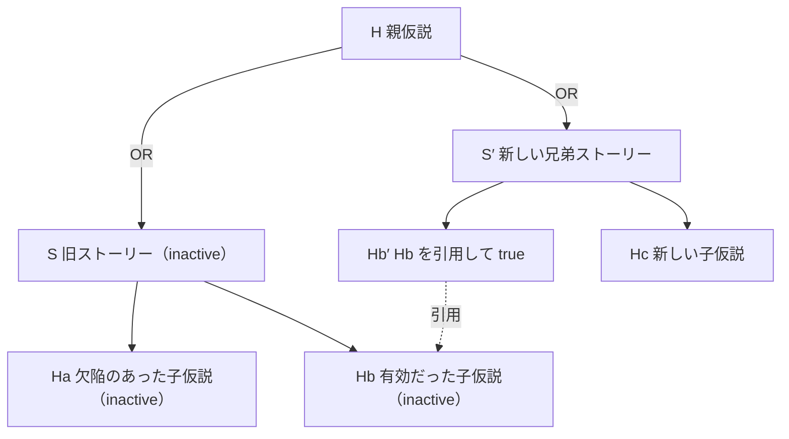

# inactive 化

論理に欠陥のあるストーリーを、計算から外すときに読む。

## 対象

- inactive にできるのは、ストーリーだけである。
  - 仮説を直接 inactive にする操作はない。
  - なぜ：仮説だけを外すと、親ストーリーの AND の条件が知らないうちに減り、ストーリーが誤って true になるから。
- ストーリーが inactive なら、その子孫もすべて inactive である。
  - 仮説は、祖先のストーリーが inactive になったときに、一緒に inactive になる。
- 根の仮説は、inactive にならない。
  - なぜ：根には、祖先のストーリーがないから。
- inactive から戻す操作はない。
  - なぜ：履歴を単純に保つため。
  - 作り直しは、新しいストーリーで行う。

## 使う場面

- ストーリーの論理に、重大な欠陥が見つかったとき。
  - 子仮説の欠陥も、そのストーリーの欠陥として扱う。
  - 例：子仮説の主文が曖昧で、真偽を決められない。
- [偽と結論する](falsification.md) とき。

## 操作

- [apply request](../apply-request/README.md) の `story.inactivate` で行う。
- inactive にする理由（reason）を、自由記述で必ず書く。
  - なぜ：欠陥の重さを審査し、あとから経緯を辿れるようにするため。

## 効果

- inactive な部分木は、伝播に関与しない（[真偽値の伝播](propagation.md)）。
- inactive な部分木の下には、新しいストーリーを作れない。
- データは削除しない。
- inactive な部分木も、閲覧と引用ができる。
- 過去の値は、履歴と、リビジョンを固定した引用で辿る。
- inactive になる前に葉だった仮説には、検証結果を出せる（[検証結果](verdict.md)）。

## 作り直し

1. inactive にしたストーリーの親仮説の下に、新しい兄弟ストーリーを立てる。
2. もとのストーリーで有効だった子仮説は、[流用](verdict.md) で使い回す。

