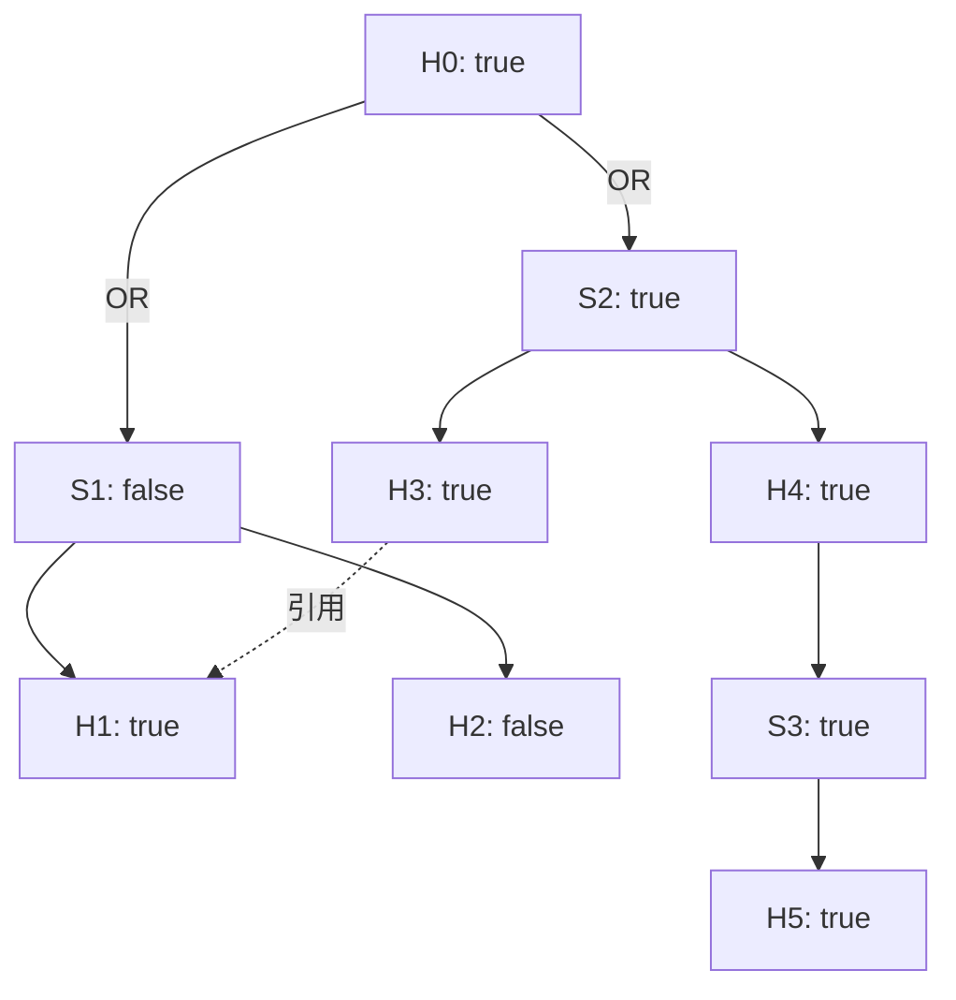

# 真偽値の伝播

木の各ノードの値が、どう決まるかを確かめるときに読む。

## 値

ノードの値は、`true`、`false`、`null`（未決）の 3 値のどれかである。

## 葉の値

- 有効な検証結果があれば、その値になる。
- 検証結果がなければ、`null` になる。

## ストーリーの値

ストーリーの値は、子仮説の AND である。

- 子仮説に 1 つでも false があれば、`false`。
- 子仮説がすべて true なら、`true`。
- それ以外は `null`。

active なストーリーの子仮説は、すべて active である（[inactive 化](inactive.md)）。
そのため、AND の計算で inactive を扱う必要はない。

## 子ストーリーを持つ仮説の値

active な子ストーリーを持つ仮説の値は、active な子ストーリーの OR である。
ただし、false は伝わらない。

- active な子ストーリーに 1 つでも true があれば、`true`。
- それ以外は `null`。
- 子ストーリーがすべて false でも、自動では false にしない。
  - なぜ：新しく兄弟ストーリーを作れば、別のストーリーで親仮説を検証できる可能性が残るから。

inactive なストーリーは、親仮説の OR の計算から外れる。

## 真理値表

ストーリー（子仮説 A AND B）

| A \ B | true | null | false |
|---|---|---|---|
| true | true | null | false |
| null | null | null | false |
| false | false | false | false |

仮説（active な子ストーリー S1 OR S2）

| S1 \ S2 | true | null | false |
|---|---|---|---|
| true | true | true | true |
| null | true | null | null |
| false | true | null | null（要再検討） |

- ストーリーの AND は、3 値論理（Kleene）の AND と同じである。
- 仮説の OR は、Kleene の OR の結果が false になる場合を、null に置き換えたものである。

## 要再検討

- active な子ストーリーがあり、そのすべてが false の仮説を、要再検討と呼ぶ。
- 要再検討は、値から導かれる見え方であり、保存する属性ではない。

要再検討の仮説をどう扱うかは、[仮説が偽になったとき](falsification.md) に書く。

## 根拠部分木

根拠部分木は、根の値が true か false のときに、その値を支えている部分木である。
根から、次の規則でたどる。

- true の仮説からは、true の子ストーリーへ進む。
- ストーリーからは、すべての子仮説へ進む。
- 葉で止まる。

## 計算し直す時点

- 葉以外の値は、自動で計算される。
- apply request が反映されると、同時に値も更新される。
  - 反映の途中の状態は、どの主体からも見えない。
  - なぜ：途中の状態を見た主体が、誤った値で判断しないようにするため。

## 例

- H0 は根（究極の問い）である。
- H1、H2、H3、H5 は葉である。
- H3 は、H1 を引用して true にした葉である。
- H2 が false なので、S1 は false になる。
- S2 がないときの H0 は `null` で、要再検討である。
- S2 が作られて検証されると、H0 は true になる。
