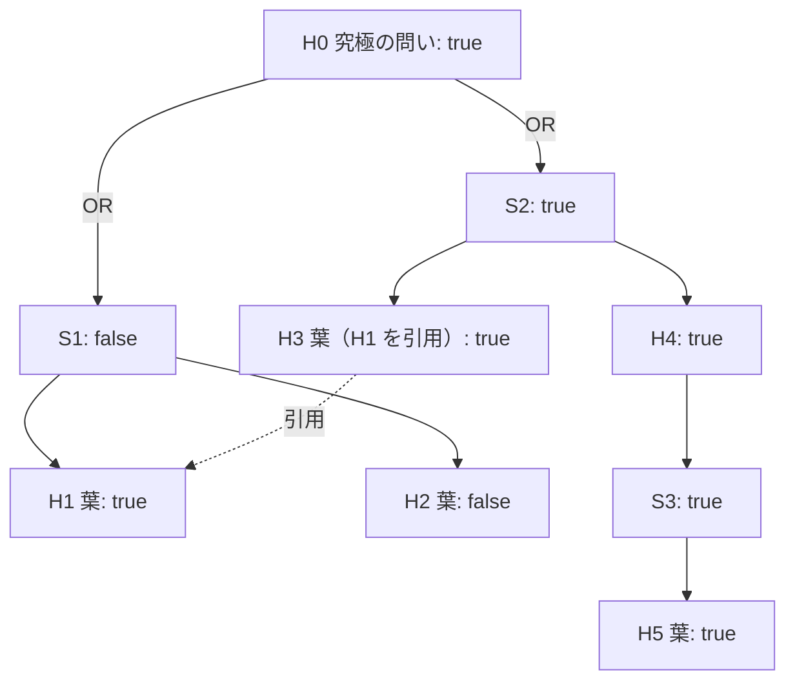

# 真偽値の伝播

木の各ノードの値が、どう決まるかを確かめるときに読む。
伝播エンジンは、このページの規則で値を計算する。

## 値

ノードの値は、次の 3 値のどれかである。

- `true`
- `false`
- `null`（未決）

## 葉の値

- 有効な検証結果があれば、その値になる。
- 検証結果がなければ、`null` になる。

## ストーリーの値

ストーリーの値は、子仮説の AND である。

- 子仮説に 1 つでも false があれば、`false`。
- 子仮説がすべて true なら、`true`。
- それ以外は `null`。

active なストーリーの子仮説は、すべて active である（[inactive 化](inactive.md)）。
そのため、AND の計算で inactive を扱う必要はない。

## 子ストーリーを持つ仮説の値

active な子ストーリーを持つ仮説の値は、active な子ストーリーの OR である。
ただし、false は伝わらない。

- active な子ストーリーに 1 つでも true があれば、`true`。
- それ以外は `null`。
- 子ストーリーがすべて false でも、自動では false にしない。
  - なぜ：新しく兄弟ストーリーを作れば、別の道筋で親仮説を検証できる可能性が残るから。

inactive なストーリーは、親仮説の OR の計算から外れる。

## 真理値表

ストーリー（子仮説 A AND B）

| A \ B | true | null | false |
|---|---|---|---|
| true | true | null | false |
| null | null | null | false |
| false | false | false | false |

仮説（active な子ストーリー S1 OR S2）

| S1 \ S2 | true | null | false |
|---|---|---|---|
| true | true | true | true |
| null | true | null | null |
| false | true | null | null（要再検討） |

- ストーリーの AND は、3 値論理（Kleene）の AND と同じである。
- 仮説の OR は、Kleene の OR の結果が false になる場合を、null に置き換えたものである。

## 要再検討

- active な子ストーリーがあり、そのすべてが false の仮説を、要再検討として表示する。
- 要再検討は、値から導かれる見え方であり、保存する属性ではない。

要再検討の仮説をどう扱うかは、[仮説が偽になったとき](falsification.md) に書く。

## 再計算

- 値は、AR の適用と同じトランザクションの中で計算し直す。
  - なぜ：途中の状態を、ほかの主体に見せないため。

## 例

- H2 が false なので、S1 は false になる。
- S2 がないときの H0 は `null` で、要再検討になる。
- Builder が S2 を作り、それが検証されて、H0 は true になる。
